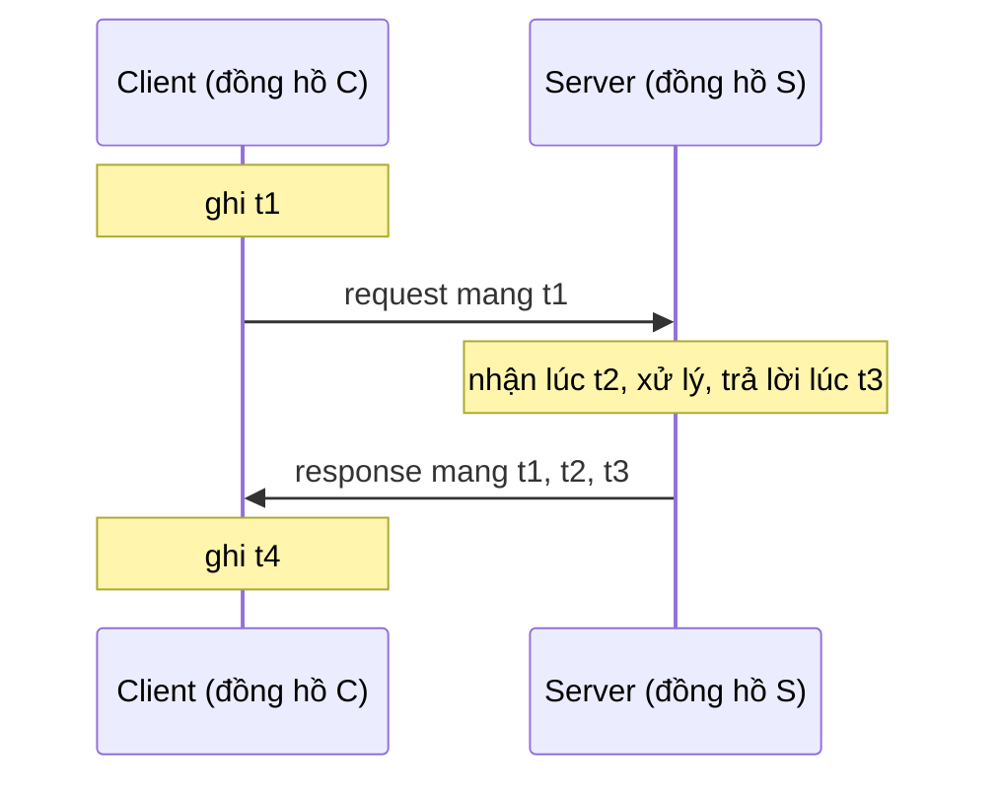
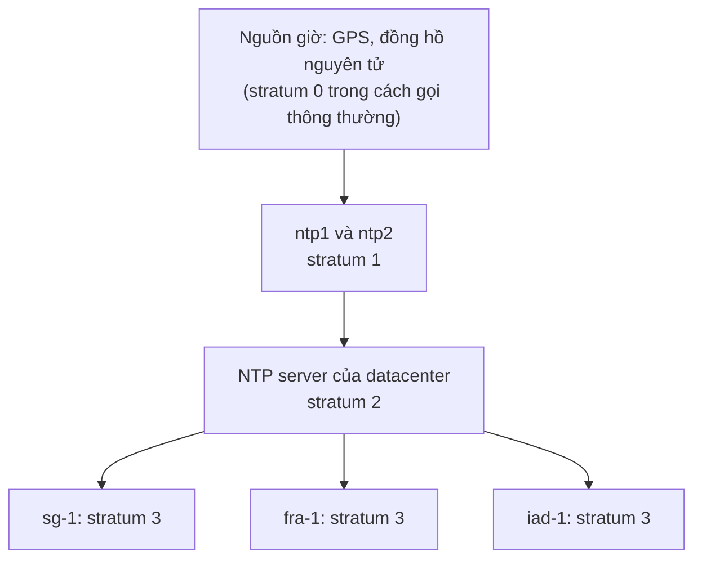
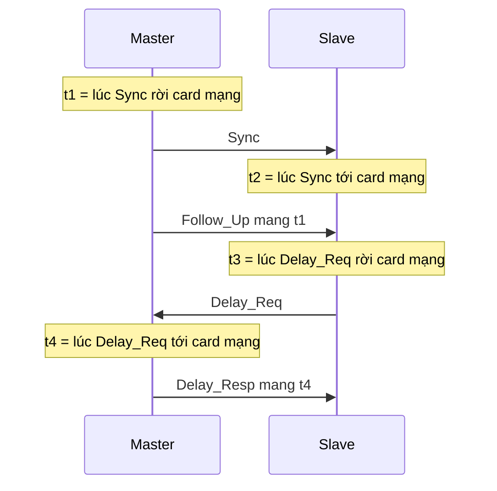

# P15 · Chương 11 — Đồng bộ đồng hồ trong hệ phân tán

[P12 · Chương 08](../12-he-thong-du-lieu/08-su-co-he-phan-tan.md) (mục 5–6) đã nói đồng hồ treo tường khác đồng hồ monotonic thế nào, và vì sao timestamp lấy từ hai máy không sắp được thứ tự. [P12 · Chương 09](../12-he-thong-du-lieu/09-consistency-va-consensus.md) (mục 3) trả lời bằng cách bỏ hẳn giờ vật lý để dùng đồng hồ Lamport và vector clock. Nhưng hệ thật không bỏ được giờ vật lý: lease hết hạn lúc nào, chứng chỉ TLS hết hạn lúc nào, "đọc snapshot tại 10:00:00" nghĩa là gì, tất cả đều là câu hỏi về giờ. Chương này đi vào phần P12 mới chỉ chạm tới: đồng hồ vật lý đồng bộ được tốt đến đâu, bằng thuật toán nào, giới hạn nằm ở chỗ nào, và khi đã biết độ sai thì hệ thống nên dùng nó ra sao.

Cả chương bám theo một ví dụ giả định là `lockd` (nhận xét của người soạn: không phải code trong repo), một dịch vụ khóa nhân bản ở ba vùng: `sg-1` ở Singapore, `fra-1` ở Frankfurt, `iad-1` ở Virginia. Worker `reconcile` xin lease `locks/reconcile` với TTL 10 giây, và `lockd` có hai cách để biết một lease đã hết hạn chưa. **Cách A:** lúc cấp lease, node cấp ghi `expires_at` bằng giờ treo tường của nó cộng 10 giây; node nào cần biết lease còn hay hết thì so `expires_at` với đồng hồ của chính nó. **Cách B:** mỗi bên tự đo bằng đồng hồ monotonic xem từ lúc gửi (hoặc nhận) yêu cầu đã trôi qua bao lâu. Cách A đòi các đồng hồ *khớp nhau*; cách B chỉ đòi chúng *chạy cùng tốc độ*. Hai đòi hỏi này khác nhau rất xa, và chương này đi tìm xem đồng hồ thật cho được những gì, rồi xem một độ lệch 500 ms làm hỏng cách nào. Khoảng cách giả định để tính (nhận xét của người soạn): RTT giữa `sg-1` và `fra-1` là 170 ms, giữa `fra-1` và `iad-1` là 90 ms, giữa `sg-1` và `iad-1` là 240 ms.

## Bạn sẽ hiểu được gì

1. **Q1.** Hai đồng hồ vừa chỉnh khớp sẽ lệch nhau bao nhiêu sau $T$ giây, và vì sao phải đồng bộ lại định kỳ? → mục 1
2. **Q2.** Cristian và Berkeley đồng bộ bằng cách nào, và cận sai số $\pm(\mathrm{RTT}/2 - \min)$ của Cristian được chứng minh ra sao? → mục 2
3. **Q3.** NTP tính độ lệch $\theta$ và độ trễ $\delta$ từ bốn mốc thời gian thế nào, vì sao sai số không vượt $\delta/2$ dù đường đi bất đối xứng, và stratum, bộ lọc, thuật toán chọn nguồn làm gì? → mục 3
4. **Q4.** Sửa đồng hồ bằng slew khác step ở đâu, leap second làm gì với đồng hồ máy, và smear giải quyết nó ra sao? → mục 4
5. **Q5.** PTP (IEEE 1588) khác NTP ở chỗ nào; hardware timestamping bỏ được phần sai số nào và không bỏ được phần nào? → mục 5
6. **Q6.** Vì sao $n$ process không thể đồng bộ chặt hơn $u(1 - 1/n)$ (Lundelius–Lynch), và chứng minh đi theo ý nào? → mục 6
7. **Q7.** Hybrid logical clock (HLC) ghép đồng hồ logic với đồng hồ vật lý thế nào, vì sao $\lvert l - pt\rvert \le \varepsilon$, và nó hỏng khi nào? → mục 7
8. **Q8.** Khi đã có cận sai số, hệ thống dùng nó ra sao (TrueTime, max-offset của CockroachDB, lease), và độ lệch 500 ms làm hỏng cơ chế nào, không hỏng cơ chế nào? → mục 8

## Kiến thức cần trước

- [P12 · Chương 08](../12-he-thong-du-lieu/08-su-co-he-phan-tan.md), mục 5–6: đồng hồ treo tường và monotonic, bốn mốc của NTP ở mức mô tả, drift 50 ppm, slew và step, các ngưỡng của RFC 5905, TrueTime với con số 1–7 ms. Chương này không giảng lại những phần đó mà chứng minh và đào sâu thêm.
- [P12 · Chương 09](../12-he-thong-du-lieu/09-consistency-va-consensus.md), mục 3: happens-before và đồng hồ Lamport. Mục 7 dùng chúng để dựng HLC.
- [P12 · Chương 08](../12-he-thong-du-lieu/08-su-co-he-phan-tan.md), mục 7–8, và [P15 · Chương 05](05-loai-tru-tuong-ho-va-bau-leader.md), mục 8: process pause, lease và fencing token. Mục 8 ở đây chỉ nói phần lease *cần gì ở đồng hồ*.
- [P15 · Chương 09](09-giao-dich-phan-tan.md), mục 6: TrueTime và commit wait. Mục 8 chỉ nối chúng với phần đồng bộ ở trước, không chứng minh lại.
- [P14 · Chương 01](../14-toan-va-ly-thuyet/01-logic-va-chung-minh.md): cách đọc chứng minh; chương này có nhiều chứng minh ngắn, đánh dấu "(chứng minh của người soạn)".
- Phần cứng đếm nhịp (clock CPU, thanh ghi `CNTVCT_EL0`) nằm ở [P2 · Chương 01, mục 4.3](../02-cpu/01-mo-hinh-may-va-isa.md) và [P1 · Chương 01, mục 3.2](../01-linux/01-os-va-kernel.md). Chương này bắt đầu từ chỗ máy *đã có* một bộ đếm thời gian và hỏi nó đúng đến đâu.

---

## 1. Drift và skew: đồng hồ lệch nhau bao nhiêu sau $T$ giây (Q1)

> **Trả lời ngắn.** Đồng hồ của mỗi máy chạy nhanh hoặc chậm hơn giờ thật một chút; mức chệch tốc độ đó là *drift*, đo bằng phần triệu (ppm), và đồng hồ máy tính thường cỡ 50 ppm[^ppm-50]. Hiệu giữa hai đồng hồ, gọi là *skew*, tăng dần theo thời gian kể từ lần chỉnh gần nhất: nếu mỗi đồng hồ chệch tối đa $\rho$ thì sau $T$ giây hai đồng hồ lệch nhau tối đa $2\rho T$. Vì vậy muốn giữ skew dưới $\delta$ thì phải đồng bộ lại ít nhất mỗi $\delta/(2\rho)$ giây[^resync-period].

**Giải thích.**

*Với `lockd`.* Giả sử lúc 09:00:00 cả ba node vừa đồng bộ xong và đồng hồ khớp nhau. Nếu `lockd` chạy theo cách A, lease 10 giây chỉ đúng khi các node đồng ý với nhau về "bây giờ là mấy giờ" với sai số nhỏ hơn mức `lockd` chịu được. Nhưng hai đồng hồ chạy với tốc độ hơi khác nhau thì lệch nhau ngày một lớn. Câu hỏi đầu tiên vì thế là: lớn dần nhanh cỡ nào, và bao lâu thì phải đồng bộ lại? Mục này trả lời bằng một mệnh đề có chứng minh.

### 1.1 Mô hình đồng hồ

Đồng hồ máy tính đếm dao động của một tinh thể thạch anh. Tần số của nó không bao giờ đúng tuyệt đối: nó đổi theo từng con chip, theo nhiệt độ và theo tuổi linh kiện[^quartz-temp]. Một loại thạch anh thông thường ở 31 °C sai khoảng 6 phần triệu, tức nửa giây mỗi ngày[^quartz-6ppm]. Người ta đo sai số tốc độ này bằng ppm; 1 ppm là 1 micro-giây mỗi giây, khoảng 86 ms mỗi ngày[^ppm-def].

Ta ký hiệu $C_i(t)$ là số đọc của đồng hồ máy $i$ tại thời điểm thật $t$. Mô hình chuẩn giả định tốc độ của nó luôn sát 1:

$$\lvert C_i'(t) - 1\rvert \le \rho \quad \text{với mọi } t,$$

trong đó $\rho$ là *drift rate* tối đa. Lamport gọi giả thiết này là điều kiện PC1 và đòi đồng hồ vật lý phải chạy xấp xỉ đúng tốc độ[^lamport-pc1]. *Skew* giữa hai đồng hồ là hiệu $s_{ij}(t) = C_i(t) - C_j(t)$. Đạo hàm của skew là hiệu hai drift, $s_{ij}'(t) = C_i'(t) - C_j'(t)$, nên skew chính là drift *tích lũy theo thời gian*; đó là lý do hai máy vừa khớp nhau vẫn lệch dần.

### 1.2 Skew lớn dần nhanh cỡ nào

**Mệnh đề 1 (skew giữa hai lần chỉnh).** Giả sử $C_i$ và $C_j$ đều thỏa $\lvert C' - 1\rvert \le \rho$ và tại $t_0$ có $\lvert s_{ij}(t_0)\rvert = \sigma_0$. Khi đó với mọi $t \ge t_0$,

$$\lvert s_{ij}(t)\rvert \le \sigma_0 + 2\rho\,(t - t_0),$$

và cận này đạt được.

*Chứng minh (chứng minh của người soạn).* Đặt $f = s_{ij} = C_i - C_j$. Vì $C_i', C_j' \in [1-\rho,\, 1+\rho]$ nên $f' = C_i' - C_j' \in [-2\rho,\, 2\rho]$. Lấy tích phân từ $t_0$ đến $t$ được $f(t) - f(t_0) = \int_{t_0}^{t} f'(\tau)\, d\tau$, suy ra $\lvert f(t) - f(t_0)\rvert \le 2\rho\,(t - t_0)$. Áp dụng bất đẳng thức tam giác: $\lvert f(t)\rvert \le \lvert f(t_0)\rvert + 2\rho\,(t - t_0) = \sigma_0 + 2\rho\,(t - t_0)$. Cận đạt được khi $C_i' \equiv 1 + \rho$, $C_j' \equiv 1 - \rho$ (hai đồng hồ trôi ngược chiều) và $f(t_0) = \sigma_0$. $\square$

**Hệ quả (chu kỳ đồng bộ).** Muốn skew không bao giờ vượt $\delta$, chu kỳ giữa hai lần chỉnh phải thỏa $\sigma_0 + 2\rho T \le \delta$, tức

$$T \le \frac{\delta - \sigma_0}{2\rho}.$$

Với đồng bộ hoàn hảo ($\sigma_0 = 0$) đó là $\delta/(2\rho)$, đúng công thức mà giáo trình hệ phân tán hay viết[^resync-period]. Số cụ thể với $\rho = 50$ ppm $= 5 \times 10^{-5}$ (tính của người soạn):

- Một đồng hồ lệch so với giờ thật $\rho T = 5 \times 10^{-5} \times 86\,400 = 4{,}32$ giây mỗi ngày; số này khớp với 86 ms mỗi ngày cho mỗi ppm ở trên, vì $50 \times 86{,}4$ ms $= 4{,}32$ s.
- Hai đồng hồ trôi ngược chiều lệch nhau $2\rho T = 10^{-4} T$:

| $T$ | 1 s | 16 s | 64 s | 1024 s | 1 giờ | 1 ngày |
|---|---|---|---|---|---|---|
| skew tối đa | 0,1 ms | 1,6 ms | 6,4 ms | 102,4 ms | 360 ms | 8,64 s |

- Chu kỳ đồng bộ cần để giữ skew $\le \delta$: $\delta = 1$ ms cần $T \le 10$ s; $\delta = 10$ ms cần $T \le 100$ s; $\delta = 500$ ms cần $T \le 5000$ s, khoảng 83 phút.

Các cột 16 s đến 1024 s trong bảng nằm đúng trong khoảng poll của NTP, từ 16 giây đến 36 giờ[^ntp-poll]. Nếu chỉ chỉnh *giờ* mỗi 1024 giây mà không làm gì khác thì hai máy có thể lệch tới 100 ms. NTP làm tốt hơn vì nó chỉnh cả *tốc độ* đồng hồ: tiến trình discipline điều khiển cả thời gian lẫn tần số của đồng hồ hệ thống[^ntp-discipline]. Sau khi sửa tần số, drift còn lại nhỏ hơn nhiều; RFC 5905 giả định tần số đã hiệu chỉnh chỉ còn sai tối đa 15 ppm (hằng PHI) và cho sai số tăng theo tốc độ ấy[^phi-15]. Chrony còn báo riêng ước lượng cận sai số của tần số, cột Skew trong `chronyc tracking`[^chrony-skew-freq]; đừng nhầm với "skew" giữa hai đồng hồ của chương này.

### 1.3 Hai mục tiêu đồng bộ

Chương này gặp hai loại mục tiêu khác nhau (định nghĩa của người soạn). *Đồng bộ ngoài* (external) đòi mỗi đồng hồ nằm trong $\delta$ so với một nguồn chuẩn như UTC; Cristian và NTP thuộc loại này. *Đồng bộ trong* (internal) chỉ đòi mọi cặp đồng hồ lệch nhau không quá $\delta$, không cần ai đúng giờ thật; Berkeley và kết quả Lundelius–Lynch ở mục 6 thuộc loại này. Đồng bộ ngoài với $\delta$ kéo theo đồng bộ trong với $2\delta$, vì hai đồng hồ cùng cách UTC không quá $\delta$ thì cách nhau không quá $2\delta$. Chiều ngược lại không đúng: cả đàn đồng hồ có thể khớp nhau mà cùng trôi xa UTC.

<details><summary>Đi sâu: các con số ppm đến từ đâu và vì sao mỗi nguồn nói một số khác</summary>

Bảng dưới gom các cận drift xuất hiện trong chương. Chúng không mâu thuẫn nhau vì mỗi con số trả lời một câu hỏi khác:

| Nguồn | Con số | Nó đo cái gì |
|---|---|---|
| Bài giảng Rutgers | 6 ppm ở 31 °C[^quartz-6ppm] | một loại thạch anh thông thường, nhiệt độ cố định |
| Bài giảng Cambridge | khoảng 50 ppm[^ppm-50] | đồng hồ máy tính điển hình |
| RFC 5905, hằng PHI | 15 ppm[^phi-15] | cận tần số *sau khi* đã discipline; dispersion tăng cỡ 1,3 giây mỗi ngày[^phi-day] |
| Google, TrueTime | 200 ppm[^tt-drift] | cận bảo thủ giữa hai lần đồng bộ (xem [P12 · Chương 08, mục 6](../12-he-thong-du-lieu/08-su-co-he-phan-tan.md) và [P15 · Chương 09, mục 6.2](09-giao-dich-phan-tan.md)) |
| Kernel Linux, `MAXFREQ` | 500 000 ns/s, tức 500 ppm[^kernel-maxfreq] | giới hạn lỗi tần số trong mã NTP của kernel |

Khi thiết kế, người ta lấy cận bảo thủ: cận lớn quá thì hệ chỉ chậm hơn (chờ lâu hơn, lease ngắn hơn), còn cận nhỏ quá thì hệ sai (nhận xét của người soạn). Hằng PHI của RFC cũng đúng tinh thần này: nó là cận dùng để *tính sai số tối đa*, không phải số đo drift thật của máy bạn.

</details>

**Quay lại Q1:** skew giữa hai đồng hồ lớn tuyến tính theo thời gian kể từ lần chỉnh gần nhất, tối đa $\sigma_0 + 2\rho T$; với 50 ppm đó là 8,64 giây mỗi ngày cho hai đồng hồ trôi ngược chiều, và muốn giữ skew dưới $\delta$ thì phải đồng bộ lại mỗi $(\delta - \sigma_0)/(2\rho)$ giây.

---

## 2. Cristian và Berkeley: hai thuật toán đồng bộ đơn giản nhất (Q2)

> **Trả lời ngắn.** Thuật toán của Cristian hỏi một server giờ chuẩn, đo thời gian khứ hồi (RTT) rồi đặt giờ bằng giờ server trả về cộng nửa RTT, vì ta không có lý do gì để tin hai chiều có độ trễ khác nhau[^cristian-sym]. Nếu biết độ trễ một chiều tối thiểu $m$, giờ thật nằm trong một khoảng rộng $\mathrm{RTT} - 2m$ quanh ước lượng đó, nên sai số không vượt $\mathrm{RTT}/2 - m$[^cristian-range]. Thuật toán Berkeley không cần máy nào có giờ chuẩn: một master lấy trung bình giờ của các máy rồi gửi cho mỗi máy độ chỉnh để về mức trung bình[^berk-avg].

**Giải thích.**

*Với `lockd`.* `sg-1` vừa khởi động lại và đồng hồ của nó sai không biết bao nhiêu. Trong ba node, chỉ `iad-1` nằm cạnh một nguồn giờ tốt (giả sử datacenter ở đó có GPS). `sg-1` cần lấy giờ của `iad-1` qua một đường mạng có RTT 240 ms. Hai thuật toán dưới đây trả lời hai tình huống khác nhau: có một nguồn giờ để tin (Cristian), hoặc không có nguồn nào để tin (Berkeley).

### 2.1 Cristian: đo RTT, chia đôi

Cristian đề xuất phương pháp này năm 1989 cho mạng có độ trễ ngẫu nhiên không có cận trên[^cristian-abs]. Các bước:

1. Client đọc đồng hồ của mình được $T_0$ rồi gửi request.
2. Server đọc đồng hồ của nó được $T_S$ rồi trả lời.
3. Client nhận trả lời, đọc đồng hồ được $T_1$; $D = T_1 - T_0$ là RTT đo được.
4. Client đặt đồng hồ thành $T_S + D/2$.

Ví dụ trên `lockd` (số giả định): `sg-1` ghi $T_0 = 100{,}000$ s, nhận trả lời lúc $T_1 = 100{,}240$ s, và `iad-1` báo $T_S = 100{,}912$ s. Vậy $D = 240$ ms và `sg-1` đặt đồng hồ thành $100{,}912 + 0{,}120 = 101{,}032$ s; đồng hồ của nó đang chậm $101{,}032 - 100{,}240 = 0{,}792$ s so với `iad-1`.

Bước 4 dựa vào giả định hai chiều có độ trễ bằng nhau[^cristian-sym]. Giả định đó sai một chút thì ước lượng sai một chút; câu hỏi là *sai tối đa bao nhiêu*, và đây là lúc cần độ trễ tối thiểu.

**Mệnh đề 2 (độ chính xác của Cristian).** Gọi $m$ là độ trễ một chiều tối thiểu (mỗi chiều mất ít nhất $m$). Giả sử đồng hồ server đúng và đồng hồ client không đáng kể drift trong khoảng $D$. Khi đó giờ thật lúc client nhận trả lời nằm trong $[T_S + m,\; T_S + D - m]$, và ước lượng $T_S + D/2$ sai không quá $D/2 - m$.

*Chứng minh (chứng minh của người soạn; kết quả theo bài giảng của Krzyzanowski[^cristian-range]).* Gọi $t_0$, $t_s$, $t_1$ là các thời điểm *thật* client gửi request, server đọc đồng hồ, client nhận trả lời; $t_1 - t_0 = D$. Request mất ít nhất $m$ nên $t_s \ge t_0 + m$. Trả lời mất ít nhất $m$ nên $t_s \le t_1 - m$. Vậy $t_1 - t_s \in [m,\; D - m]$. Server đọc $T_S$ đúng lúc $t_s$ và đồng hồ nó đúng, nên giờ thật tại $t_1$ là $T_S + (t_1 - t_s) \in [T_S + m,\; T_S + D - m]$. Khoảng này rộng $D - 2m$ và $T_S + D/2$ nằm chính giữa, nên ước lượng lệch tối đa một nửa bề rộng, $D/2 - m$. Cận đạt được khi request mất đúng $m$ và trả lời mất $D - m$ (hoặc ngược lại). $\square$

Với ví dụ trên và $m = 100$ ms (độ trễ truyền tối thiểu một chiều, giả định): giờ thật nằm trong $[101{,}012;\ 101{,}052]$ s, tức ước lượng $101{,}032$ s sai không quá $\pm 20$ ms. Thời gian server xử lý request không cần tách riêng, vì nó nằm gọn trong khoảng $[t_0 + m,\; t_1 - m]$. Còn sai số tốc độ của client trong 240 ms chỉ làm $D$ sai cỡ $50 \times 10^{-6} \times 0{,}24 = 12$ µs, không đáng kể.

Cristian nêu thêm hai cách cải thiện và hai hạn chế. Có thể gửi nhiều request liên tiếp để hy vọng một cái đi nhanh hơn hẳn các cái khác[^cristian-retry]; theo Mệnh đề 2, mẫu có $D$ nhỏ nhất cho khoảng hẹp nhất. Sai số cộng dồn khi đồng bộ qua nhiều chặng: máy A lấy giờ từ B với $\pm 5$ ms mà B lấy giờ từ C với $\pm 7$ ms thì A chỉ đảm bảo $\pm 12$ ms[^cristian-cumul]; đó là mầm của tầng stratum ở NTP. Còn hạn chế lớn nhất là dồn mọi thứ vào một server: nó hỏng thì không ai đồng bộ được[^cristian-spof].

### 2.2 Berkeley: không có giờ chuẩn thì lấy trung bình

Thuật toán Berkeley, do Gusella và Zatti đề xuất, không giả định máy nào có nguồn giờ chuẩn mà lấy giờ trung bình của các máy tham gia rồi đưa tất cả về mức đó[^berk-avg]. Một máy được chọn làm master. Nó hỏi giờ từng máy, dùng phương pháp Cristian để bù độ trễ mạng, rồi tính trung bình *kể cả giờ của chính nó*[^berk-master]. Nó có thể loại các số đọc lệch quá xa trước khi lấy trung bình[^berk-cmu]. Cách tính này gọi là *fault-tolerant average*: chỉ lấy trung bình của những máy mà đồng hồ chưa trôi quá một mức cho trước[^berk-ft]. Cuối cùng master gửi cho mỗi máy *độ chỉnh* để máy đó về đúng mức trung bình[^berk-offset]. Nó không gửi giờ mới, vì gửi giờ tuyệt đối sẽ thêm một nguồn bất định nữa[^berk-whyoffset]; độ chỉnh thì không phụ thuộc vào việc bản tin mất bao lâu để tới nơi (nhận xét của người soạn). Nếu master hỏng, một máy khác được bầu thay[^berk-elect].

Ví dụ trên `lockd` (số giả định): không node nào đáng tin hơn node khác, nên `fra-1` làm master. Thêm máy phụ `tmp-1`, một VM vừa khôi phục từ snapshot nên lệch cả giờ. Master chọn ngưỡng $\Theta = 100$ ms quanh *trung vị* các số đọc (ngưỡng và trung vị là lựa chọn của người soạn).

| Máy | Số đọc so với master (đã bù RTT) | Vào trung bình? | Độ chỉnh gửi đi |
|---|---|---|---|
| `fra-1` (master) | 0 | có | +6,67 ms |
| `sg-1` | +40 ms | có | −33,33 ms |
| `iad-1` | −20 ms | có | +26,67 ms |
| `tmp-1` | +3 600 000 ms (1 giờ) | không: cách trung vị gần 1 giờ, xa hơn nhiều so với $\Theta$ | −3 599 993,33 ms, kèm cảnh báo |

Trung vị của bốn số đọc là $(0 + 40)/2 = 20$ ms, nên cửa sổ chấp nhận là $[-80,\ 120]$ ms và chỉ `tmp-1` bị loại. Trung bình của ba số còn lại là $(0 + 40 - 20)/3 = 6{,}67$ ms. Sau khi áp độ chỉnh, cả ba máy cùng đọc 6,67 ms *sau* số đọc cũ của master: $0 + 6{,}67 = 40 - 33{,}33 = -20 + 26{,}67$. Hy vọng của thuật toán là trung bình triệt tiêu khuynh hướng chạy nhanh hay chậm của từng đồng hồ[^berk-hope].

Bộ lọc outlier có giới hạn mà người dùng nên biết. **Mệnh đề 3 (suy luận của người soạn).** Nếu master lấy trung bình $m$ số đọc nằm cùng trong một cửa sổ rộng $2\Theta$, và $f$ máy trong số đó nói dối nhưng vẫn lọt cửa sổ, thì trung bình bị kéo lệch tối đa $2f\Theta/m$. *Chứng minh.* Thay giá trị thật của một máy bằng giá trị nói dối làm tổng đổi tối đa $2\Theta$ (cả hai giá trị cùng nằm trong cửa sổ rộng $2\Theta$); với $f$ máy nói dối, tổng đổi tối đa $2f\Theta$, rồi chia cho $m$. $\square$ Với $\Theta = 100$ ms, $m = 3$, $f = 1$ đó là 66,7 ms. Ngưỡng $\Theta$ vừa quyết định loại nhầm đồng hồ lệch thật, vừa quyết định một máy gian dối kéo được bao xa.

| | Cristian | Berkeley |
|---|---|---|
| Cần nguồn giờ chuẩn? | có (server là chuẩn) | không |
| Loại đồng bộ | ngoài (external) | trong (internal) |
| Sau khi chạy, các đồng hồ | gần giờ của server | gần nhau, có thể cùng trôi xa UTC (nhận xét của người soạn) |
| Chống máy hỏng | không: server hỏng là mất[^cristian-spof] | loại outlier và bầu master mới[^berk-ft] |

<details><summary>Đi sâu: hai điểm nối sang các mục sau</summary>

- Cận $D/2 - m$ của Cristian chỉ dùng độ trễ *tối thiểu* và một RTT quan sát được. Mục 6 hỏi câu hỏi ngược lại: nếu biết cả cận trên lẫn cận dưới của độ trễ thì *thuật toán nào* cũng không thể làm tốt hơn mức nào.
- Một độ chỉnh âm của Berkeley không thể áp bằng cách đặt thẳng đồng hồ lùi, vì mọi chương trình đang đo thời gian bằng đồng hồ treo tường sẽ thấy giờ đi lùi. Cách áp an toàn là làm đồng hồ chạy chậm lại một thời gian (slew); mục 4 nói chi tiết (nhận xét của người soạn).

</details>

**Quay lại Q2:** Cristian đặt giờ bằng giờ server cộng nửa RTT và sai tối đa $\mathrm{RTT}/2 - m$ (chứng minh ở Mệnh đề 2, từ chỗ server đọc đồng hồ nằm trong $[t_0 + m,\ t_1 - m]$); Berkeley lấy trung bình sau khi loại outlier rồi gửi độ chỉnh, nên đưa các máy lại gần nhau mà không cần giờ chuẩn.

---
## 3. NTP: bốn mốc thời gian, sai số δ/2 và cả hệ thống đứng sau (Q3)

> **Trả lời ngắn.** Mỗi lần trao đổi, client ghi bốn mốc $t_1$ đến $t_4$ rồi tính độ lệch $\hat\theta = \frac{(t_2 - t_1) + (t_3 - t_4)}{2}$ và độ trễ khứ hồi $\delta = (t_4 - t_1) - (t_3 - t_2)$[^ntp-formula]. Sai số của $\hat\theta$ bằng nửa hiệu hai độ trễ một chiều nên không bao giờ vượt $\delta/2$, dù đường đi bất đối xứng đến đâu; và với một mẫu thì không thuật toán nào làm tốt hơn. NTP còn xếp các server thành tầng stratum, giữ 8 mẫu gần nhất và chọn mẫu có $\delta$ nhỏ nhất, rồi dùng thuật toán giao khoảng để loại server sai trước khi chỉnh đồng hồ.

**Giải thích.**

*Với `lockd`.* Ba node của `lockd` chạy `chrony` với bốn nguồn NTP mỗi node. Mỗi lần hỏi một nguồn, node nhận về một con số "nguồn nhanh hơn tôi bao nhiêu", và cần biết con số ấy đáng tin tới đâu *trước khi* dùng nó để chỉnh giờ. Mục này dẫn công thức từ đầu, chứng minh cận sai số, rồi đi lên phía trên một mẫu: từ một mẫu đến đồng hồ hệ thống.

### 3.1 Bốn mốc thời gian

Client gửi request mang $t_1$ (đọc từ đồng hồ client). Server nhận lúc $t_2$, trả lời lúc $t_3$ (cả hai đọc từ đồng hồ server). Client nhận lúc $t_4$ (đọc từ đồng hồ client). RFC 5905 mô tả đúng bốn mốc này: server gửi lại $t_1$, $t_2$ và $t_3$, client thêm $t_4$, rồi cả bốn dùng để tính độ lệch và độ trễ của server so với client[^ntp-four].



(Sơ đồ của người soạn theo RFC 5905, mục 8.)

RFC viết hai công thức[^ntp-formula], và nó định nghĩa $\theta$ là độ lệch của server so với client, $\delta$ là độ trễ khứ hồi[^ntp-offset-def]. RFC chỉ phát biểu công thức; phần dẫn và chứng minh sai số dưới đây là của người soạn.

### 3.2 Dẫn công thức và chứng minh sai số

Gọi $\theta^\ast$ là độ lệch *thật* giữa hai đồng hồ (giờ server trừ giờ client), giả định không đổi trong một lần trao đổi. Gọi $d_1 \ge 0$ là độ trễ thật của request và $d_2 \ge 0$ là độ trễ thật của trả lời. Client không biết $\theta^\ast$, $d_1$, $d_2$; nó chỉ biết bốn mốc.

Request rời client lúc $t_1$ (giờ client), tới server sau $d_1$, tức lúc $t_1 + d_1$ theo giờ client, tức $t_1 + d_1 + \theta^\ast$ theo giờ server. Vậy

$$t_2 = t_1 + d_1 + \theta^\ast. \tag{1}$$

Trả lời rời server lúc $t_3$ (giờ server), tới client sau $d_2$, tức lúc $t_3 + d_2$ theo giờ server, tức $t_3 + d_2 - \theta^\ast$ theo giờ client. Vậy

$$t_4 = t_3 + d_2 - \theta^\ast. \tag{2}$$

Từ (1) có $t_2 - t_1 = d_1 + \theta^\ast$, từ (2) có $t_3 - t_4 = \theta^\ast - d_2$. Cộng hai vế rồi chia đôi:

$$\hat\theta = \frac{(t_2 - t_1) + (t_3 - t_4)}{2} = \theta^\ast + \frac{d_1 - d_2}{2}. \tag{3}$$

Còn $\delta = (t_4 - t_1) - (t_3 - t_2) = (t_4 - t_3) + (t_2 - t_1) = (d_2 - \theta^\ast) + (d_1 + \theta^\ast)$, tức

$$\delta = d_1 + d_2. \tag{4}$$

Hai kết quả đáng đọc kỹ. Công thức (4) nói $\delta$ chính là tổng hai độ trễ mạng, *không gồm* thời gian server xử lý $t_3 - t_2$. Công thức (3) nói sai số của $\hat\theta$ chỉ phụ thuộc *hiệu* hai độ trễ: nếu hai chiều bằng nhau thì $\hat\theta$ đúng tuyệt đối, bất kể mạng chậm đến đâu.

**Mệnh đề 4 (cận sai số).** Sai số $e = \hat\theta - \theta^\ast$ thỏa $\lvert e\rvert \le \delta/2$. Nếu biết mỗi chiều mất ít nhất $m$ thì $\lvert e\rvert \le \delta/2 - m$. Cả hai cận đều đạt được.

*Chứng minh (chứng minh của người soạn).* Từ (3), $e = (d_1 - d_2)/2$. Vì $d_1, d_2 \ge 0$ nên $\lvert d_1 - d_2\rvert \le d_1 + d_2 = \delta$ theo (4); suy ra $\lvert e\rvert \le \delta/2$, dấu bằng khi một trong hai độ trễ bằng 0 (toàn bộ trễ dồn về một chiều). Nếu thêm $d_1, d_2 \ge m$: từ (4) có $d_1 = \delta - d_2 \le \delta - m$, nên $d_1 \in [m,\; \delta - m]$ và $e = d_1 - \delta/2 \in [m - \delta/2,\; \delta/2 - m]$. Hai đầu mút đạt được khi $d_1 = m$ hoặc $d_1 = \delta - m$. $\square$

Cận $\delta/2 - m$ chính là cận của Cristian ở Mệnh đề 2 với $D = \delta$: NTP là Cristian với mốc thời gian của server được tách riêng ra, nên thời gian xử lý ở server không chen vào sai số. RFC 5905 gom sai số này vào một đại lượng gọi là *synchronization distance* $\lambda = \varepsilon + \delta/2$, mà nó mô tả là sai số tối đa do mọi nguyên nhân[^ntp-lambda]; số hạng $\delta/2$ ở đó chính là cận của Mệnh đề 4 (với $m = 0$, vì client không biết $m$), còn $\varepsilon$ là dispersion tăng theo thời gian mà ta đã gặp ở mục 1.

**Mệnh đề 5 (một mẫu không thể làm tốt hơn).** Với bốn mốc đã đo, mọi giả thuyết $d_1 \in [0,\, \delta]$, $d_2 = \delta - d_1$, $\theta^\ast = (t_2 - t_1) - d_1$ đều sinh ra *đúng* bốn mốc ấy. Vì thế mọi ước lượng đặt tại $x$ có sai số tối đa không nhỏ hơn $\max\bigl(\lvert x - (\hat\theta - \delta/2)\rvert,\ \lvert x - (\hat\theta + \delta/2)\rvert\bigr) \ge \delta/2$, nhỏ nhất khi $x = \hat\theta$.

*Chứng minh (chứng minh của người soạn).* Thay giả thuyết vào (1): $t_1 + d_1 + \theta^\ast = t_1 + d_1 + (t_2 - t_1) - d_1 = t_2$. Thay vào (2): $t_3 + d_2 - \theta^\ast = t_3 + (\delta - d_1) - (t_2 - t_1) + d_1 = t_3 + \delta - (t_2 - t_1)$; thế $\delta = (t_4 - t_1) - (t_3 - t_2)$ được đúng $t_4$. Khi $d_1$ chạy từ 0 đến $\delta$, $\theta^\ast$ chạy qua toàn đoạn $[\hat\theta - \delta/2,\ \hat\theta + \delta/2]$ (vì $\theta^\ast = \hat\theta + \delta/2 - d_1$ theo (3) và (4)). Client không phân biệt được các giả thuyết đó, nên mọi ước lượng đều có thể sai tới nửa bề rộng. $\square$

Mệnh đề 5 là cách nói chặt của ý "mạng không cho node biết độ trễ thật của từng gói"[^ntp-latency]: bất đối xứng *vô hình* với client. Nó cũng giải thích vì sao mục 6 có thể chứng minh một cận dưới chung cho mọi thuật toán.

### 3.3 Ví dụ số

Giả sử `sg-1` hỏi một server NTP và ghi (đơn vị ms, $t_1$ và $t_4$ theo giờ client, $t_2$ và $t_3$ theo giờ server): $t_1 = 1000$, $t_2 = 1139$, $t_3 = 1140$, $t_4 = 1209$.

- $\hat\theta = \frac{(1139 - 1000) + (1140 - 1209)}{2} = \frac{139 - 69}{2} = 35$ ms.
- $\delta = (1209 - 1000) - (1140 - 1139) = 209 - 1 = 208$ ms.
- Giờ thật của server so với client nằm trong $[35 - 104,\ 35 + 104] = [-69,\ 139]$ ms. Nếu biết mỗi chiều mất ít nhất $m = 50$ ms thì khoảng thu lại còn $\pm(104 - 50) = \pm 54$ ms, tức $[-19,\ 89]$ ms.

Giả sử sự thật (client không biết) là $d_1 = 80$ ms, $d_2 = 128$ ms, $\theta^\ast = 59$ ms. Kiểm: $t_2 = 1000 + 80 + 59 = 1139$ ✓ và $t_4 = 1140 + 128 - 59 = 1209$ ✓. Sai số là $35 - 59 = -24$ ms, đúng bằng $(d_1 - d_2)/2 = (80 - 128)/2$, nằm gọn trong $\pm 104$ (và trong $\pm 54$). Nhưng $d_1 = 0$, $d_2 = 208$, $\theta^\ast = 139$ cũng cho đúng bốn mốc ấy, và với giả thuyết đó sai số là $-104$ ms: đúng cận.

### 3.4 Từ một mẫu đến đồng hồ hệ thống

Một mẫu chỉ cho một khoảng. NTP xây ba tầng lên trên nó.

**Stratum.** Các server NTP xếp thành tầng: server nối trực tiếp với nguồn giờ (đồng hồ nguyên tử, GPS) là stratum 1, server lấy giờ từ stratum $k$ là stratum $k + 1$, và độ chính xác giảm dần khi stratum tăng[^ntp-stratum]. Trong gói tin, stratum 0 là "không xác định", 1 là server chính, từ 2 đến 15 là server phụ lấy giờ qua NTP, 16 là chưa đồng bộ[^ntp-stratum-table]. Topology không do người cấu hình mà do một biến thể của thuật toán định tuyến Bellman-Ford tính ra cây đường đi ngắn nhất gốc ở các server chính[^ntp-bellman]. Sai số cộng dồn theo từng chặng, như $\pm 5$ ms cộng $\pm 7$ ms thành $\pm 12$ ms ở mục 2; RFC cũng cộng dồn độ trễ và dispersion qua từng tầng, từ đồng hồ tham chiếu xuống, thành root delay và root dispersion[^ntp-root-accum].



(Sơ đồ minh họa của người soạn; tên server và số tầng là giả định cho `lockd`.)

**Bộ lọc đồng hồ (clock filter).** Với mỗi server, NTP giữ các mẫu $(\theta, \delta, \varepsilon, t)$ gần nhất trong một thanh ghi dịch 8 tầng[^ntp-filter8]. Nó xếp 8 mẫu theo $\delta$ tăng dần[^ntp-filter-sort] và coi mẫu đầu danh sách là mẫu tốt nhất[^ntp-filter-best]. Lý do tự nhiên nhất là Mệnh đề 4: mẫu có $\delta$ nhỏ nhất có cận sai số $\delta/2$ nhỏ nhất (suy luận của người soạn). Bộ lọc này làm giảm *phương sai* của sai số do hàng đợi, nhưng không sửa được bất đối xứng *cố định* của đường đi, như mô phỏng ở mục 3.5 sẽ cho thấy.

**Thuật toán chọn nguồn (selection).** Mỗi server $p$ cho một khoảng đúng $[\theta_p - \lambda_p,\ \theta_p + \lambda_p]$ chứa giờ thật nếu server đó tốt[^ntp-corr-interval]. Thuật toán giao khoảng tìm khoảng giao nhau chứa các midpoint của một đa số *truechimer*, theo nguyên lý Byzantine mà Marzullo đề xuất[^ntp-intersect]. Truechimer là đồng hồ giữ được độ chính xác theo chuẩn đã công bố, còn *falseticker* là đồng hồ cho giờ sai hoặc mâu thuẫn[^ntp-select-tf]. Thuật toán bắt đầu bằng giả định không có falseticker, rồi tăng dần số falseticker $f$ cho đến khi $f < m/2$ không còn thỏa[^ntp-falsef].

Ví dụ (số giả định). Giả sử `fra-1` chỉ còn ba nguồn trả lời, mỗi nguồn cho $(\theta, \lambda)$ tính bằng ms: nguồn 1 là $(12, 8)$, nguồn 2 là $(15, 6)$, nguồn 3 là $(180, 10)$. Các khoảng là $[4, 20]$, $[9, 21]$ và $[170, 190]$. Với $f = 0$ không có điểm nào thuộc cả ba khoảng. Với $f = 1$ thì khoảng $[9, 20]$ thuộc hai khoảng đầu và chứa midpoint 12 và 15 của chúng, còn midpoint 180 của nguồn 3 nằm ngoài: nguồn 3 là falseticker và bị loại. Hai nguồn còn lại được gộp bằng trung bình có trọng số $1/\lambda$[^ntp-combine-weights]: $\frac{12/8 + 15/6}{1/8 + 1/6} = \frac{96}{7} \approx 13{,}7$ ms. Hai bước nữa của RFC là thuật toán cluster, dùng thống kê để chọn tập truechimer chính xác nhất, và thuật toán combine, tính trung bình các truechimer sống sót[^ntp-cluster-combine]. Vì thuật toán tìm đa số nên với ba nguồn chỉ chịu được một falseticker; khuyến nghị dùng ít nhất bốn nguồn nằm ở mục 8.

**Kỷ luật đồng hồ và chu kỳ hỏi.** Kết quả cuối đi vào tiến trình *discipline*, điều khiển cả thời gian lẫn tần số của đồng hồ hệ thống[^ntp-discipline]. Chu kỳ hỏi $2^\tau$ giây, với $\tau$ từ 4 (16 s) đến 17 (36 giờ) và do chính thuật toán discipline chọn[^ntp-poll]. Synchronization distance của một server tăng theo thời gian; khi nó vượt ngưỡng `MAXDIST` thì server bị coi là không còn dùng được[^ntp-maxdist].

### 3.5 Mô phỏng: sai số, bộ lọc và bất đối xứng

Chương trình ở phần Đi sâu cuối mục dựng 200 000 lần trao đổi giữa client và server với độ lệch thật 59 ms, trễ lan truyền 10 ms mỗi chiều và trễ xếp hàng ngẫu nhiên (phân phối mũ, trung bình 2 ms) mỗi chiều; trường hợp thứ hai thêm 20 ms *cố định* vào chiều đi. Kết quả của một lần chạy trên macOS arm64 (quan sát, không phải bảo đảm của NTP):

- Cả bốn đẳng thức $\delta = d_1 + d_2$, $2(\hat\theta - \theta^\ast) = d_1 - d_2$, $\lvert e\rvert \le \delta/2$ và $\lvert e\rvert \le \delta/2 - m$ đúng ở 200 000/200 000 mẫu, ở cả hai trường hợp.
- Khi đường đi đối xứng, sai số trung bình là +0,005 ms; lấy mẫu có $\delta$ nhỏ nhất trong cửa sổ 8 mẫu hạ độ lệch chuẩn của sai số từ 1,420 ms xuống 0,359 ms (trung bình 8 mẫu cho 0,505 ms).
- Khi chiều đi chậm hơn 20 ms một cách cố định, sai số trung bình là +10,001 ms *dù có lọc hay không*: đúng bằng nửa chênh lệch cố định, theo công thức (3). Bộ lọc hạ độ lệch chuẩn từ 1,419 ms xuống 0,358 ms nhưng không động tới độ chệch 10 ms.
- Với $d_1 = 0$ và $d_2 = 100$ ms, sai số là −50 ms, đúng bằng $-\delta/2$.

Hệ quả thực tế (nhận xét của người soạn): NTP chống được nhiễu ngẫu nhiên của hàng đợi bằng lọc và lấy trung bình, nhưng nếu đường lên và đường xuống của server đi qua hai tuyến cáp khác nhau thì độ chệch cố định đó nằm lại trong mọi mẫu. Chỉ biết thêm về đường đi (đo, hoặc cấu hình sẵn như PTP cho phép ở mục 5) mới sửa được.

<details><summary>Đi sâu: chương trình mô phỏng, độ trễ bị kẻ tấn công thao túng, và khi tốc độ đồng hồ chen vào</summary>

Chương trình dưới chỉ dùng `std`, biên dịch bằng `rustc --edition 2021 -O` (rustc 1.95.0), chạy trên macOS arm64. Mọi thời gian tính bằng micro-giây dạng số nguyên để các đẳng thức được kiểm chính xác.

```rust
// Ước lượng độ lệch NTP khi đường đi bất đối xứng. Đơn vị: micro-giây.
struct Rng(u64);
impl Rng {
    fn unit(&mut self) -> f64 {
        let mut x = self.0; // xorshift64*
        x ^= x >> 12;
        x ^= x << 25;
        x ^= x >> 27;
        self.0 = x;
        (x.wrapping_mul(0x2545F4914F6CDD1D) >> 11) as f64 / (1u64 << 53) as f64
    }
    fn queue(&mut self, mean: f64) -> i64 {
        (-mean * (1.0 - self.unit()).ln()) as i64 // trễ xếp hàng phân phối mũ
    }
}

struct Sample { t1: i64, t2: i64, t3: i64, t4: i64, d1: i64, d2: i64 }

/// Dựng bốn mốc từ "sự thật": theta = giờ server - giờ client, d1 chiều đi, d2 chiều về.
fn exchange(t1: i64, theta: i64, d1: i64, d2: i64) -> Sample {
    let t2 = t1 + d1 + theta; // server nhận, theo đồng hồ server
    let t3 = t2 + 50; // server xử lý 50 µs rồi trả lời
    let t4 = t3 + d2 - theta; // client nhận, theo đồng hồ client
    Sample { t1, t2, t3, t4, d1, d2 }
}
fn theta2(s: &Sample) -> i64 { (s.t2 - s.t1) + (s.t3 - s.t4) } // = 2 * theta_hat
fn delta(s: &Sample) -> i64 { (s.t4 - s.t1) - (s.t3 - s.t2) }

fn stats(v: &[f64]) -> (f64, f64) {
    let m = v.iter().sum::<f64>() / v.len() as f64;
    (m, (v.iter().map(|x| (x - m).powi(2)).sum::<f64>() / v.len() as f64).sqrt())
}

fn main() {
    let (theta, base, n) = (59_000i64, 10_000i64, 200_000usize);
    let mut rng = Rng(0x9E37_79B9_7F4A_7C15);
    for extra in [0i64, 20_000] {
        // chiều đi dài hơn chiều về `extra` µs một cách cố định, cộng xếp hàng ngẫu nhiên mỗi chiều
        let xs: Vec<Sample> = (0..n)
            .map(|i| {
                let (d1, d2) = (base + extra + rng.queue(2_000.0), base + rng.queue(2_000.0));
                exchange(1_000_000 * i as i64, theta, d1, d2)
            })
            .collect();
        let ok = |f: &dyn Fn(&Sample) -> bool| xs.iter().filter(|s| f(s)).count();
        println!("chênh lệch cố định d1 - d2 = {} ms, {n} lần trao đổi", extra / 1000);
        println!("  delta = d1 + d2:                 {}/{n}", ok(&|s| delta(s) == s.d1 + s.d2));
        println!("  2(theta_hat - theta) = d1 - d2:  {}/{n}", ok(&|s| theta2(s) - 2 * theta == s.d1 - s.d2));
        println!("  |sai số| <= delta/2:             {}/{n}", ok(&|s| (theta2(s) - 2 * theta).abs() <= delta(s)));
        println!("  |sai số| <= delta/2 - d_min:     {}/{n}", ok(&|s| (theta2(s) - 2 * theta).abs() <= delta(s) - 2 * base));
        let err = |x2: f64| (x2 / 2.0 - theta as f64) / 1000.0; // sai số, ms
        let raw: Vec<f64> = xs.iter().map(|s| err(theta2(s) as f64)).collect();
        let (mut best, mut mean8) = (vec![], vec![]);
        for w in xs.chunks_exact(8) {
            best.push(err(theta2(w.iter().min_by_key(|s| delta(s)).unwrap()) as f64)); // mẫu delta nhỏ nhất
            mean8.push(err(w.iter().map(|s| theta2(s) as f64).sum::<f64>() / 8.0));
        }
        for (name, v) in [("từng mẫu", &raw), ("delta nhỏ nhất trong 8", &best), ("trung bình 8 mẫu", &mean8)] {
            let (m, sd) = stats(v);
            println!("  sai số theo {name:24} trung bình {m:+7.3} ms, độ lệch chuẩn {sd:.3} ms");
        }
    }
    let s = exchange(0, theta, 0, 100_000); // toàn bộ trễ dồn về chiều về
    println!("cực trị: d1 = 0, d2 = 100 ms -> delta = {} ms, sai số = {} ms",
        delta(&s) / 1000, (theta2(&s) - 2 * theta) / 2000);
}
```

Output nguyên văn của một lần chạy (quan sát):

```text
chênh lệch cố định d1 - d2 = 0 ms, 200000 lần trao đổi
  delta = d1 + d2:                 200000/200000
  2(theta_hat - theta) = d1 - d2:  200000/200000
  |sai số| <= delta/2:             200000/200000
  |sai số| <= delta/2 - d_min:     200000/200000
  sai số theo từng mẫu                 trung bình  +0.005 ms, độ lệch chuẩn 1.420 ms
  sai số theo delta nhỏ nhất trong 8   trung bình  +0.003 ms, độ lệch chuẩn 0.359 ms
  sai số theo trung bình 8 mẫu         trung bình  +0.005 ms, độ lệch chuẩn 0.505 ms
chênh lệch cố định d1 - d2 = 20 ms, 200000 lần trao đổi
  delta = d1 + d2:                 200000/200000
  2(theta_hat - theta) = d1 - d2:  200000/200000
  |sai số| <= delta/2:             200000/200000
  |sai số| <= delta/2 - d_min:     200000/200000
  sai số theo từng mẫu                 trung bình +10.001 ms, độ lệch chuẩn 1.419 ms
  sai số theo delta nhỏ nhất trong 8   trung bình +10.001 ms, độ lệch chuẩn 0.358 ms
  sai số theo trung bình 8 mẫu         trung bình +10.001 ms, độ lệch chuẩn 0.504 ms
cực trị: d1 = 0, d2 = 100 ms -> delta = 100 ms, sai số = -50 ms
```

*Kẻ tấn công kiểm soát độ trễ.* Từ công thức (3), nếu kẻ nằm giữa đường truyền cộng thêm $x$ vào *một* chiều, sai số của $\hat\theta$ tăng đúng $x/2$ (suy luận của người soạn). RFC 7384 gọi kịch bản này là packet delay manipulation: kẻ tấn công nhận gói rồi chuyển tiếp sau khi thêm một độ trễ được tính toán có chủ ý[^r7384-delay]. Cận $\delta/2$ vẫn đúng, vì $\delta$ cũng tăng $x$; tức là sai số tối đa kẻ ấy gây ra bị chặn bởi độ trễ nó thêm vào. Chrony đặt giới hạn `maxdelay` và `maxdistance` cho phần này; docs của chrony viết rằng kẻ tấn công có thể bỏ hoặc làm chậm gói NTP trong các giới hạn đó nhưng không sửa được timestamp bên trong gói[^tempo-note].

*Khi tốc độ đồng hồ chen vào.* Mục 3.2 giả định tốc độ đồng hồ không đổi trong một lần trao đổi. Khi khoảng $t_4 - t_1$ dài thì giả định này lung lay: RFC nêu ví dụ chênh lệch tần số 100 ppm và $t_4 - t_1 = 64$ s cho độ trễ tính ra là −6,4 ms, nên $\delta$ phải bị chặn dưới bằng độ chính xác của hệ thống[^ntp-negdelay]. Phép tính là $100 \times 10^{-6} \times 64 = 6{,}4$ ms.

</details>

**Quay lại Q3:** từ bốn mốc, $\hat\theta = \frac{(t_2 - t_1) + (t_3 - t_4)}{2}$ và $\delta = d_1 + d_2$; sai số $(d_1 - d_2)/2$ không vượt $\delta/2$ và một mẫu không thể làm tốt hơn; NTP cộng thêm stratum, bộ lọc chọn $\delta$ nhỏ nhất, thuật toán giao khoảng loại falseticker, nhưng độ chệch cố định của đường đi vẫn còn.

---

## 4. Slew, step và leap second (Q4)

> **Trả lời ngắn.** Khi đã biết đồng hồ lệch $x$, daemon sửa bằng *step* (đặt thẳng, giờ nhảy và có thể lùi) hoặc *slew* (chạy nhanh hoặc chậm hơn một chút cho đến khi hết lệch, mất $x/r$ giây nếu tốc độ sửa là $r$). Step làm chương trình đo thời gian bằng đồng hồ treo tường có thể thấy thời lượng âm; slew giữ đồng hồ không đi lùi nhưng làm *mọi* đồng hồ của máy, kể cả monotonic, chạy sai tốc độ trong lúc sửa. Leap second là ca khó nhất: Unix time không có giây 23:59:60, nên kernel lùi đồng hồ một giây, hoặc người vận hành *smear*, tức dàn giây thừa trong nhiều giờ để không có bước nhảy, đổi lại giờ lệch UTC tới nửa giây.

**Giải thích.**

*Với `lockd`.* Sau một lần máy tạm dừng, `fra-1` thấy mình chậm 800 ms so với các nguồn. `chrony` phải chọn: đặt thẳng giờ nhảy tới 800 ms, hay chạy nhanh hơn một chút cho đến khi bù đủ. Lease của `reconcile` đang đếm ngược bằng đồng hồ của `fra-1`, nên lựa chọn này quyết định lease co giãn thế nào.

### 4.1 Hai cách sửa và cái giá của chúng

[P12 · Chương 08, mục 6.2](../12-he-thong-du-lieu/08-su-co-he-phan-tan.md) đã định nghĩa slew và step cùng các ngưỡng 125 ms và 1000 s của RFC 5905; ở đây ta đi vào cơ chế và hệ quả.

*Step.* Đặt thẳng đồng hồ về giờ ước lượng; trên Linux, một lời gọi `adjtimex` với `ADJ_SETOFFSET` cộng một lượng vào giờ hiện tại[^adjtimex-setoffset]. Ngưỡng và khoảng chờ trước khi NTP step đã có ở P12·08. Chính RFC cũng nhắc rằng ngưỡng step có thể chỉnh để giảm khả năng giờ bị bước lùi, và việc chỉnh có thể có hậu quả nghiêm trọng[^ntp-stepback]. Chrony khuyên chỉ step lúc khởi động, trước khi chạy các chương trình cần thời gian tiến đều[^chrony-makestep]; lệnh `makestep threshold limit` chỉ step khi lệch vượt ngưỡng và số lần cập nhật từ lúc chạy chưa quá giới hạn[^chrony-makestep-limit].

*Slew.* `adjtime(3)` làm đồng hồ chạy nhanh thêm một phần nhỏ (hoặc chậm đi) mỗi giây cho đến khi bù hết lượng cần chỉnh[^adjtime-slew]. Nếu mỗi giây đồng hồ chạy nhanh hoặc chậm thêm $r$ giây (tốc độ sửa $r$) thì sửa độ lệch $x$ mất $T_{\text{slew}} = x / r$ giây. Chrony cho tốc độ slew tối đa mặc định 83 333,333 ppm, tức một phần mười hai[^chrony-maxslew]. Tính của người soạn:

| Độ lệch $x$ | Tốc độ sửa $r$ | Thời gian $x/r$ |
|---|---|---|
| 500 ms | 500 ppm (giới hạn tần số của kernel) | 1000 s, khoảng 16,7 phút |
| 500 ms | 83 333 ppm (mặc định của chrony) | 6 s |
| 1 s (một leap second) | 83 333 ppm | 12 s |
| 1 s | 11,57 ppm | 86 400 s, đúng 24 giờ |

Dòng thứ ba khớp với docs của chrony: slew một leap second với `maxslewrate` mặc định mất 12 giây[^chrony-slewmode]; dòng cuối là cách Google smear ở mục 4.3.

*Cái giá thật của slew nằm ở đồng hồ monotonic.* Docs của `clock_gettime(2)` nói `CLOCK_MONOTONIC` không bị ảnh hưởng bởi bước nhảy của giờ hệ thống, nhưng *có* bị ảnh hưởng bởi các điều chỉnh từng bước nhỏ của `adjtime(3)` và NTP[^mono-slewed]. Vậy trong lúc chrony slew ở tốc độ $r$, một timer monotonic đo 10 giây thật ra kéo dài từ $10/(1 + r)$ đến $10/(1 - r)$ giây thật. Với $r = 1/12$ đó là từ 9,23 s đến 10,91 s (suy luận của người soạn). Điều này không phải lỗi: Rust cũng nói rõ một `Instant` có thể nhảy tiến hoặc co giãn (nhanh hay chậm đi), chỉ không bao giờ đi lùi[^rust-instant]. Nó là lý do mục 8 phải tính tốc độ slew vào cận drift $\rho$ khi chọn thời hạn lease.

### 4.2 Leap second: khi UTC có giây 23:59:60

Khi UTC chèn leap second, ngày cuối tháng sáu hoặc tháng mười hai có thêm giây 23:59:60[^chrony-leap-june]. Unix time là số giây kể từ 1/1/1970 *không* tính leap second[^chrony-unixdef], nên đồng hồ hệ thống không thể có giờ 23:59:60: giây được chèn bị bỏ qua và đồng hồ bỗng nhanh hơn UTC một giây[^chrony-unix]. NTP báo trước bằng hai bit Leap Indicator trong gói tin: có leap second sắp được chèn hoặc xóa vào phút cuối của tháng hiện tại[^ntp-li]. Với Linux, cờ `STA_INS` của `adjtimex` bật thì kernel chèn leap second sau giây cuối của ngày UTC và kéo dài phút cuối ngày thêm một giây[^adjtimex-ins].

Kernel xử lý bằng cách *lùi đồng hồ một giây* ở cuối ngày, như comment trong `second_overflow()` của kernel 6.8 viết: nếu đang ở trạng thái chèn leap second vào cuối ngày thì đồng hồ hệ thống bị đặt lùi một giây[^kernel-leap]. Chrony gọi đây là chế độ `system` và mô tả giống hệt: kernel lùi đồng hồ một giây khi đồng hồ chạm 00:00:00 UTC[^chrony-system]. Nghĩa là trong một giây, đồng hồ treo tường đi lùi.

Đây là bước nhảy lùi mà [P12 · Chương 08, mục 5](../12-he-thong-du-lieu/08-su-co-he-phan-tan.md) cảnh báo, và nó đã làm hỏng production thật. Cloudflare kể lại sự cố leap second cuối 2016: mã RRDNS của họ viết bằng Go đo độ trễ resolver bằng hiệu hai lần gọi `time.Now()`; khi đồng hồ lùi một giây, kết quả là một số âm[^cf-rtt]. Số âm đó đi vào hàm chọn upstream có trọng số, được truyền cho `rand.Int63n`, và hàm này panic khi nhận số âm[^cf-panic]. Họ tự nhận nguyên nhân gốc là niềm tin rằng thời gian không đi lùi: mã giả định hiệu hai thời điểm tệ nhất cũng bằng không[^cf-cause]. Trong Rust, bài học tương ứng là dùng `Instant` để đo khoảng thời gian, vì `SystemTime` ghi rõ có thể có thao tác xảy ra sau mà `SystemTime` lại sớm hơn[^rust-systemtime].

### 4.3 Smear: dàn giây thừa thay vì nhảy

Cách thứ hai là không nhảy mà *dàn* giây thừa ra nhiều giờ. Google smear từ 2008, dàn giây thừa ra các giờ quanh leap second[^smear-2008], và áp dụng cho mọi dịch vụ của họ, kể cả API công khai[^smear-since]. Họ khuyến nghị mọi người smear theo một chuẩn chung: tuyến tính trong 24 giờ từ trưa đến trưa UTC[^smear-24]. Độ chệch tần số của smear là 1 giây trên 86 400 giây, khoảng 11,6 ppm (tính của người soạn: $1/86\,400 = 11{,}57\times 10^{-6}$); con số này nằm trong sai số thạch anh thông thường và thấp xa mức slew tối đa 500 ppm của NTP[^smear-ppm]. Đổi lại, trong lúc smear, đồng hồ lệch UTC: ngay trước giây nhuận, giờ smear chậm hơn UTC gần 0,5 giây, và khi giây nhuận kết thúc nó nhanh hơn UTC gần 0,5 giây[^smear-half].

Mọi nơi smear không cần giống Google: có nơi smear 2000 giây sau leap second[^smear-others], RFC 8633 ghi nhận các chu kỳ từ 2 đến 24 giờ đều từng chạy tốt và trong thời gian đó giờ các client có thể lệch UTC tới cả một giây tùy cách cài[^r8633-range]. Mục đích của smear là cho phép hệ thống xử lý leap second kém vẫn chạy nhất quán, đổi bằng độ trung thực với UTC[^r8633-purpose].

**Không trộn nguồn smear với nguồn không smear.** Google khuyến nghị đừng trộn: kết quả lúc leap second có thể khó đoán[^smear-nomix]. RFC 8633 viết chặt hơn: mỗi client *không được* cấu hình dùng lẫn server smear và không smear[^r8633-nomix]. Bài học có thật: trong leap second tháng 6/2015, nhiều client có bốn nguồn mà hai nguồn đưa giờ UTC/POSIX nhất quán còn hai nguồn đưa giờ đã smear, nên không chọn được nguồn đúng[^r8633-2015]. Ở góc nhìn của mục 3.4, đó là trường hợp 2–2: không có đa số nên thuật toán giao khoảng không có đáp án. Chrony cũng dặn khi bật smear phía server, các client chỉ được dùng những server smear theo đúng cùng một cách[^chrony-smearcare].

Với `lockd` có hệ quả trực tiếp (suy luận của người soạn): một đội node nửa smear nửa không smear sẽ lệch nhau tới khoảng 0,5 giây quanh leap second, theo chính con số của Google[^smear-half]. Đó là mức mà mục 8 sẽ thấy rất gần giới hạn của CockroachDB.

| | Step | Slew | Smear |
|---|---|---|---|
| Đồng hồ treo tường | nhảy, có thể lùi | liên tục, chạy nhanh/chậm tạm thời | liên tục, tốc độ lệch cỡ 11,6 ppm trong 24 giờ |
| Đồng hồ monotonic | không đổi | bị co giãn theo tốc độ slew | bị co giãn rất nhẹ |
| Độ chính xác so với UTC | đúng ngay sau bước | đúng sau $x/r$ giây | lệch tới ~0,5 s trong cửa sổ smear |
| Hợp với | lúc khởi động | lệch nhỏ khi đang chạy | leap second, khi cả đội cùng smear |

<details><summary>Đi sâu: tóm các mốc của kernel và nguồn gốc của sự cố 2012</summary>

- Kernel xử lý leap second ngay trong hàm gọi mỗi giây một lần: `second_overflow()` vừa chuyển trạng thái chèn/xóa leap second, vừa tăng cận sai số `maxerror` (mục 8)[^kernel-leap].
- Sự cố leap second 30/6/2012 do lỗi kernel Linux đã nằm trong [P12 · Chương 08, mục 5, phần Đi sâu](../12-he-thong-du-lieu/08-su-co-he-phan-tan.md); chương này không lặp lại.
- Bản post-mortem của Cloudflare nói Go thời điểm đó chưa có nguồn thời gian monotonic[^cf-nomono], nên `time.Now()` là thước đo duy nhất mà mã RRDNS có (suy luận của người soạn). Về sau Go sửa ở chính chỗ này: từ Go 1.9, mỗi giá trị `Time` tự theo dõi cả thời gian monotonic, nên hiệu hai giá trị `Time` là phép tính an toàn khi đồng hồ treo tường bị chỉnh[^go19-mono].

</details>

**Quay lại Q4:** step làm giờ nhảy (kể cả lùi), slew giữ giờ liền mạch nhưng mất $x/r$ giây và làm mọi đồng hồ chạy lệch tốc độ trong lúc sửa; leap second bị kernel xử lý bằng cách lùi một giây, còn smear dàn nó trong 24 giờ ở tốc độ 11,6 ppm với giá là lệch UTC tới 0,5 giây, và không được trộn với nguồn không smear.

---
## 5. PTP và hardware timestamping (Q5)

> **Trả lời ngắn.** PTP (IEEE 1588) là giao thức đồng bộ giờ mà chuẩn mô tả là đạt độ chính xác dưới micro-giây với rất ít tài nguyên mạng và CPU[^ieee-abs]. Nó dùng cùng phép tính bốn mốc như NTP, nhưng timestamp do chính card mạng đóng dấu[^kts-hw], nên bỏ được phần độ trễ bất định của kernel, driver và hàng đợi. Phần nó không bỏ được là *bất đối xứng* của đường truyền: PTP cũng không nhìn thấy nó, chỉ cho bạn khai báo giá trị đã đo[^ptp4l-asym].

**Giải thích.**

*Với `lockd`.* Giả sử commit wait của `lockd` tỉ lệ với $\varepsilon$ (mục 8). Nếu $\varepsilon$ là vài mili-giây thì mỗi lần cấp lease chờ vài mili-giây; nếu hạ được $\varepsilon$ xuống cỡ chục micro-giây thì chờ gần như bằng không. NTP qua kernel khó xuống tới đó. Mục này xem vì sao, và PTP đổi gì.

### 5.1 Vì sao NTP qua kernel có trần

Mệnh đề 4 nói sai số tối đa là $\delta/2$, mà $\delta = d_1 + d_2$ gồm *mọi* thời gian gói tin mất, kể cả thời gian nằm trong máy chứ không chỉ trên dây. Timestamp phần mềm được kernel gắn trong device driver, "càng sát càng tốt nhưng luôn trước khi" giao gói cho network interface[^kts-sw]. Từ lúc đóng dấu đến lúc gói thật sự ra dây còn hàng đợi và DMA; chúng dao động theo tải máy và khác nhau giữa chiều gửi và chiều nhận, nên chui vào $d_1$, $d_2$ như nhiễu *bất đối xứng* (suy luận của người soạn). Hardware timestamping cắt phần đó: card mạng dùng đồng hồ riêng để đóng dấu đúng lúc gói rời hoặc tới, tránh được độ trễ xử lý và xếp hàng trong kernel, driver và phần cứng[^chrony-hwts]. RFC 7384 cũng nhận xét timestamp thường được đóng càng gần thời điểm truyền hoặc nhận càng tốt để có độ chính xác cao[^r7384-close].

Chú ý: đây là khác biệt về *nơi đóng dấu*, không phải về giao thức. Chrony cũng bật được hardware timestamping cho chính gói NTP, và muốn kết quả tốt nhất thì cả hai đầu đều phải làm vậy[^chrony-hwts-both].

### 5.2 Bốn mốc của PTP

Trong chế độ delay request-response (E2E), mặc định của `ptp4l`[^ptp4l-e2e], master gửi gói Sync và ghi $t_1$ lúc nó rời card mạng; slave ghi $t_2$ lúc gói tới card; rồi slave gửi Delay_Req ghi $t_3$, master ghi $t_4$ lúc nó tới và báo lại $t_4$ trong Delay_Resp. Ở chế độ hai bước, thời điểm gửi được thông báo mà không sửa chính gói đã gửi[^r7384-twostep]; `ptp4l` có tùy chọn hai bước, và chế độ một bước chỉ dùng được với hardware timestamping[^ptp4l-twostep]. Các tên gói Sync, Follow_Up, Delay_Req, Delay_Resp xuất hiện trong man page `ptp4l`[^ptp4l-delayresp]; việc gói Follow_Up là gói mang $t_1$ chính xác ở chế độ hai bước là hiểu biết của người soạn về chuẩn IEEE 1588 (chuẩn trả phí nên chương này không trích được).



(Sơ đồ của người soạn.) Phép tính *giống hệt* NTP với vai đổi chỗ: master đóng vai "client" của mục 3 (gửi trước), slave đóng vai "server". Vì vậy độ lệch của slave so với master là $\hat\theta = \frac{(t_2 - t_1) + (t_3 - t_4)}{2} = \frac{(t_2 - t_1) - (t_4 - t_3)}{2}$ và đường truyền một chiều trung bình là $\delta/2 = \frac{(t_2 - t_1) + (t_4 - t_3)}{2}$ (suy ra của người soạn từ (3) và (4)). Mệnh đề 4 áp dụng nguyên văn: sai số không vượt $\delta/2 - m$. Điểm khác là $\delta$ giờ chỉ còn thời gian trên dây và trong switch, vì card mạng đã lấy phần của host ra khỏi các mốc. Chu kỳ gửi Sync cũng chỉnh được, và Sync dày hơn có thể làm đồng hồ cục bộ chính xác hơn[^ptp4l-sync].

### 5.3 Cái còn lại: bất đối xứng

Nếu chiều master-đến-slave dài hơn chiều ngược lại (ví dụ hai sợi cáp khác chiều dài) thì (3) cho sai số $(d_1 - d_2)/2$ y như ở NTP, và client không thể tự phát hiện (Mệnh đề 5). `ptp4l` có tham số `delayAsymmetry`, độ chênh lệch thời gian giữa hai đường truyền và nhận tính bằng nano-giây, dương khi chiều master-đến-slave dài hơn[^ptp4l-asym]; tức *người vận hành phải tự đo* rồi khai báo. `ptp4l` cài cả ba loại đồng hồ ordinary, boundary và transparent[^ptp4l-desc]; hai loại sau nằm dọc đường đi (ví dụ trong switch) để hạn chế sai số do hàng đợi (hiểu biết của người soạn về chuẩn, chưa trích được). Và nếu kẻ tấn công thêm độ trễ có chủ ý vào một chiều, nó gây sai số $x/2$ y như ở NTP[^r7384-delay].

### 5.4 PTP trên Linux

Kernel Linux coi đồng hồ của card mạng là *PTP hardware clock* (PHC): hạ tầng PTP kết hợp với `SO_TIMESTAMPING` cho một cách chuẩn để viết chương trình PTP ở user space và đồng bộ Linux với đồng hồ ngoài[^kptp-intro]. Mỗi PHC hiện thành một character device mà user space dùng như một POSIX clock id với `clock_gettime`, `clock_settime`, `clock_adjtime`[^kptp-api]. `ptp4l` (mặc định dùng hardware timestamping[^ptp4l-hw]) giữ cho PHC khớp với master; rồi `phc2sys` đồng bộ đồng hồ hệ thống theo PHC[^phc2sys]. Cách thay thế: chrony coi PHC là một refclock; PHC thường chạy theo TAI chứ không phải UTC nên phải khai báo độ lệch UTC–TAI[^chrony-phc-tai]. Ứng dụng đọc timestamp phần cứng qua `SO_TIMESTAMPING` và đổi sang giờ hệ thống bằng chính PHC đó[^kts-phc].

| | NTP qua kernel | PTP với hardware timestamping |
|---|---|---|
| Nơi đóng dấu | driver, phần mềm[^kts-sw] | card mạng[^kts-hw] |
| Mục tiêu độ chính xác theo tài liệu | cỡ vài chục micro-giây trên LAN nhanh[^ntp-tens-us] | dưới micro-giây[^ieee-abs] |
| Hỗ trợ trên đường đi | không | boundary/transparent clock (nhận xét của người soạn) |
| Bất đối xứng | vô hình | vô hình, nhưng có tham số bù tay |

Với `lockd` (nhận xét của người soạn): trong một region, PTP có thể hạ $\varepsilon$ xuống cỡ micro-giây nếu card mạng và switch hỗ trợ. Giữa các region thì độ bất đối xứng của tuyến cáp dài là thứ chi phối, nên mỗi region thường cần nguồn giờ riêng (GPS hoặc dịch vụ giờ của nhà cung cấp) rồi so với nhau bằng thuật toán ở mục 3.

<details><summary>Đi sâu: PTP trong CockroachDB, và vì sao đây là chuyện của host chứ không của giao thức</summary>

- Docs của CockroachDB nêu một ca có thật: nó có thể chạy một lúc với đồng hồ cũ khi dùng vMotion, vì vMotion tạm dừng VM, chuyển sang phần cứng khác rồi chạy lại[^crdb-vmotion]. Cách phòng của họ là dùng cờ chỉ định một PTP hardware clock để CockroachDB hỏi giờ[^crdb-ptp]. Đây là ví dụ của một cơ chế *sống* ở host: đồng hồ PHC không bị VM pause làm chậm.
- Mục 8 sẽ nối PTP với cận sai số: PTP hạ $\delta$ nên hạ cận $\varepsilon$ mà các hệ như Spanner hay CockroachDB phải chờ hoặc thử lại.

</details>

**Quay lại Q5:** PTP tính độ lệch bằng đúng phép tính bốn mốc của NTP nhưng timestamp do card mạng đóng nên $\delta$ gần như chỉ còn thời gian trên dây; sai số vẫn bị chặn $\delta/2 - m$, và bất đối xứng đường truyền vẫn là phần không bỏ được, chỉ bù được nếu đo trước.

---

## 6. Cận dưới Lundelius–Lynch: độ bất định của mạng đặt trần cho đồng bộ (Q6)

> **Trả lời ngắn.** Khi mọi đồng hồ chạy đúng tốc độ thật (không drift) và độ trễ mỗi tin nằm trong một khoảng rộng $u$, $n$ process không hỏng không thể đồng bộ chặt hơn $u(1 - 1/n)$[^ll-theorem]. Một thuật toán đơn giản, trong đó mỗi process gửi giờ cho mọi process khác rồi hiệu chỉnh về mức trung bình, đạt đúng cận này (chứng minh của người soạn ở mục 6.2). Vậy trần của độ chính xác do độ bất định của độ trễ đặt ra chứ không do thuật toán, và thêm node cũng không làm tốt hơn: cận tăng dần tới $u$.

**Giải thích.**

*Với `lockd`.* Giả sử `sg-1` và `fra-1` biết mọi tin giữa chúng mất từ 80 đến 100 ms một chiều, tức $u = 20$ ms. Hai node thử mọi mánh, gửi nhiều tin, đo RTT, lấy trung bình, nhưng sẽ có một thực thi mà đồng hồ chúng lệch nhau ít nhất $u/2 = 10$ ms. Vì sao không thể hơn? Mục này trả lời bằng một chứng minh chừng một trang.

### 6.1 Mô hình

Mô hình (theo hướng của các bài báo[^ahr-nodrift], định nghĩa chi tiết là của người soạn): có $n$ process; đồng hồ phần cứng của process $i$ là $H_i(t) = t + c_i$ với $c_i$ chưa biết (không drift); giữa mọi cặp process có thể gửi tin, và độ trễ mỗi tin nằm trong $[d - u,\ d]$ với $d$, $u$ đã biết; $u$ là *độ bất định*. Mỗi process chỉ thấy *view* của mình: dãy sự kiện kèm số đọc đồng hồ cục bộ lúc sự kiện xảy ra. Thuật toán chọn một hiệu chỉnh $x_i$ từ view, và đồng hồ logic là $L_i = H_i + x_i$. Chất lượng là độ lệch xấu nhất $\max_{i,k}\lvert L_i - L_k\rvert$ trên mọi thực thi hợp lệ. Người ta đặt giả thiết "không drift" để tách riêng tác động của độ bất định: trong hệ thật, độ bất định của độ trễ thường là nguồn khó khăn chính chứ không phải drift[^ahr-uncert].

### 6.2 Cận trên: thuật toán lấy trung bình

Mỗi process $j$ gửi cho mọi process khác số đọc $H_j$ lúc gửi. Process $i$ nhận số đọc $r$ từ $j$ khi đồng hồ của mình chỉ $a$, và ước lượng hiệu $H_j - H_i$ bằng cách giả định trễ nằm ở giữa khoảng: $D_{ij} = r + (d - u/2) - a$. Rồi nó đặt $x_i = \frac{1}{n}\sum_{j \ne i}D_{ij}$ (với $D_{ii} = 0$).

**Mệnh đề 6.** Mọi thực thi hợp lệ cho $\lvert L_i - L_k\rvert \le u(1 - 1/n)$.

*Chứng minh (chứng minh của người soạn).* Gọi $\delta_{ji}$ là độ trễ thật của tin $j \to i$ và $e_{ji} = (d - u/2) - \delta_{ji} \in [-u/2,\ u/2]$. Tin gửi lúc thật $t$ mang $r = t + c_j$ và tới lúc $t + \delta_{ji}$, khi đó $a = t + \delta_{ji} + c_i$. Vậy $D_{ij} = (c_j - c_i) + e_{ji}$. Suy ra
$$L_i - t = c_i + \frac{1}{n}\sum_{j \ne i}\bigl[(c_j - c_i) + e_{ji}\bigr] = \frac{1}{n}\sum_{j} c_j + \frac{1}{n}\sum_{j \ne i} e_{ji},$$
và hiệu hai đồng hồ logic là
$$L_i - L_k = \frac{1}{n}\Bigl[(e_{ki} - e_{ik}) + \sum_{j \ne i,k}(e_{ji} - e_{jk})\Bigr].$$
Trong ngoặc có $1 + (n - 2) = n - 1$ số hạng, mỗi số hạng là hiệu hai số thuộc $[-u/2,\ u/2]$ nên có trị tuyệt đối tối đa $u$. Vậy $\lvert L_i - L_k\rvert \le (n-1)u/n = u(1 - 1/n)$. Cận đạt được khi mọi tin *tới* $i$ nhanh nhất và mọi tin *tới* $k$ chậm nhất. $\square$

### 6.3 Cận dưới: kỹ thuật dịch (shifting)

Ý của cận dưới là xây nhiều thực thi mà process *không thể phân biệt* nhưng khiến đồng hồ chúng lệch nhau theo những kiểu khác nhau. Kỹ thuật dịch (shifting) do Lundelius và Lynch đưa ra để chứng minh cận dưới cho đồ thị đầy đủ[^ahr-shift], và cũng là kỹ thuật thường dùng để dựng các thực thi không phân biệt được[^llsw-shift].

**Bổ đề dịch.** Với một thực thi $\alpha$ và vector $s = (s_1, \ldots, s_n)$, dựng $\alpha(s)$ bằng cách dời mọi sự kiện của process $i$ sớm hơn $s_i$ giây thật và cộng $s_i$ vào đồng hồ phần cứng của nó, để số đọc cục bộ của từng sự kiện không đổi. Khi đó: (a) view của mọi process không đổi[^ahr-views], nên thuật toán cho cùng hiệu chỉnh $x$; (b) tin từ $a$ đến $b$ có độ trễ mới $\delta + s_a - s_b$; (c) $H_i(t) = t + c_i + s_i$. *Chứng minh (b)*: tin gửi lúc thật $\tau_a$ và nhận lúc $\tau_b$ trong $\alpha$ thì ở $\alpha(s)$ được gửi lúc $\tau_a - s_a$ và nhận lúc $\tau_b - s_b$, nên độ trễ là $\tau_b - \tau_a + s_a - s_b$. $\square$

**Thực thi cơ sở $\alpha$.** Mọi $c_i = 0$. Tin từ process có chỉ số thấp đến chỉ số cao có độ trễ $d$ (chậm nhất); tin từ chỉ số cao xuống thấp có độ trễ $d - u$ (nhanh nhất). Theo (b), $\alpha(s)$ vẫn hợp lệ (mọi trễ trong $[d - u,\ d]$) đúng khi $0 \le s_b - s_a \le u$ với mọi $a < b$.

**Chứng minh cận dưới (chứng minh của người soạn, theo cấu trúc n thực thi, n bất đẳng thức của bài báo gốc).** Gọi $\varepsilon$ là độ lệch mà thuật toán bảo đảm trên mọi thực thi hợp lệ. Xét $n$ thực thi: $\alpha(s^{(0)}) = \alpha$ với $s^{(0)} = 0$, và với $i = 1, \ldots, n-1$ thì $\alpha(s^{(i)})$ với $s^{(i)} = (0, \ldots, 0, u, \ldots, u)$ gồm $i$ số $0$ rồi $n - i$ số $u$. Cả $n$ thực thi đều hợp lệ và cùng view, nên cùng $x$. Trong $\alpha(s)$, $L_i - L_k = (s_i + x_i) - (s_k + x_k)$. Vậy:

- Trong $\alpha(s^{(i)})$, $1 \le i \le n-1$: $L_{i+1} - L_i = x_{i+1} - x_i + u \le \varepsilon$.
- Trong $\alpha(s^{(0)})$: $L_1 - L_n = x_1 - x_n \le \varepsilon$.

Cộng $n$ bất đẳng thức: vế trái là $(x_n - x_1) + (n-1)u + (x_1 - x_n) = (n-1)u$, nên $n\varepsilon \ge (n-1)u$, tức $\varepsilon \ge u(1 - 1/n)$. $\square$

Ví dụ $n = 3$, $u = 30$ ms: ba bất đẳng thức $x_2 - x_1 + 30 \le \varepsilon$, $x_3 - x_2 + 30 \le \varepsilon$ và $x_1 - x_3 \le \varepsilon$ cộng lại thành $60 \le 3\varepsilon$, tức $\varepsilon \ge 20$ ms $= 2u/3$. Với $n = 2$ và $u = 20$ ms của `lockd`: $\varepsilon \ge 10$ ms. Thuật toán có thể thích nghi, gửi nhiều tin tùy ý: lập luận vẫn đúng vì mọi tin theo cùng một chiều đều được gán cùng một độ trễ trong $\alpha$.

### 6.4 Ý nghĩa

- Cận chỉ phụ thuộc $u$. NTP và PTP không phá được nó mà *thu nhỏ $u$*: lọc theo $\delta$ nhỏ nhất chọn các mẫu mà độ trễ nằm sát đầu thấp của khoảng, còn hardware timestamping bỏ nhiễu phần mềm khỏi $u$ (suy luận của người soạn).
- Thêm node làm cận *tệ đi*: $u/2$ cho $n = 2$, $2u/3$ cho $n = 3$, rồi tiến dần tới $u$. Đó là cận cho độ lệch xấu nhất của *mọi cặp*, chứ không phải của từng cặp.
- Trên đồ thị có đường kính $D$, kỹ thuật dịch cho thấy không tránh được độ lệch xấu nhất cỡ $D/2$ (với độ bất định đơn vị mỗi chặng)[^llsw-diam]; đó là phiên bản lý thuyết của sai số cộng dồn qua các stratum ở mục 3.
- Mô hình có drift và có process hỏng chứa mọi thực thi của mô hình này, nên cận dưới vẫn đúng ở đó (suy luận của người soạn).

Chương trình dưới (phần Đi sâu) kiểm bằng số hai điều. Với thuật toán lấy trung bình, duyệt *mọi* tổ hợp độ trễ ở hai đầu mút (hàm tuyến tính nên cực đại đạt ở đỉnh) cho độ lệch xấu nhất đúng bằng $u(1 - 1/n)$ ở $n = 2, \ldots, 5$. Với thực thi $\alpha$ của chứng minh cận dưới, trung bình "dịch tối đa" dọc chu trình $0 \to 1 \to \cdots \to n-1 \to 0$ cũng đúng bằng $u(1 - 1/n)$ ở $n = 2, \ldots, 8$.

<details><summary>Đi sâu: chương trình kiểm số, và vì sao chương này không trích nguyên văn bài báo gốc</summary>

Chương trình chỉ dùng `std`, biên dịch bằng `rustc --edition 2021 -O` (rustc 1.95.0), chạy trên macOS arm64. Đơn vị $u = 60$ để $u(1 - 1/n)$ là số nguyên với $n = 2, \ldots, 6$.

```rust
// Kiểm số học cho cận Lundelius–Lynch: n process, đồng hồ không drift,
// độ trễ mỗi tin trong [d - u, d]. Đơn vị: u = 60 (chia hết cho 2, 3, 4, 5, 6).
const D: i64 = 1000;
const U: i64 = 60;

/// (a) Thuật toán lấy trung bình: process i ước lượng độ lệch của j bằng cách giả định trễ d - u/2.
/// Sai số ước lượng của tin j->i là e = (d - u/2) - trễ, nằm trong [-u/2, u/2]. Sau khi hiệu chỉnh,
/// chênh lệch giữa i và k là (1/n) * (sum_{j!=i} e_ji - sum_{j!=k} e_jk).
/// Hàm tuyến tính trong các e, nên cực đại đạt ở đỉnh hộp: duyệt mọi tổ hợp trễ ở hai đầu mút.
fn worst_skew_of_averaging(n: usize) -> i64 {
    let pairs: Vec<(usize, usize)> = (0..n).flat_map(|j| (0..n).filter(move |&i| i != j).map(move |i| (j, i))).collect();
    let mut worst_times_n = 0i64; // lưu n * chênh lệch để giữ số nguyên
    for mask in 0u32..(1u32 << pairs.len()) {
        // bit = 1: tin chậm nhất (trễ d, e = -u/2); bit = 0: tin nhanh nhất (trễ d - u, e = +u/2)
        let mut e = vec![vec![0i64; n]; n]; // e[j][i]
        for (b, &(j, i)) in pairs.iter().enumerate() {
            e[j][i] = if mask >> b & 1 == 1 { -U / 2 } else { U / 2 };
        }
        for i in 0..n {
            for k in (i + 1)..n {
                let si: i64 = (0..n).filter(|&j| j != i).map(|j| e[j][i]).sum();
                let sk: i64 = (0..n).filter(|&j| j != k).map(|j| e[j][k]).sum();
                worst_times_n = worst_times_n.max((si - sk).abs());
            }
        }
    }
    assert_eq!(worst_times_n % n as i64, 0);
    worst_times_n / n as i64
}

/// (b) Thực thi alpha của chứng minh cận dưới: tin từ process thấp đến cao có trễ d (chậm),
/// từ cao xuống thấp có trễ d - u (nhanh). Một vector dịch s hợp lệ khi mọi trễ mới
/// delay + s_gửi - s_nhận vẫn nằm trong [d - u, d]. Tính "dịch tối đa" ms(p, q) = max (s_q - s_p)
/// bằng đường đi ngắn nhất (Floyd–Warshall) trên các ràng buộc s_b - s_a <= w(a, b).
fn max_shifts(n: usize) -> Vec<Vec<i64>> {
    let delay = |a: usize, b: usize| if a < b { D } else { D - U };
    let mut w = vec![vec![i64::MAX / 4; n]; n];
    for a in 0..n {
        w[a][a] = 0;
        for b in 0..n {
            if a != b {
                // tin a->b: s_b - s_a <= delay(a,b) - (d - u); tin b->a: s_b - s_a <= d - delay(b,a)
                w[a][b] = (delay(a, b) - (D - U)).min(D - delay(b, a));
            }
        }
    }
    for k in 0..n { for a in 0..n { for b in 0..n { w[a][b] = w[a][b].min(w[a][k] + w[k][b]); } } }
    w
}

fn main() {
    println!("n | (a) xấu nhất của thuật toán trung bình | (b) trung bình dịch tối đa trên chu trình | u(1 - 1/n)");
    for n in 2..=8 {
        let ms = max_shifts(n);
        let cycle: i64 = (0..n).map(|p| ms[p][(p + 1) % n]).sum(); // 0->1->...->n-1->0
        let bound = U as f64 * (n - 1) as f64 / n as f64;
        let a = if n <= 5 {
            let worst = worst_skew_of_averaging(n);
            assert_eq!(worst * n as i64, U * (n as i64 - 1));
            format!("{worst}")
        } else {
            format!("(bỏ qua: 2^{} tổ hợp)", n * (n - 1))
        };
        assert_eq!(cycle * n as i64, U * (n as i64 - 1) * n as i64);
        println!("{n} | {a} | {cycle}/{n} = {:.2} | {bound:.2}", cycle as f64 / n as f64);
    }

    // (c) Các thực thi trong chứng minh: s(i) = (0,..,0, u,..,u) với i số 0 đầu; kiểm mọi trễ vẫn hợp lệ.
    let n = 5;
    let delay = |a: usize, b: usize| if a < b { D } else { D - U };
    let mut all_valid = true;
    for i in 1..n {
        let s: Vec<i64> = (0..n).map(|j| if j < i { 0 } else { U }).collect();
        for a in 0..n { for b in 0..n {
            if a != b { let d2 = delay(a, b) + s[a] - s[b]; all_valid &= (D - U..=D).contains(&d2); }
        } }
    }
    println!("n = {n}: {} thực thi dịch s(1..{}) đều có mọi trễ trong [d - u, d]: {all_valid}", n - 1, n - 1);
}
```

Output nguyên văn của một lần chạy (quan sát):

```text
n | (a) xấu nhất của thuật toán trung bình | (b) trung bình dịch tối đa trên chu trình | u(1 - 1/n)
2 | 30 | 60/2 = 30.00 | 30.00
3 | 40 | 120/3 = 40.00 | 40.00
4 | 45 | 180/4 = 45.00 | 45.00
5 | 48 | 240/5 = 48.00 | 48.00
6 | (bỏ qua: 2^30 tổ hợp) | 300/6 = 50.00 | 50.00
7 | (bỏ qua: 2^42 tổ hợp) | 360/7 = 51.43 | 51.43
8 | (bỏ qua: 2^56 tổ hợp) | 420/8 = 52.50 | 52.50
n = 5: 4 thực thi dịch s(1..4) đều có mọi trễ trong [d - u, d]: true
```

Bài báo gốc (Lundelius và Lynch, 1984) chỉ có bản scan không có lớp văn bản nên chương này không trích nguyên văn được; người soạn đã đối chiếu bằng mắt: bài báo dựng cũng $n$ thực thi tương đương và rút ra $n$ bất đẳng thức, còn thuật toán cận trên cũng là thuật toán lấy trung bình ở mục 6.2. Cận dưới được tổng quát hóa cho các giả định độ trễ khác bởi Attiya, Herzberg và Rajsbaum, những người trình bày một phương pháp thiết kế thuật toán đồng bộ tối ưu theo nhiều giả định về độ bất định của độ trễ[^ahr-method]. Fan và Lynch phát biểu kết quả của bài báo gốc cho đồ thị đầy đủ $n$ node là không thể đồng bộ chặt hơn $d(1 - 1/n)$ với $d$ là khoảng cách giữa mọi cặp node[^ll-theorem], và nhắc rằng "khoảng cách" ở đó tương ứng với độ bất định của độ trễ tin[^ll-dist].

</details>

**Quay lại Q6:** với độ trễ trong $[d-u, d]$ và đồng hồ không drift, $n$ process không thể đồng bộ chặt hơn $u(1 - 1/n)$ (dựng $n$ thực thi không phân biệt được rồi cộng $n$ bất đẳng thức), và thuật toán lấy trung bình đạt đúng cận đó; muốn đồng bộ tốt hơn phải thu nhỏ $u$, không phải đổi thuật toán.

---
## 7. Logical vs physical và hybrid logical clock (Q7)

> **Trả lời ngắn.** HLC gắn mỗi sự kiện một cặp $(l, c)$: $l$ là thời gian vật lý lớn nhất mà node đã biết (từ đồng hồ của chính nó và từ các tin nhận được), còn $c$ chỉ đếm sự kiện cùng $l$[^hlc-alg]. Cặp này tăng ngặt theo nhân quả như đồng hồ Lamport, đồng thời luôn gần giờ vật lý: $0 \le l - pt \le \varepsilon$ khi các đồng hồ lệch nhau không quá $\varepsilon$[^hlc-cor1]. Vì HLC chỉ đọc đồng hồ vật lý chứ không chỉnh nó, nó chạy trên NTP có sẵn[^hlc-readonly].

**Giải thích.**

*Với `lockd`.* `lockd` muốn gắn mỗi lần cấp lease một timestamp để (a) sắp thứ tự các lần cấp theo nhân quả, và (b) khi gỡ lỗi có thể hỏi "trạng thái lease vào khoảng 10:00:00", mà không tin vào skew giữa các node. Đồng hồ Lamport ([P12 · Chương 09, mục 3](../12-he-thong-du-lieu/09-consistency-va-consensus.md)) cho (a) nhưng con số của nó không liên quan gì tới giờ; đồng hồ vật lý cho (b) nhưng bị skew đảo thứ tự. HLC lấy cả hai.

### 7.1 Khi nào đồng hồ vật lý đủ dùng, và khi nào không

Lamport đã tính điều kiện để đồng hồ vật lý *một mình* đủ giữ nhân quả: gọi $\mu$ là cận dưới của thời gian truyền tin giữa các process[^lamport-mu] và $\kappa$ là cận drift; nếu $\varepsilon/(1 - \kappa) \le \mu$ thì "hành vi bất thường" không thể xảy ra[^lamport-anomaly]. Nghĩa là skew phải nhỏ hơn độ trễ truyền tin ngắn nhất. Với `lockd`, hai node trong cùng một region có $\mu$ cỡ 0,1 ms nên skew phải dưới 0,1 ms, và giữa các region $\mu$ cỡ 85 ms (số giả định) nên skew phải dưới 85 ms; NTP thông thường không bảo đảm được mức nào trong hai mức đó một cách chắc chắn. Vì vậy cần một đồng hồ giữ được nhân quả *bất chấp* skew, và gần giờ thật khi skew nhỏ.

### 7.2 Bài toán và vì sao thuật toán ngây thơ hỏng

Mục tiêu của HLC là phát hiện nhân quả một chiều như đồng hồ Lamport, trong khi giữ giá trị đồng hồ luôn gần đồng hồ vật lý[^hlc-goal]. Cách ngây thơ là đặt $l := \max(l + 1,\ pt)$ khi có sự kiện cục bộ và $l := \max(l + 1,\ l_m + 1,\ pt)$ khi nhận tin. Nó hỏng ở chỗ $l$ phải gánh hai việc cùng lúc, giữ pt lớn nhất đã thấy *và* đếm tăng cho nhân quả, nên $l - pt$ có thể lớn dần không giới hạn khi các node trả lời nhau liên tục[^hlc-naive]. HLC tách thành hai phần để có chỗ đặt lại phần đếm.

### 7.3 Thuật toán

Mỗi node giữ $(l, c)$ khởi đầu $(0, 0)$; $pt$ là số đọc đồng hồ vật lý hiện tại của node.

- *Sự kiện cục bộ hoặc gửi tin.* $l' := l$; $l := \max(l',\ pt)$; nếu $l = l'$ thì $c := c + 1$, ngược lại $c := 0$. Gắn $(l, c)$ vào sự kiện (và vào tin).
- *Nhận tin mang $(l_m, c_m)$.* $l' := l$; $l := \max(l',\ l_m,\ pt)$; rồi $c := \max(c, c_m) + 1$ nếu $l = l' = l_m$; $c := c + 1$ nếu $l = l' \ne l_m$; $c := c_m + 1$ nếu $l = l_m \ne l'$; $c := 0$ nếu $l$ khác cả hai.

Phần $l$ là một tầng gián tiếp để giữ pt lớn nhất đã biết, còn $c$ chỉ ghi nhận cập nhật nhân quả khi các $l$ bằng nhau[^hlc-alg]. So sánh theo thứ tự từ điển $(l, c)$.

### 7.4 Chứng minh

**Định lý 1 (nhân quả).** Nếu $e$ xảy ra trước $f$ thì $(l_e, c_e) < (l_f, c_f)$ theo thứ tự từ điển[^hlc-th1].

*Chứng minh (chứng minh của người soạn).* Đủ xét hai loại cạnh của quan hệ xảy-ra-trước, vì quan hệ này là bao đóng bắc cầu của chúng và thứ tự từ điển là bắc cầu. *Cạnh cùng node, $f$ ngay sau $e$:* với sự kiện cục bộ hoặc gửi, $l_f = \max(l_e, pt) \ge l_e$; nếu bằng thì $c_f = c_e + 1 > c_e$, nếu lớn hơn thì $l_f > l_e$. *Cạnh gửi-nhận, $f$ nhận tin của sự kiện gửi $s$, $e$ là sự kiện ngay trước $f$ ở cùng node:* $l_f = \max(l_e, l_s, pt)$. Nếu $l_f > l_e$ và $l_f > l_s$ thì $f$ lớn hơn cả hai. Nếu $l_f = l_e = l_s$ thì $c_f = \max(c_e, c_s) + 1$ lớn hơn cả hai. Nếu $l_f = l_e > l_s$ thì $c_f = c_e + 1 > c_e$ và $l_f > l_s$. Nếu $l_f = l_s > l_e$ thì $c_f = c_s + 1 > c_s$ và $l_f > l_e$. $\square$

**Bổ đề 7 (bản chính xác của Định lý 3).** Gọi $g \preceq f$ nếu $g = f$ hoặc $g$ xảy ra trước $f$. Khi đó $l_f = \max\{\, pt_g : g \preceq f \,\}$.

Bài báo chỉ phát biểu dạng yếu: $l_f$ là giá trị đồng hồ lớn nhất mà $f$ biết, và nếu $l_f > pt_f$ thì có $g$ xảy ra trước $f$ với $pt_g = l_f$[^hlc-th23].

*Chứng minh (chứng minh của người soạn).* Quy nạp theo thứ tự sự kiện. Với sự kiện cục bộ hoặc gửi $f$ ngay sau $e$ ở cùng node: $\{g \preceq f\} = \{g \preceq e\} \cup \{f\}$ nên $l_f = \max(l_e, pt_f)$ chính là cực đại cần tìm. Với sự kiện nhận $f$ của tin từ $s$: $\{g \preceq f\} = \{g \preceq e\} \cup \{g \preceq s\} \cup \{f\}$ nên $l_f = \max(l_e, l_s, pt_f)$. Với sự kiện đầu tiên của node, phần $\{g \preceq e\}$ rỗng và $l = 0 \le pt$. $\square$

**Hệ quả (cận $\lvert l - pt\rvert \le \varepsilon$).** Giả sử (A1) đồng hồ vật lý của mỗi node không giảm theo thời gian thật; (A2) tại mọi thời điểm thật, hai đồng hồ bất kỳ lệch nhau không quá $\varepsilon$; (A3) $g$ xảy ra trước $f$ thì $g$ xảy ra sớm hơn $f$ theo thời gian thật. Khi đó $0 \le l_f - pt_f \le \varepsilon$ với mọi sự kiện $f$[^hlc-cor1].

*Chứng minh (chứng minh của người soạn; bài báo nói gọn "do ràng buộc đồng bộ đồng hồ").* $l_f \ge pt_f$ vì $f \preceq f$. Với $g$ xảy ra trước $f$, gọi $t_g \le t_f$ là thời gian thật của chúng và $g$ ở node $i$, $f$ ở node $j$: $pt_g = pt_i(t_g) \le pt_j(t_g) + \varepsilon \le pt_j(t_f) + \varepsilon = pt_f + \varepsilon$, bước đầu theo (A2), bước sau theo (A1). Vậy mọi $pt_g$ trong cực đại của Bổ đề 7 đều $\le pt_f + \varepsilon$, nên $l_f \le pt_f + \varepsilon$. $\square$

Phần đếm $c$ cũng bị chặn: nếu đồng hồ vật lý của mỗi node tăng ít nhất 1 giữa hai sự kiện liên tiếp của nó thì $c_f \le N(\varepsilon + 1)$ với $N$ node[^hlc-cor3] (chỉ nêu, không chứng minh lại).

### 7.5 Vết chạy tay trên `lockd`

Giả sử (số giả định) đồng hồ `sg-1` nhanh 100 ms, `fra-1` đúng giờ, `iad-1` chậm 50 ms, nên $\varepsilon = 150$ ms; độ trễ `sg-1`→`fra-1` là 85 ms, `fra-1`→`iad-1` là 45 ms, `iad-1`→`sg-1` là 115 ms. Chương trình ở phần Đi sâu chạy đúng chuỗi sự kiện này:

| Sự kiện | pt | $(l, c)$ | $l - pt$ |
|---|---|---|---|
| e1: `sg-1` cấp lease (cục bộ) | 100 | (100, 0) | 0 |
| e2: `sg-1` gửi m1 cho `fra-1` | 105 | (105, 0) | 0 |
| e3: `fra-1` nhận m1 | 90 | (105, 1) | 15 |
| e4: `fra-1` gửi m2 cho `iad-1` | 92 | (105, 2) | 13 |
| e5: `iad-1` sự kiện cục bộ | 50 | (50, 0) | 0 |
| e6: `iad-1` nhận m2 | 87 | (105, 3) | 18 |
| e7: `iad-1` gửi m3 cho `sg-1` | 90 | (105, 4) | 15 |
| e8: `sg-1` nhận m3 | 355 | (355, 0) | 0 |

Đọc bảng. Chuỗi nhân quả e1→e2→e3→e4→e6→e7→e8 có nhãn HLC tăng ngặt, còn nhãn pt thuần của cùng chuỗi là 100, 105, 90, 92, 87, 90, 355: *ba lần* nhãn pt đi lùi dù nhân quả đi tiến (e3, e6, e7 đều có pt nhỏ hơn sự kiện đứng trước nó). Ở e3, `fra-1` thấy tin mang $l = 105$ trong khi đồng hồ nó mới chỉ 90, nên đặt $l = 105$ và $c = 1$; $l - pt = 15$ ms, nhỏ hơn nhiều so với $\varepsilon$. Ở e8, `sg-1` nhận tin sau 115 ms, pt của nó đã vượt xa $l$ nên $l$ nhảy lên đúng pt và $c$ về 0.

### 7.6 Mô phỏng 5 node

Chương trình thứ hai mô phỏng 5 node với lệch đồng hồ $-50, -20, 0, +25, +50$ ms (nên $\varepsilon = 101$ ms kể cả làm tròn), sự kiện cách nhau 1 đến 2,5 ms, trễ mạng 0,1 đến 0,9 ms, trên 1 000 000 sự kiện. Kết quả của một lần chạy trên macOS arm64 (quan sát):

- 50,0% tin nhận có nhãn pt *nhỏ hơn* nhãn pt lúc gửi, tức đồng hồ vật lý đơn thuần sắp sai thứ tự một nửa số cặp gửi-nhận; nhãn HLC không đảo lần nào (0 trên 333 505 tin) và $l \ge pt$ ở mọi sự kiện.
- $\max(l - pt) = 100$ ms, sát $\varepsilon = 101$ ms: cận $\varepsilon$ gần như đạt được. Đếm $c$ lớn nhất là 42, thấp xa cận $N(\varepsilon + 1) = 510$.
- Khi một node *nhảy đồng hồ tới +10 giây*, nhãn HLC vẫn giữ nhân quả (0 đảo thứ tự) nhưng $\max(l - pt)$ thành 10 050 ms: bình thường $\varepsilon$ là cận ta cam kết, và khi cam kết đó vỡ, cả cụm bị kéo theo.

Điều cuối là lý do các hệ thật không tin timestamp từ xa mù quáng. Mã HLC của CockroachDB có hàm kiểm tra: nó trả lỗi khi timestamp từ xa vượt giờ vật lý cục bộ quá độ lệch tối đa cho phép[^crdb-hlc-check].

### 7.7 HLC so với TrueTime, và HLC trong thực tế

HLC không cần chờ hết độ bất định của đồng hồ, vì nó ghi nhận quan hệ nhân quả ngay trong khoảng bất định nhờ các luật cập nhật[^hlc-vs-spanner]. HLC cũng có thể cho external consistency mà không hạn chế thông lượng ghi bằng cách thêm bước chờ thông báo cho client sau khi giao dịch kết thúc[^hlc-extcons]; xem [P15 · Chương 09, mục 6](09-giao-dich-phan-tan.md) cho commit wait của Spanner và [P15 · Chương 03](03-phan-cap-consistency.md) cho external consistency trong thang consistency. Điểm cần nhớ: HLC bảo đảm nhân quả, *không* bảo đảm "sau theo thời gian thật thì timestamp lớn hơn" nếu không có thêm bước chờ.

Nhóm tác giả đo trên 4 instance ở bốn region AWS (Ireland, US East, US West, Tokyo): với NTP lệch 3 ms, $c = 0$ chiếm khoảng 95% trường hợp và $c = 1$ chiếm 5% còn lại[^hlc-wan-numbers]. Họ giải thích: độ trễ tin ở WAN lớn hơn nhiều so với độ bất định đồng bộ $\varepsilon$ nên $l$ trong tin tới nơi đã nằm trong quá khứ của người nhận[^hlc-wan]. Nói cách khác (nhận xét của người soạn): HLC chỉ *thật sự làm việc* khi độ trễ tin nhỏ hơn skew, tức bên trong một datacenter; giữa các region, nó gần như trùng với pt.

CockroachDB dùng HLC: timestamp gồm thành phần vật lý luôn sát giờ máy và thành phần logic để phân biệt sự kiện cùng thành phần vật lý, nên giờ HLC luôn lớn hơn hoặc bằng giờ máy[^crdb-hlc-doc]. Khi gửi request các node kèm timestamp HLC cục bộ, và khi nhận chúng báo cho HLC của mình biết timestamp của người gửi[^crdb-hlc-msg]. Comment trong mã nguồn tóm gọn: timestamp gồm thời gian vật lý lớn nhất trong mọi sự kiện, và một đồng hồ logic nhích lên mỗi khi có sự kiện xảy ra "trong tương lai" của đồng hồ vật lý cục bộ[^crdb-hlc-code]. Bài thực hành cài HLC của bạn nằm ở [lab 12b](../labs/12b-du-lieu-phan-tan-lab.md).

<details><summary>Đi sâu: chương trình đầy đủ, và vì sao HLC vừa vặn 64 bit</summary>

Chương trình chỉ dùng `std`, biên dịch bằng `rustc --edition 2021 -O` (rustc 1.95.0), chạy trên macOS arm64. `derive(Ord)` trên `Ts { l, c }` cho đúng thứ tự từ điển theo thứ tự khai báo trường (xem [P12 · Chương 09](../12-he-thong-du-lieu/09-consistency-va-consensus.md)).

```rust
// Hybrid Logical Clock (Kulkarni et al. 2014): cài đặt, vết chạy tay và mô phỏng.
// pt (thời gian vật lý) tính bằng mili-giây.

#[derive(Clone, Copy, PartialEq, Eq, PartialOrd, Ord, Debug, Default)]
struct Ts {
    l: u64, // pt lớn nhất mà node đã biết
    c: u32, // đếm sự kiện có cùng l
} // derive Ord so sánh theo (l, c): đúng thứ tự từ điển của bài báo

#[derive(Default)]
struct Hlc {
    last: Ts,
}

impl Hlc {
    /// Sự kiện cục bộ hoặc gửi tin.
    fn tick(&mut self, pt: u64) -> Ts {
        let l_old = self.last.l;
        let l = l_old.max(pt);
        let c = if l == l_old { self.last.c + 1 } else { 0 };
        self.last = Ts { l, c };
        self.last
    }
    /// Nhận tin mang nhãn `m`.
    fn recv(&mut self, pt: u64, m: Ts) -> Ts {
        let l_old = self.last.l;
        let l = l_old.max(m.l).max(pt);
        let c = match (l == l_old, l == m.l) {
            (true, true) => self.last.c.max(m.c) + 1,
            (true, false) => self.last.c + 1,
            (false, true) => m.c + 1,
            (false, false) => 0,
        };
        self.last = Ts { l, c };
        self.last
    }
}

struct Rng(u64);
impl Rng {
    fn below(&mut self, n: u64) -> u64 {
        let mut x = self.0; // xorshift64*
        x ^= x >> 12;
        x ^= x << 25;
        x ^= x >> 27;
        self.0 = x;
        x.wrapping_mul(0x2545F4914F6CDD1D) % n
    }
}

/// 5 node, mỗi node có đồng hồ lệch `offs_ms[i]` so với giờ thật; sự kiện cách nhau 1..2,5 ms,
/// trễ mạng 0,1..0,9 ms (nhỏ hơn nhiều so với độ lệch đồng hồ).
fn simulate(label: &str, offs_ms: [i64; 5]) {
    let n = 5;
    let eps = offs_ms.iter().max().unwrap() - offs_ms.iter().min().unwrap() + 1; // epsilon (ms), +1 vì làm tròn
    let mut rng = Rng(0x1234_5678_9ABC_DEF1);
    let pt_of = |t_us: i64, i: usize| ((t_us + offs_ms[i] * 1000 + 60_000_000) / 1000) as u64;
    let mut hlc: Vec<Hlc> = (0..n).map(|_| Hlc::default()).collect();
    let mut next_ev: Vec<i64> = (0..n).map(|_| 1_000 + rng.below(1000) as i64).collect();
    let mut inbox: Vec<Vec<(i64, Ts, u64)>> = vec![Vec::new(); n]; // (giờ đến µs, nhãn gửi, pt gửi)
    let (mut msgs, mut pt_inv, mut hlc_inv, mut max_gap, mut max_c) = (0u64, 0u64, 0u64, 0u64, 0u32);
    for _ in 0..1_000_000 {
        let i = (0..n).min_by_key(|&k| next_ev[k]).unwrap(); // node có sự kiện sớm nhất
        let t = next_ev[i];
        next_ev[i] = t + 1_000 + rng.below(1_500) as i64;
        let p = pt_of(t, i);
        let ts = if let Some(pos) = inbox[i].iter().position(|m| m.0 <= t) {
            let (_, m, mp) = inbox[i].remove(pos);
            let r = hlc[i].recv(p, m);
            msgs += 1;
            pt_inv += (p < mp) as u64; // nhãn pt thuần: nhận "trước" gửi
            hlc_inv += (r <= m) as u64; // nhãn HLC: nhận không lớn hơn gửi
            r
        } else if rng.below(2) == 0 {
            let r = hlc[i].tick(p); // gửi tin cho node khác
            let j = (i + 1 + rng.below(n as u64 - 1) as usize) % n;
            inbox[j].push((t + 100 + rng.below(800) as i64, r, p));
            r
        } else {
            hlc[i].tick(p)
        };
        assert!(ts.l >= p); // định lý 2: l >= pt
        max_gap = max_gap.max(ts.l - p);
        max_c = max_c.max(ts.c);
    }
    println!("[{label}] epsilon = {eps} ms; {msgs} tin nhận");
    println!("  nhận có nhãn pt < nhãn pt lúc gửi: {pt_inv} ({:.1}%); nhận có nhãn HLC <= nhãn HLC lúc gửi: {hlc_inv}",
        100.0 * pt_inv as f64 / msgs as f64);
    println!("  max (l - pt) = {max_gap} ms; max c = {max_c} (cận N*(epsilon+1) = {})", n as i64 * (eps + 1));
}

fn main() {
    // ---- Vết chạy tay (mục 7): sg nhanh 100 ms, fra đúng giờ, iad chậm 50 ms ----
    let pt = |t: i64, off: i64| (t + off) as u64;
    let (mut sg, mut fra, mut iad) = (Hlc::default(), Hlc::default(), Hlc::default());
    let e1 = sg.tick(pt(0, 100));
    let e2 = sg.tick(pt(5, 100)); // gửi m1
    let e3 = fra.recv(pt(90, 0), e2);
    let e4 = fra.tick(pt(92, 0)); // gửi m2
    let e5 = iad.tick(pt(100, -50));
    let e6 = iad.recv(pt(137, -50), e4);
    let e7 = iad.tick(pt(140, -50)); // gửi m3
    let e8 = sg.recv(pt(255, 100), e7);
    for (name, ts, p) in [("e1", e1, 100), ("e2", e2, 105), ("e3", e3, 90), ("e4", e4, 92),
                          ("e5", e5, 50), ("e6", e6, 87), ("e7", e7, 90), ("e8", e8, 355)] {
        println!("{name}: (l, c) = ({:3}, {}), pt = {p:3}, l - pt = {}", ts.l, ts.c, ts.l - p);
    }
    let chain = [e1, e2, e3, e4, e6, e7, e8];
    println!("chuỗi nhân quả e1->e2->e3->e4->e6->e7->e8 tăng ngặt theo (l, c): {}", chain.windows(2).all(|w| w[0] < w[1]));

    simulate("lệch -50..+50 ms", [-50, -20, 0, 25, 50]);
    simulate("một node nhảy +10 s", [-50, -20, 0, 25, 10_000]);
}
```

Output nguyên văn của một lần chạy (quan sát):

```text
e1: (l, c) = (100, 0), pt = 100, l - pt = 0
e2: (l, c) = (105, 0), pt = 105, l - pt = 0
e3: (l, c) = (105, 1), pt =  90, l - pt = 15
e4: (l, c) = (105, 2), pt =  92, l - pt = 13
e5: (l, c) = ( 50, 0), pt =  50, l - pt = 0
e6: (l, c) = (105, 3), pt =  87, l - pt = 18
e7: (l, c) = (105, 4), pt =  90, l - pt = 15
e8: (l, c) = (355, 0), pt = 355, l - pt = 0
chuỗi nhân quả e1->e2->e3->e4->e6->e7->e8 tăng ngặt theo (l, c): true
[lệch -50..+50 ms] epsilon = 101 ms; 333505 tin nhận
  nhận có nhãn pt < nhãn pt lúc gửi: 166684 (50.0%); nhận có nhãn HLC <= nhãn HLC lúc gửi: 0
  max (l - pt) = 100 ms; max c = 42 (cận N*(epsilon+1) = 510)
[một node nhảy +10 s] epsilon = 10051 ms; 333505 tin nhận
  nhận có nhãn pt < nhãn pt lúc gửi: 166684 (50.0%); nhận có nhãn HLC <= nhãn HLC lúc gửi: 0
  max (l - pt) = 10050 ms; max c = 52 (cận N*(epsilon+1) = 50260)
```

Bài báo nhấn mạnh HLC tương thích ngược với NTP và vừa trong định dạng timestamp NTP 64 bit[^hlc-64]. Còn lợi ích mà tác giả nêu cho các ứng dụng cần giờ vật lý là đọc snapshot tại một thời điểm: vì HLC gần giờ NTP nên dùng thay được, và vì nó giữ nhân quả nên trả về được snapshot nhất quán mà không phải chờ hết độ bất định đồng bộ[^hlc-nowait], cùng ý với [P15 · Chương 06](06-snapshot-toan-cuc.md) nhưng không cần thông điệp marker. Crate `uhlc` cài HLC kèm định danh node duy nhất (xem [P12 · Chương 09, mục 3](../12-he-thong-du-lieu/09-consistency-va-consensus.md), phần Đi sâu).

</details>

**Quay lại Q7:** HLC ghép $(l, c)$ với $l$ là pt lớn nhất đã biết; thứ tự từ điển $(l, c)$ giữ nhân quả (Định lý 1), $l_f = \max\{pt_g : g \preceq f\}$ nên $0 \le l - pt \le \varepsilon$ khi đồng hồ lệch nhau không quá $\varepsilon$, và nó hỏng đúng khi giả thiết $\varepsilon$ vỡ, vì khi đó một đồng hồ nhảy xa kéo cả cụm theo.

---

## 8. Dùng cận bất định và vận hành khi đồng hồ lệch (Q8)

> **Trả lời ngắn.** Khi đồng bộ cho ta một cận sai số thật $\varepsilon$, ta không còn tin vào một con số "giờ" mà tin vào một *khoảng* $[t - \varepsilon,\ t + \varepsilon]$. Có ba cách dùng khoảng đó: chờ hết $\varepsilon$ (commit wait của Spanner), bắt đọc thử lại khi gặp giá trị trong khoảng bất định và tự dừng khi lệch quá max-offset (CockroachDB), hoặc rút ngắn quyền dùng lease đi $\varepsilon$. Vận hành là giữ cho $\varepsilon$ thật nhỏ hơn $\varepsilon$ đã cam kết, và biết độ lệch 500 ms làm hỏng cơ chế nào, không hỏng cơ chế nào.

**Giải thích.**

*Với `lockd`.* Ta quay lại hai cách A và B ở đầu chương. Cách A (so `expires_at` giữa các node) cần $\varepsilon$; cách B (mỗi bên tự đo khoảng thời gian) cần một cận *tốc độ*. Mục này chứng minh cả hai và nói rõ hệ thật dùng cái nào.

### 8.1 Từ NTP đến một khoảng $[earliest, latest]$

Mọi daemon NTP đều tính sẵn một cận sai số. RFC 5905 gọi nó là synchronization distance $\lambda = \varepsilon + \delta/2$, sai số tối đa do mọi nguyên nhân[^ntp-lambda]. Chrony viết thành công thức cho người dùng: cận tuyệt đối của sai số đồng hồ (giả sử server stratum-1 đúng) là $\lvert\text{offset hệ thống}\rvert + \text{root dispersion} + \tfrac12\,\text{root delay}$[^chrony-bound]. AWS ClockBound dùng đúng công thức đó, gọi là Clock Error Bound, và trả về hai timestamp $(earliest, latest)$ mà giờ thật nằm giữa[^clockbound-formula]; nó cung cấp client bằng crate Rust và thư viện C[^clockbound-rust]. Kernel Linux cũng giữ một cận sai số `maxerror` và tự tăng nó mỗi giây: `time_maxerror += MAXFREQ / NSEC_PER_USEC`, tức 500 µs mỗi giây, và đặt cờ chưa đồng bộ khi nó vượt giới hạn[^kernel-bump]; daemon nạp giá trị vào qua `ADJ_MAXERROR`[^kernel-adjmaxerr].

Cấu trúc luôn là *răng cưa*: cận nhỏ ngay sau lần đồng bộ ($\sigma_0$, từ $\delta/2$) rồi tăng tuyến tính theo thời gian vì drift ($\varepsilon(t) = \sigma_0 + \rho\,(t - t_{\text{sync}})$, như ở mục 1). TrueTime của Spanner là cùng cấu trúc với $\rho = 200$ ppm và chu kỳ 30 giây (xem [P12 · Chương 08, mục 6](../12-he-thong-du-lieu/08-su-co-he-phan-tan.md) và [P15 · Chương 09, mục 6.2](09-giao-dich-phan-tan.md)); điểm khác chỉ là Google xây hạ tầng để $\sigma_0$ nhỏ. Ví dụ số trên `lockd` (giả định): offset hệ thống 0,2 ms, root dispersion 1,0 ms, root delay 12 ms cho cận $0{,}2 + 1{,}0 + 6 = 7{,}2$ ms.

### 8.2 Ba cách dùng cận

**(a) Chờ hết $\varepsilon$.** Đó là commit wait của Spanner; chứng minh external consistency nằm ở P15·09, không lặp lại. Chi phí của nó tỉ lệ $\varepsilon$, nên mục 5 cố hạ $\varepsilon$.

**(b) Thử lại khi gặp giá trị trong khoảng bất định, và tự dừng khi lệch quá cam kết.** CockroachDB đảo vai so với Spanner: Spanner luôn chờ sau khi ghi, CockroachDB thỉnh thoảng thử lại khi đọc[^crdb-vs-spanner]. Khi bắt đầu giao dịch nó chọn timestamp tạm bằng giờ node, và cộng độ lệch đồng hồ tối đa của cụm để có khoảng $[ts,\ ts + \text{max offset}]$, gọi là cửa sổ bất định[^crdb-uncertainty]. Giao dịch chỉ cần xử lý thêm khi gặp giá trị nằm trong khoảng đó[^crdb-restart]. Chính con số max-offset là *lời hứa của người vận hành*: comment trong mã viết nó là độ lệch đồng hồ tối đa giữa hai node bất kỳ trong cụm, do người vận hành hứa[^crdb-code-maxoffset]. Cụm dùng nó để chuyển lease an toàn và bảo đảm linearizability trên từng khóa[^crdb-code-lease]. Nếu đồng hồ lệch quá lời hứa thì có thể có đọc cũ (stale read)[^crdb-code-stale]. Vì vậy server tự dừng: cờ `--max-offset` đặt độ lệch tối đa cho phép của cụm, vượt thì server crash để giảm khả năng đọc dữ liệu không nhất quán[^crdb-maxoffset]; cụ thể một node tự tắt khi lệch so với ít nhất một nửa số node khác tới 80% max-offset, và mặc định max-offset là 500 ms[^crdb-80]. Docs nói rõ ngoài cận đã cấu hình thì có thể vi phạm linearizability của từng khóa giữa các giao dịch có quan hệ nhân quả[^crdb-skew].

**(c) Rút ngắn quyền dùng lease đi $\varepsilon$.** Đây là chỗ `lockd` cách A cần. Xét kỹ ở mục 8.3.

### 8.3 Lease của `lockd`: cách A cần $\varepsilon$, cách B cần $\rho$

**Cách A: so `expires_at` giữa các node.** Node cấp ghi $T = $ giờ của nó $+ \tau$. Holder $H$ dùng lease khi đồng hồ nó còn dưới $T - m$; challenger $C$ được lấy lease khi đồng hồ nó đạt $T$. Giả sử hai đồng hồ không đi lùi và lệch nhau không quá $\varepsilon$ tại mọi thời điểm thật.

**Mệnh đề 8 (lease tuyệt đối).** Nếu $m \ge \varepsilon$ thì $H$ không bao giờ dùng lease sau khi $C$ đã lấy. Nếu $m = 0$ và skew thật là $\sigma$, cửa sổ chồng lấn có thể dài tới $\sigma$.

*Chứng minh (chứng minh của người soạn).* Gọi $C_H$, $C_C$ là hai đồng hồ. $H$ chỉ dùng lease ở thời điểm thật $t$ khi $C_H(t) < T - m$. Khi đó $C_C(t) \le C_H(t) + \varepsilon < T - m + \varepsilon \le T$, nên $C$ chưa đạt $T$, tức chưa lấy được lease. Với $m = 0$ và $C_C(t) = C_H(t) + \sigma$, $C$ lấy lease khi $C_H(t) = T - \sigma$ còn $H$ vẫn dùng đến $C_H(t) = T$: chồng lấn $\sigma$ (tính theo đồng hồ $H$, bằng $\sigma$ giây thật). $\square$

Với skew 500 ms và TTL 10 s, cách A không có margin để một holder cũ vẫn tin mình giữ lease thêm 0,5 giây sau khi người khác đã lấy: 5% TTL. Cận $\varepsilon$ phải gồm cả $\sigma_0 + 2\rho T$ của mục 1 và sai số từ mục 3, hay đơn giản là cận mà mục 8.1 tính.

**Cách B: mỗi bên đo khoảng thời gian cục bộ.** Holder gửi yêu cầu gia hạn lúc đồng hồ nó chỉ $c_0$ và tin lease đến khi đồng hồ nó tiến thêm $\tau'$ *kể từ $c_0$ (trước khi gửi)*. Server bắt đầu đếm $\tau$ từ lúc *nhận* yêu cầu và không cấp cho ai khác trước khi đồng hồ server tiến thêm $\tau$. Giả sử tốc độ mọi đồng hồ nằm trong $[1 - \rho,\ 1 + \rho]$.

**Mệnh đề 9 (lease theo khoảng cục bộ).** Lease an toàn (holder dừng trước khi server nhả) nếu $\tau' \le \tau\,\dfrac{1 - \rho}{1 + \rho}$. Điều kiện này cũng cần trong trường hợp xấu nhất.

*Chứng minh (chứng minh của người soạn).* Gọi $t_0$ là thời điểm thật holder gửi và $t_1 \ge t_0$ là lúc server nhận. Holder dừng lúc thật nhiều nhất là $t_0 + \tau'/(1 - \rho)$ (đồng hồ holder chậm nhất). Server nhả lúc thật ít nhất là $t_1 + \tau/(1 + \rho) \ge t_0 + \tau/(1 + \rho)$ (đồng hồ server nhanh nhất). An toàn nếu $\tau'/(1 - \rho) \le \tau/(1 + \rho)$, tức điều kiện trên. Cần trong trường hợp xấu nhất vì khi $t_1 = t_0$, đồng hồ holder chậm nhất và server nhanh nhất thì hai vế bằng nhau, và $\tau'$ lớn hơn thì holder dừng sau server nhả. $\square$

Không có skew và không có độ trễ mạng trong điều kiện: cách B *miễn nhiễm với skew*, chỉ cần cận tốc độ. Hệ thật làm đúng như vậy. Chubby: client giữ một lease timeout cục bộ là xấp xỉ bảo thủ của timeout bên master[^chubby-local], và đòi đồng hồ server không chạy nhanh hơn đồng hồ client quá một hệ số hằng đã biết[^chubby-rate]. client-go của Kubernetes: client chỉ hành động theo timestamp lấy cục bộ và không coi timestamp trong record bầu cử là chính xác[^k8s-skew], nên "chịu được skew tùy ý nhưng không chịu được tốc độ skew tùy ý"[^k8s-rate]. Mức chịu tốc độ cấu hình được: tỉ lệ tối đa giữa thời gian trôi trên node nhanh nhất và chậm nhất xấp xỉ đạt được bằng cách đặt tỉ lệ LeaseDuration trên RenewDeadline như thế[^k8s-ratio]. Đó chính là Mệnh đề 9 với $\mathrm{LeaseDuration}/\mathrm{RenewDeadline} \ge (1 + \rho)/(1 - \rho)$ (suy luận của người soạn: holder kiên nhẫn $\mathrm{RenewDeadline}$, challenger chờ $\mathrm{LeaseDuration}$).

Con số cho TTL 10 s: với $\rho = 50$ ppm holder dùng tối đa 9,999 s; với $\rho = 500$ ppm là 9,990 s; và nếu chrony đang slew ở tốc độ mặc định $r = 1/12$ thì $\rho = 1/12$ và holder chỉ được dùng $10 \times 11/13 = 8{,}46$ s (chương trình ở mục "Liên hệ với Rust" tính các số này). Mục 4.1 cho thấy vì sao tốc độ slew phải tính vào $\rho$: monotonic clock cũng bị slew[^mono-slewed].

Cả hai cách đều không thay được fencing: một holder bị pause (GC, preempt) giữa lúc kiểm lease và lúc ghi vẫn ghi muộn; xem [P12 · Chương 08, mục 7–8](../12-he-thong-du-lieu/08-su-co-he-phan-tan.md) và [P15 · Chương 05, mục 8](05-loai-tru-tuong-ho-va-bau-leader.md).

### 8.4 Độ lệch 500 ms làm hỏng cơ chế nào

| Cơ chế | Dùng đồng hồ nào | Khi hai node lệch 500 ms |
|---|---|---|
| Lease `expires_at` tuyệt đối (cách A) | giờ treo tường, so giữa các node | chồng lấn đến 0,5 s nếu không có margin (Mệnh đề 8) |
| Lease đo khoảng cục bộ (cách B, Kubernetes, Chubby) | monotonic cục bộ | không ảnh hưởng; chỉ tốc độ mới ảnh hưởng[^k8s-rate] |
| TTL lưu bằng timestamp tuyệt đối, ví dụ Redis | giờ treo tường lưu trong dữ liệu | key lưu hạn tuyệt đối[^redis-abs]; chỉ khi lệch lớn mới thấy chuyện lạ như key hết hạn ngay lúc nạp RDB[^redis-desync], còn 0,5 s chỉ làm key có TTL ngắn hơn 0,5 s mất sớm (suy luận của người soạn) |
| Chứng chỉ X.509 | giờ treo tường của bên kiểm | chứng chỉ hợp lệ trong khoảng từ `notBefore` đến `notAfter`[^x509-valid], nên chứng chỉ mới cấp (theo đồng hồ CA) có thể bị bên chậm 0,5 s từ chối trong 0,5 s đầu (suy luận của người soạn) |
| JWT `exp`/`nbf` | giờ treo tường | thường cho phép leeway cỡ vài phút[^jwt-leeway], nên 0,5 s không đáng kể trừ khi token sống cỡ giây (suy luận của người soạn) |
| Last-write-wins theo timestamp | giờ treo tường | ghi trong cửa sổ 0,5 s có thể sắp sai thứ tự ([P12 · Chương 08, mục 6.4](../12-he-thong-du-lieu/08-su-co-he-phan-tan.md)) |
| CockroachDB | HLC + max-offset | 500 ms là giá trị mặc định của max-offset và node tự tắt từ 80% của nó[^crdb-80] |
| HLC bất kỳ | giờ treo tường + tin | nhãn vẫn giữ nhân quả, nhưng $l - pt$ có thể tới 0,5 s (mục 7.6) |

Quanh leap second, đội node nửa smear nửa không smear tự tạo ra skew cỡ 0,5 s (mục 4.3); với CockroachDB đó là mức đã quá 80% của max-offset mặc định (suy luận của người soạn).

### 8.5 Vận hành: giữ cận thật nhỏ hơn cận đã hứa

Danh sách việc cần làm (nhận xét của người soạn, kèm nguồn cho từng điểm):

1. **Dùng ít nhất bốn nguồn độc lập.** Với hai nguồn lệch nhau, khó biết nguồn nào đúng[^r8633-two]; RFC 8633 khuyến nghị ít nhất bốn nguồn độc lập, đa dạng[^r8633-four]. Khớp với thuật toán chọn ở mục 3.4, vốn cần đa số.
2. **Giám sát cả offset lẫn cận sai số.** `chronyc tracking` báo offset hệ thống[^chrony-systime], root delay[^chrony-rootdelay] và root dispersion[^chrony-rootdisp]; `chronyc sources` đánh dấu nguồn bị cho là falseticker[^chrony-x]. Collector `timex` của node_exporter bao quanh `adjtimex`[^nodeexp-readme] và xuất cả offset lẫn `maxerror`[^nodeexp-code]. RFC 8633 khuyến nghị dùng khả năng giám sát từ xa của triển khai NTP để nhanh chóng nhận ra server lệch[^r8633-monitor].
3. **Đặt ngưỡng cảnh báo thấp hơn ngưỡng tự tắt.** CockroachDB khuyến nghị theo dõi metric `clock_offset_meannanos` và cảnh báo khi gần 80% max-offset[^crdb-monitor].
4. **Chỉ step khi khởi động**, và dùng slew lúc đang chạy (mục 4.1)[^chrony-makestep-limit].
5. **Không trộn nguồn smear với không smear** (mục 4.3), và thêm tốc độ slew tối đa vào cận drift khi tính thời hạn lease.
6. **Chọn cơ chế theo cái nó cần:** đo khoảng thời gian cục bộ (monotonic) cho timeout và lease; HLC cho nhãn nhân quả; cận $\varepsilon$ chỉ khi *thật sự* cần so giờ giữa các node.

<details><summary>Đi sâu: kernel maxerror, và vì sao cận của kernel bảo thủ hơn cận của NTP</summary>

Giới hạn tần số của kernel là `MAXFREQ` = 500 000 ns/s và độ lệch pha tối đa `MAXPHASE` = 500 000 000 ns; giới hạn `NTP_PHASE_LIMIT` là `(MAXPHASE / NSEC_PER_USEC) << 5`[^kernel-maxfreq]. Tính của người soạn: $500\,000\,000 / 1000 = 500\,000$ µs, nhân $2^5 = 32$ được 16 000 000 µs = 16 giây; đó là mức `maxerror` bị chặn trên và cờ chưa đồng bộ bật. Mỗi giây kernel cộng 500 µs vào `maxerror`[^kernel-bump]. Với chu kỳ poll 1024 s, cận của kernel tăng $1024 \times 500\ \mu\text{s} = 0{,}512$ s nếu daemon không nạp lại, trong khi RFC 5905 chỉ cho dispersion tăng 15 µs mỗi giây (cỡ 15 ms sau 1024 s)[^phi-15]. Tỉ lệ 500/15 là cỡ 33 lần; đó là phép chia của người soạn, và nó giải thích vì sao các daemon nạp lại `maxerror` từ root distance chứ không để kernel tự tăng.

</details>

**Quay lại Q8:** từ NTP, chrony hay ClockBound ta có cận $\varepsilon = \lvert\text{offset}\rvert + \text{root dispersion} + \tfrac12\text{root delay}$; dùng nó bằng cách chờ (Spanner), thử lại và tự dừng khi lệch quá max-offset (CockroachDB), hoặc thu hẹp lease đi $\varepsilon$ (cách A); cách B chỉ cần cận tốc độ $\rho$, nên 500 ms lệch làm hỏng lease tuyệt đối, last-write-wins và max-offset mặc định của CockroachDB nhưng không đụng tới lease đo khoảng cục bộ.

---
## Liên hệ với Rust

Rust `std` có hai kiểu thời gian, ứng với hai loại đồng hồ ở [P12 · Chương 08, mục 5](../12-he-thong-du-lieu/08-su-co-he-phan-tan.md), và không có kiểu nào mang cận sai số. Cả hai điểm đều quyết định cách viết `lockd`.

*`Instant` cho khoảng thời gian.* Docs của `Instant` nói một instant có thể nhảy tiến hoặc co giãn (nhanh hay chậm đi) nhưng không bao giờ đi lùi[^rust-instant]. Đó là đúng loại đồng hồ mà cách B ở mục 8 cần: slew làm nó co giãn (mục 4.1), step và leap second thì không làm nó lùi. Mã đo thời hạn lease nên dùng `Instant`, lấy mốc *trước khi* gửi yêu cầu.

*`SystemTime` cho nhãn.* Docs của `SystemTime` nói rõ nó không đơn điệu: một thao tác xảy ra sau thao tác khác theo thời gian thật vẫn có thể có `SystemTime` sớm hơn[^rust-systemtime]. Dùng nó để ghi vào log hoặc làm một thành phần của HLC thì được; dùng nó để đo thời lượng thì lặp lại đúng lỗi của Cloudflare ở mục 4.2.

*Cận sai số phải tự mang vào.* Muốn có khoảng $[earliest, latest]$ trong Rust, ClockBound của AWS cung cấp client dưới dạng crate Rust[^clockbound-rust]; đó là thư viện ngoài, không phải `std`. Còn HLC thì chỉ cần một kiểu nhỏ với `derive(Ord)` như chương trình ở mục 7.

Chương trình dưới tính thời hạn lease mà holder được phép tin theo Mệnh đề 9, đo bằng `Instant`; nó biên dịch và chạy với rustc 1.95.0 trên macOS arm64, output là quan sát của một lần chạy:

```rust
use std::time::{Duration, Instant};

/// Thời hạn lease mà holder được phép tin, đo bằng đồng hồ monotonic cục bộ,
/// khi tốc độ mọi đồng hồ chỉ lệch tối đa `rho_ppm` phần triệu so với giờ thật.
fn safe_ttl(ttl: Duration, rho_ppm: f64) -> Duration {
    let rho = rho_ppm * 1e-6;
    ttl.mul_f64((1.0 - rho) / (1.0 + rho))
}

/// `start` phải lấy TRƯỚC khi gửi request xin/gia hạn lease.
struct Lease {
    start: Instant,
    ttl: Duration,
}

impl Lease {
    fn valid(&self) -> bool {
        self.start.elapsed() < self.ttl
    }
}

fn main() {
    let ttl = Duration::from_secs(10);
    for (name, rho_ppm) in [
        ("dao động thạch anh 50 ppm", 50.0),
        ("giới hạn tần số của kernel 500 ppm", 500.0),
        ("chrony đang slew ở maxslewrate mặc định 83333,333 ppm", 83_333.333),
    ] {
        println!("{name:56} -> holder dùng tối đa {:.4} s trên TTL 10 s", safe_ttl(ttl, rho_ppm).as_secs_f64());
    }
    let lease = Lease { start: Instant::now(), ttl: safe_ttl(ttl, 50.0) };
    println!("ngay sau khi xin lease: valid = {}", lease.valid());
}
```

```text
dao động thạch anh 50 ppm                                -> holder dùng tối đa 9.9990 s trên TTL 10 s
giới hạn tần số của kernel 500 ppm                       -> holder dùng tối đa 9.9900 s trên TTL 10 s
chrony đang slew ở maxslewrate mặc định 83333,333 ppm    -> holder dùng tối đa 8.4615 s trên TTL 10 s
ngay sau khi xin lease: valid = true
```

Ba con số đầu khớp công thức $10 \times (1 - \rho)/(1 + \rho)$ với $\rho = 50$ ppm, 500 ppm và $1/12$ (tính tay: 9,999 s; 9,990 s; $10 \times 11/13 = 8{,}4615$ s).

---

## Tóm tắt

- Skew giữa hai đồng hồ lớn tuyến tính theo thời gian kể từ lần chỉnh gần nhất, tối đa $\sigma_0 + 2\rho T$; với 50 ppm đó là 8,64 giây mỗi ngày giữa hai đồng hồ trôi ngược chiều, và chu kỳ đồng bộ cần là $(\delta - \sigma_0)/(2\rho)$[^resync-period].
- Cristian đặt giờ bằng giờ server cộng nửa RTT; giờ thật nằm trong khoảng rộng $\mathrm{RTT} - 2m$ nên sai số tối đa $\mathrm{RTT}/2 - m$[^cristian-range]. Berkeley lấy trung bình sau khi loại outlier và gửi độ chỉnh; nó là đồng bộ trong, không cần giờ chuẩn[^berk-avg].
- NTP: $\hat\theta = \frac{(t_2 - t_1) + (t_3 - t_4)}{2}$ và $\delta = d_1 + d_2$[^ntp-formula]; sai số $(d_1 - d_2)/2$ không vượt $\delta/2$ và một mẫu không thể tốt hơn, vì bất đối xứng vô hình với client.
- NTP xếp 8 mẫu theo $\delta$ và lấy mẫu đầu[^ntp-filter-best], loại falseticker bằng thuật toán giao khoảng cần đa số[^ntp-falsef]; bộ lọc chống nhiễu ngẫu nhiên nhưng không sửa độ chệch cố định của đường đi.
- Step làm giờ nhảy (kể cả lùi); slew mất $x/r$ giây và làm cả đồng hồ monotonic co giãn[^mono-slewed]; leap second bị kernel xử lý bằng cách lùi một giây, smear dàn nó trong 24 giờ (11,6 ppm) với giá là lệch UTC tới 0,5 giây[^smear-half], và không được trộn nguồn smear với nguồn không smear[^r8633-2015].
- PTP dùng cùng phép tính bốn mốc, nhưng card mạng đóng dấu[^kts-hw] nên $\delta$ chỉ còn thời gian trên dây; bất đối xứng vẫn còn, chỉ bù được nếu đo trước[^ptp4l-asym].
- Lundelius–Lynch: độ trễ trong $[d-u, d]$, không drift thì $n$ process không đồng bộ chặt hơn $u(1 - 1/n)$[^ll-theorem]; thuật toán lấy trung bình đạt đúng cận; muốn tốt hơn phải thu nhỏ $u$.
- HLC $(l, c)$ giữ nhân quả (Định lý 1[^hlc-th1]) và $0 \le l - pt \le \varepsilon$[^hlc-cor1], vì $l_f = \max\{pt_g : g \preceq f\}$; nó hỏng khi giả thiết $\varepsilon$ vỡ, nên CockroachDB kiểm timestamp từ xa[^crdb-hlc-check].
- Lease tuyệt đối (cách A) cần margin $\ge \varepsilon$; lease đo khoảng cục bộ (cách B) chỉ cần $\tau' \le \tau(1-\rho)/(1+\rho)$ và miễn nhiễm với skew[^k8s-rate]. Độ lệch 500 ms phá cách A, last-write-wins và max-offset mặc định của CockroachDB[^crdb-80], nhưng không phá cách B.

---

## Câu hỏi tự kiểm tra

1. Hai đồng hồ trôi ngược chiều, mỗi cái 25 ppm. Skew tối đa sau 1 giờ là bao nhiêu, và cần đồng bộ lại ít nhất bao lâu một lần để skew không vượt 2 ms?

<details><summary>Đáp án</summary>

$2\rho T = 2 \times 25\times 10^{-6} \times 3600 = 0{,}18$ s. Chu kỳ $T \le \delta/(2\rho) = 2\times 10^{-3} / (5 \times 10^{-5}) = 40$ s, theo công thức $\delta/(2\rho)$[^resync-period] và Mệnh đề 1 (với $\sigma_0 = 0$).

</details>

2. Vì sao Cristian cần biết độ trễ một chiều tối thiểu $m$? Nếu $m = 0$ thì cận là bao nhiêu?

<details><summary>Đáp án</summary>

Vì server đọc đồng hồ ở một thời điểm bất kỳ trong khoảng $[t_0 + m,\ t_1 - m]$; $m$ càng lớn thì khoảng càng hẹp. Với $m = 0$ cận là $\mathrm{RTT}/2$, và đó cũng là cận khi ta không biết gì thêm về mạng[^cristian-range].

</details>

3. Berkeley khác Cristian ở hai điểm nào? Vì sao master gửi độ chỉnh thay vì giờ?

<details><summary>Đáp án</summary>

Berkeley không cần máy nào có giờ chuẩn mà lấy trung bình[^berk-avg]; nó loại outlier trước khi lấy trung bình[^berk-cmu]. Gửi giờ tuyệt đối thêm một nguồn bất định nữa[^berk-whyoffset]; độ chỉnh là hiệu nên không phụ thuộc thời gian bản tin đi (nhận xét của người soạn).

</details>

4. Viết $\hat\theta$ và $\delta$ theo $t_1, \ldots, t_4$, rồi chứng minh $\lvert \hat\theta - \theta^\ast\rvert \le \delta/2$.

<details><summary>Đáp án</summary>

Công thức ở RFC 5905[^ntp-formula]. Từ $t_2 - t_1 = d_1 + \theta^\ast$ và $t_3 - t_4 = \theta^\ast - d_2$ có $\hat\theta - \theta^\ast = (d_1 - d_2)/2$; $\delta = d_1 + d_2$; vì $d_1, d_2 \ge 0$ nên $\lvert d_1 - d_2\rvert \le d_1 + d_2$.

</details>

5. Vì sao bộ lọc của NTP chọn mẫu có $\delta$ nhỏ nhất, và vì sao nó không sửa được bất đối xứng cố định?

<details><summary>Đáp án</summary>

Mẫu $\delta$ nhỏ nhất có cận $\delta/2$ nhỏ nhất (Mệnh đề 4), và RFC coi mẫu đầu danh sách xếp theo $\delta$ là mẫu tốt nhất[^ntp-filter-best]. Bất đối xứng cố định làm *mọi* mẫu lệch cùng một chiều đúng bằng nửa chênh lệch (công thức (3)), nên chọn mẫu nào cũng không đổi độ chệch; mô phỏng ở mục 3.5 cho +10,001 ms với chênh lệch 20 ms.

</details>

6. Với ba nguồn NTP, một nguồn sai: thuật toán chọn làm gì? Với hai nguồn mâu thuẫn thì sao?

<details><summary>Đáp án</summary>

Với ba nguồn và $f = 1$, giao của hai khoảng đúng cho một khoảng chung và nguồn thứ ba bị loại vì midpoint của nó nằm ngoài; thuật toán thử $f = 0, 1, \ldots$ chừng nào $f < m/2$[^ntp-falsef]. Với hai nguồn mâu thuẫn không có đa số nên khó biết nguồn nào đúng[^r8633-two].

</details>

7. Slew khác step ở đâu, và vì sao slew vẫn làm hỏng timer monotonic?

<details><summary>Đáp án</summary>

Step đặt thẳng đồng hồ (có thể lùi); slew đổi tốc độ nên đồng hồ liền mạch nhưng mất $x/r$ giây. `CLOCK_MONOTONIC` không bị bước nhảy nhưng bị các điều chỉnh từng bước nhỏ của `adjtime` và NTP[^mono-slewed], nên một timer 10 s kéo dài từ $10/(1+r)$ đến $10/(1-r)$ giây thật.

</details>

8. Kernel xử lý leap second chèn thế nào, và smear thay đổi điều gì? Vì sao không trộn hai loại nguồn?

<details><summary>Đáp án</summary>

Kernel lùi đồng hồ một giây ở cuối ngày[^kernel-leap]. Smear dàn giây thừa trong 24 giờ ở 11,6 ppm và đồng hồ lệch UTC tới gần 0,5 giây[^smear-half]. Trộn thì client thấy hai nhóm giờ khác nhau; năm 2015 hai nguồn UTC và hai nguồn smear làm nhiều client không chọn được nguồn[^r8633-2015].

</details>

9. Hardware timestamping của PTP bỏ phần sai số nào của NTP, và phần nào còn lại?

<details><summary>Đáp án</summary>

Bỏ độ trễ xử lý và xếp hàng ở kernel, driver và phần cứng trong $d_1, d_2$[^chrony-hwts]. Còn lại bất đối xứng của đường truyền, mà `ptp4l` chỉ cho khai báo bằng `delayAsymmetry`[^ptp4l-asym].

</details>

10. Cho $u = 12$ ms. Cận Lundelius–Lynch với $n = 2$ và $n = 4$? Thêm node có làm cận tốt lên không?

<details><summary>Đáp án</summary>

$u(1 - 1/n)$: $n = 2$ cho 6 ms, $n = 4$ cho 9 ms[^ll-theorem]. Không: cận *tăng* theo $n$ và tiến dần tới $u$.

</details>

11. Viết luật nhận tin của HLC, và nêu hai tính chất chính.

<details><summary>Đáp án</summary>

$l := \max(l', l_m, pt)$, rồi $c$ theo bốn trường hợp ở mục 7.3[^hlc-alg]. Tính chất: $e \to f$ kéo theo $(l_e, c_e) < (l_f, c_f)$[^hlc-th1], và $0 \le l - pt \le \varepsilon$ khi đồng hồ lệch nhau không quá $\varepsilon$[^hlc-cor1].

</details>

12. Với TTL 10 s và $\rho = 100$ ppm, holder cách B được dùng bao lâu? Cách A cần margin bao nhiêu nếu đồng bộ mỗi 64 s sau lần đồng bộ để lại 4 ms?

<details><summary>Đáp án</summary>

Cách B: $10 \times (1 - 10^{-4})/(1 + 10^{-4}) \approx 9{,}998$ s (Mệnh đề 9). Cách A: $\varepsilon = \sigma_0 + 2\rho T = 4 + 2 \times 10^{-4} \times 64\,000 = 16{,}8$ ms (Mệnh đề 1 và 8). Cách B lấy đi của holder chừng 2 ms, cách A chừng 16,8 ms, và cách A hỏng ngay khi skew thật vượt ước lượng.

</details>

---

## Bài tập

Các lời giải là của người soạn; số đã tính tay (và chương trình trong chương đã kiểm các công thức).

**Bài 1 (Dễ).** Hai đồng hồ trôi ngược chiều với $\rho = 20$ ppm.

(a) Skew tối đa sau 1 ngày?

(b) Phải đồng bộ lại mỗi bao lâu để skew không vượt 5 ms?

<details><summary>Lời giải</summary>

(a) $2\rho T = 2 \times 20 \times 10^{-6} \times 86\,400 = 3{,}456$ s.

(b) $T \le \delta/(2\rho) = 5 \times 10^{-3}/(4 \times 10^{-5}) = 125$ s.

</details>

**Bài 2 (Dễ).** Cristian với $T_0 = 5{,}000$ s, $T_1 = 5{,}060$ s, $T_S = 7{,}120$ s, độ trễ một chiều tối thiểu $m = 20$ ms. Tính giờ client đặt, cận sai số và khoảng chứa giờ thật; nếu không biết $m$ thì cận là bao nhiêu?

<details><summary>Lời giải</summary>

$D = 60$ ms; đặt $7{,}120 + 0{,}030 = 7{,}150$ s. Cận $D/2 - m = 30 - 20 = 10$ ms; giờ thật trong $[T_S + m,\ T_S + D - m] = [7{,}140;\ 7{,}160]$ s. Nếu $m = 0$: $\pm 30$ ms.

</details>

**Bài 3 (Dễ, backend).** `sg-1` hỏi một nguồn NTP và ghi (ms) $t_1 = 0$, $t_2 = 301$, $t_3 = 303$, $t_4 = 100$. Tính $\hat\theta$, $\delta$, cận sai số; nếu mỗi chiều mất ít nhất 30 ms thì sao? `lockd` đang giả định $\varepsilon = 100$ ms: node này có nằm trong giả định không, và sau khi chỉnh thì sao?

<details><summary>Lời giải</summary>

$\hat\theta = \frac{301 + (303 - 100)}{2} = 252$ ms; $\delta = 100 - 2 = 98$ ms; cận $\delta/2 = 49$ ms, tức giờ thật của server trong $[203, 301]$ ms so với client. Với $m = 30$: $49 - 30 = 19$ ms, khoảng $[233, 271]$. Offset 252 ms vượt giả định 100 ms nên node đang vi phạm và phải được chỉnh trước khi phục vụ; sau khi chỉnh, sai số còn lại tối đa 49 ms (hoặc 19 ms), nằm trong 100 ms.

</details>

**Bài 4 (Vừa, backend).** Master Berkeley trong cụm 5 máy nhận số đọc đã bù RTT (ms so với master): master 0; M1 +35; M2 −25; M3 +180; M4 +10. Ngưỡng $\Theta = 100$ ms quanh trung vị. Tính độ chỉnh gửi cho từng máy.

<details><summary>Lời giải</summary>

Sắp xếp $-25, 0, 10, 35, 180$, trung vị 10, cửa sổ $[-90, 110]$: loại M3. Trung bình của bốn số còn lại $= (0 + 35 - 25 + 10)/4 = 5$ ms. Độ chỉnh: master $+5$, M1 $5 - 35 = -30$, M2 $5 + 25 = +30$, M4 $5 - 10 = -5$; M3 (bị loại khỏi trung bình) cũng nhận $5 - 180 = -175$ ms kèm cảnh báo. Sau khi áp, bốn máy còn lại cùng đọc $+5$ ms so với số đọc cũ của master.

</details>

**Bài 5 (Vừa).** Chứng minh nếu $d_1 = k\,d_2$ ($k > 0$) thì sai số của $\hat\theta$ bằng $\frac{k - 1}{k + 1}\cdot\frac{\delta}{2}$. Tính với $k = 4$, $\delta = 100$ ms.

<details><summary>Lời giải</summary>

$e = (d_1 - d_2)/2 = (k - 1)d_2/2$ và $\delta = d_1 + d_2 = (k + 1)d_2$, nên $e/(\delta/2) = (k - 1)/(k + 1)$. Với $k = 4$: $d_2 = 20$, $d_1 = 80$, $e = 30$ ms $= 0{,}6 \times 50$. Khi $k \to \infty$ tỉ số tiến tới 1, tức cận $\delta/2$.

</details>

**Bài 6 (Vừa, backend).** `lockd` có $\rho = 100$ ppm, đồng bộ mỗi 64 s với sai số còn lại 4 ms, TTL 10 s. Tính margin cần cho cách A (so `expires_at`) và cho cách B (đo khoảng cục bộ). Điều gì xảy ra với mỗi cách nếu NTP hỏng và skew thật thành 500 ms?

<details><summary>Lời giải</summary>

Cách A: $\varepsilon = \sigma_0 + 2\rho T = 4 + 2 \times 10^{-4} \times 64\,000 = 16{,}8$ ms, nên margin $m \ge 16{,}8$ ms (Mệnh đề 8). Cách B: $\tau' = 10 \times (1 - 10^{-4})/(1 + 10^{-4}) \approx 9{,}998$ s, margin chừng 2 ms (Mệnh đề 9), nhỏ hơn cách A khoảng 8 lần. Nếu skew thật thành 500 ms: cách A chồng lấn $500 - 16{,}8 \approx 483$ ms vì margin không đủ; cách B không đổi, chỉ cận tốc độ mới ảnh hưởng. Nếu chrony slew ở $1/12$ thì margin của cách B là $10 - 8{,}46 = 1{,}54$ s.

</details>

**Bài 7 (Vừa).** Ba node A, B, C chạy HLC. Chuỗi sự kiện, kèm pt (ms): a1: A gửi m1, pt 1020; b1: B nhận m1, pt 1004; b2: B gửi m2 cho C, pt 1006; c1: C sự kiện cục bộ, pt 977; c2: C nhận m2, pt 980; c3: C gửi m3 cho A, pt 981; a2: A nhận m3, pt 1035; a3: A gửi m4 cho B, pt 1036; b3: B nhận m4, pt 1018. Tính $(l, c)$ từng sự kiện, nêu các cạnh gửi-nhận mà pt đảo thứ tự, và $\max(l - pt)$.

<details><summary>Lời giải</summary>

a1 $(1020, 0)$; b1: $l = \max(0, 1020, 1004) = 1020 = l_m$ nên $c = 0 + 1 = 1$, được $(1020, 1)$; b2: $l = 1020 = l'$ nên $c = 2$, được $(1020, 2)$; c1 $(977, 0)$; c2: $l = 1020 = l_m$ nên $c = 2 + 1 = 3$, được $(1020, 3)$; c3: $l = l'$ nên $c = 4$, được $(1020, 4)$; a2: $l = \max(1020, 1020, 1035) = 1035$ khác cả hai nên $c = 0$, được $(1035, 0)$; a3 $(1036, 0)$; b3: $l = \max(1020, 1036, 1018) = 1036 = l_m$ nên $c = 0 + 1 = 1$, được $(1036, 1)$. Cạnh có pt đảo: a1→b1 ($1004 < 1020$), b2→c2 ($980 < 1006$), a3→b3 ($1018 < 1036$); nhãn HLC tăng ngặt trên cả ba. $\max(l - pt) = 1020 - 980 = 40$ ms tại c2.

</details>

**Bài 8 (Khó).** Chứng minh: nếu hai sự kiện có cùng nhãn $(l, c)$ thì chúng đồng thời (không xảy ra trước nhau). Từ đó chứng minh snapshot "mỗi node lấy trạng thái sau sự kiện cuối cùng có nhãn $\le (l^\ast, c^\ast)$" là một lát cắt nhất quán (không có tin nhận mà thiếu tin gửi).

<details><summary>Lời giải</summary>

Nếu $e$ xảy ra trước $f$ thì theo Định lý 1 $(l_e, c_e) < (l_f, c_f)$, nên nhãn không bằng nhau; tương tự nếu $f$ trước $e$. Vậy bằng nhau kéo theo đồng thời. Với lát cắt: giả sử lát cắt chứa sự kiện nhận $r$ (nhãn $\le (l^\ast, c^\ast)$) của tin gửi ở $s$. Vì $s$ xảy ra trước $r$ nên nhãn của $s$ nhỏ hơn nhãn của $r$ nên cũng $\le (l^\ast, c^\ast)$, do đó $s$ nằm trong lát cắt. Vậy lát cắt nhất quán, và nó không cần tin marker hay phối hợp trước (cùng ý với snapshot dựa trên HLC của bài báo[^hlc-nowait]).

</details>

**Bài 9 (Khó).** Với $n = 4$ và $u = 8$ ms, dựng các bất đẳng thức của chứng minh cận dưới và rút ra cận. So với $n = 8$.

<details><summary>Lời giải</summary>

Bốn thực thi với $s^{(1)} = (0, u, u, u)$, $s^{(2)} = (0, 0, u, u)$, $s^{(3)} = (0, 0, 0, u)$, $s^{(0)} = 0$ cho $x_2 - x_1 + u \le \varepsilon$, $x_3 - x_2 + u \le \varepsilon$, $x_4 - x_3 + u \le \varepsilon$, $x_1 - x_4 \le \varepsilon$. Cộng lại: $3u = 24 \le 4\varepsilon$, nên $\varepsilon \ge 6$ ms $= 3u/4$. Với $n = 8$: $7u/8 = 7$ ms. Cận tăng từ 6 lên 7 ms khi thêm node.

</details>

**Bài 10 (Khó, backend).** Một node CockroachDB mất daemon NTP; đồng hồ nó lệch dần so với phần còn lại với tốc độ tương đối 80 ppm. Max-offset mặc định 500 ms. Sau bao lâu node tự tắt, sau bao lâu cận 500 ms bị vi phạm, và nên đặt cảnh báo ở đâu? Nếu tốc độ tương đối là 200 ppm thì sao?

<details><summary>Lời giải</summary>

Node tự tắt khi lệch tới 80% max-offset, tức 400 ms[^crdb-80]: $0{,}4/(80 \times 10^{-6}) = 5000$ s $\approx 83$ phút. Cận 500 ms bị vượt sau $0{,}5/(80 \times 10^{-6}) = 6250$ s $\approx 104$ phút nếu node *chưa* tự tắt (vì chỉ tắt khi lệch so với ít nhất một nửa các node khác). Cảnh báo nên đặt dưới 80%[^crdb-monitor], ví dụ 50% $= 250$ ms ở $3125$ s $\approx 52$ phút. Với 200 ppm mọi mốc nhỏ đi 2,5 lần: tự tắt sau 2000 s $\approx 33$ phút. Mọi phép tính là của người soạn và giả định tốc độ trôi tương đối không đổi.

</details>

**Bài 11 (Vừa, backend).** Cụm 6 node: 3 node dùng nguồn smear, 3 node dùng nguồn không smear.

(a) Độ chệch tần số của smear 24 giờ?

(b) Skew giữa hai nhóm ở các thời điểm đáng chú ý quanh leap second?

(c) Với CockroachDB mặc định, hậu quả?

<details><summary>Lời giải</summary>

(a) $1/86\,400 = 11{,}57$ ppm.

(b) Ngay trước giây nhuận, nhóm smear chậm hơn UTC gần 0,5 s trong khi nhóm không smear còn đúng; khi giây nhuận kết thúc, nhóm smear nhanh hơn UTC gần 0,5 s[^smear-half] trong khi nhóm không smear đã lùi một giây về lại UTC (chế độ `system` của chrony[^chrony-system]). Vậy skew giữa hai nhóm đi từ cỡ $-0{,}5$ s tới $+0{,}5$ s, cực đại tuyệt đối cỡ 0,5 s.

(c) Với max-offset 500 ms, node tự tắt từ 400 ms (80%)[^crdb-80]: cực đại 0,5 s vượt ngưỡng đó, nên nhiều node có thể tự tắt đúng lúc leap second. Bài học: cả đội phải smear cùng cách hoặc không ai smear.

</details>

---

## Đọc thêm

- [P12 · Chương 08, mục 5–6](../12-he-thong-du-lieu/08-su-co-he-phan-tan.md): các loại đồng hồ Linux, drift, NTP ở mức mô tả, ngưỡng của RFC 5905 và TrueTime; nền cho chương này.
- [P12 · Chương 09, mục 3](../12-he-thong-du-lieu/09-consistency-va-consensus.md) và [P15 · Chương 05, mục 8](05-loai-tru-tuong-ho-va-bau-leader.md): đồng hồ Lamport, lease và fencing; chỗ nối với mục 7 và 8.
- [P15 · Chương 09, mục 6](09-giao-dich-phan-tan.md): TrueTime, commit wait và chứng minh external consistency, dùng cận $\varepsilon$ của mục 8.1.
- [RFC 5905 (NTPv4)](https://www.rfc-editor.org/rfc/rfc5905.html), mục 8 (giao thức on-wire) và mục 10–11 (bộ lọc, chọn nguồn, discipline): đọc để thấy công thức và thuật toán mục 3 trong dạng chuẩn.
- [RFC 8633 (NTP BCP)](https://www.rfc-editor.org/rfc/rfc8633.html), mục 3: số nguồn, giám sát và leap smear; danh sách việc cần làm ở mục 8.5.
- Cristian, [Probabilistic clock synchronization (1989)](https://link.springer.com/article/10.1007/BF01784024): trang tóm tắt của bài báo gốc của mục 2.
- Gusella và Zatti, [The Accuracy of the Clock Synchronization Achieved by TEMPO in Berkeley UNIX 4.3BSD (1987)](https://www2.eecs.berkeley.edu/Pubs/TechRpts/1987/CSD-87-337.pdf): báo cáo của Berkeley; bản scan không có lớp văn bản nên chương này không trích được, người soạn đã đọc bằng mắt phần mô tả thuật toán và phân tích độ chính xác theo drift và chu kỳ đồng bộ.
- Lundelius và Lynch, [An Upper and Lower Bound for Clock Synchronization (1984)](https://groups.csail.mit.edu/tds/papers/Lynch/ic84-scanned.pdf): bài báo gốc của mục 6 (bản scan); và Attiya, Herzberg, Rajsbaum, [Optimal Clock Synchronization under Different Delay Assumptions](https://groups.csail.mit.edu/tds/papers/Rajsbaum/sicomp96.pdf): tổng quát hóa kỹ thuật dịch.
- Kulkarni, Demirbas và cộng sự, [Logical Physical Clocks (bản tech report)](https://cse.buffalo.edu/tech-reports/2014-04.pdf): thuật toán, định lý và thí nghiệm của HLC ở mục 7.
- [chrony.conf(5)](https://manpages.debian.org/bookworm/chrony/chrony.conf.5.en.html) và [chronyc(1)](https://manpages.debian.org/bookworm/chrony/chronyc.1.en.html): `makestep`, `leapsecmode`, `smoothtime`, `hwtimestamp` và các trường của `tracking` dùng ở mục 4, 5, 8.
- [ptp4l(8)](https://manpages.debian.org/bookworm/linuxptp/ptp4l.8.en.html) và [PTP hardware clock trong kernel](https://docs.kernel.org/driver-api/ptp.html): PTP trên Linux ở mục 5.
- [Google Public NTP, Leap Smear](https://developers.google.com/time/smear): cách Google smear và các so sánh với smear khác ở mục 4.3.

[^ppm-50]: Kleppmann, Concurrent and Distributed Systems, mục 3.1, slide 45 — <https://www.cl.cam.ac.uk/teaching/2122/ConcDisSys/dist-sys-notes.pdf> — "Most computer clocks correct within ≈ 50 ppm"
[^resync-period]: Moser (UCSB ECE151), Distributed Systems Lecture 6, slide 8 — <https://courses.ece.ucsb.edu/ECE151/151_S13Moser/Files/DS-6updated.pdf> — "Goal: Never let two clocks in the distributed system differ by more than δ time units Synchronize the clocks at least every δ/(2ρ) seconds"
[^quartz-temp]: Krzyzanowski (Rutgers CS 417), Clock Synchronization, Physical clocks — <http://soft.vub.ac.be/~tvcutsem/distsys/clocks.pdf> — "While the best quartz resonators can achieve an accuracy of one second in 10 years, they are sensitive to changes in temperature and acceleration and their resonating frequency can change as they age."
[^quartz-6ppm]: Krzyzanowski (Rutgers CS 417), Clock Synchronization, Physical clocks — <http://soft.vub.ac.be/~tvcutsem/distsys/clocks.pdf> — "Standard resonators are accurate to 6 parts per million at 31° C, which corresponds to ±½ second per day."
[^ppm-def]: Kleppmann, Concurrent and Distributed Systems, mục 3.1, slide 45 — <https://www.cl.cam.ac.uk/teaching/2122/ConcDisSys/dist-sys-notes.pdf> — "1 ppm = 1 microsecond/second = 86 ms/day = 32 s/year"
[^lamport-pc1]: Lamport, Time, Clocks, and the Ordering of Events (1978), Physical Clocks — <https://lamport.azurewebsites.net/pubs/time-clocks.pdf> — "In order for the clock Cg to be a true physical clock, it must run at approximately the correct rate."
[^ntp-poll]: RFC 5905 (NTPv4), mục 5 Implementation Model — <https://www.rfc-editor.org/rfc/rfc5905.html> — "A client sends messages to each server with a poll interval of 2^tau seconds, as determined by the poll exponent tau. In NTPv4, tau ranges from 4 (16 s) to 17 (36 h)."
[^ntp-discipline]: RFC 5905 (NTPv4), mục 5 Implementation Model — <https://www.rfc-editor.org/rfc/rfc5905.html> — "The clock discipline process is a system process that controls the time and frequency of the system clock, here represented as a variable frequency oscillator (VFO)."
[^phi-15]: RFC 5905 (NTPv4), mục 4 Definitions — <https://www.rfc-editor.org/rfc/rfc5905.html> — "The dispersion (epsilon) represents the maximum error inherent in the measurement. It increases at a rate equal to the maximum disciplined system clock frequency tolerance (PHI), typically 15 ppm."
[^chrony-skew-freq]: chronyc(1), Debian bookworm, tracking, Skew — <https://manpages.debian.org/bookworm/chrony/chronyc.1.en.html> — "This is the estimated error bound on the frequency."
[^phi-day]: RFC 5905 (NTPv4), mục 9 Peer Process — <https://www.rfc-editor.org/rfc/rfc5905.html> — "The dispersion then grows at constant rate PHI; in other words, at time t, epsilon(t) = epsilon(t_0) + PHI * (t-t_0). With the default value PHI = 15 ppm, this amounts to about 1.3 s per day."
[^tt-drift]: Kleppmann, Concurrent and Distributed Systems, mục 8.2 Spanner — <https://www.cl.cam.ac.uk/teaching/2122/ConcDisSys/dist-sys-notes.pdf> — "Google assumes a maximum drift rate of 200 ppm"
[^kernel-maxfreq]: Linux v6.8, include/linux/timex.h — <https://raw.githubusercontent.com/torvalds/linux/v6.8/include/linux/timex.h> — "#define MAXPHASE 500000000L /* max phase error (ns) */ #define MAXFREQ 500000 /* max frequency error (ns/s) */ #define MAXFREQ_SCALED ((s64)MAXFREQ << NTP_SCALE_SHIFT) #define MINSEC 256 /* min interval between updates (s) */ #define MAXSEC 2048 /* max interval between updates (s) */ #define NTP_PHASE_LIMIT ((MAXPHASE / NSEC_PER_USEC) << 5) /* beyond max. dispersion */"
[^cristian-sym]: Krzyzanowski (Rutgers CS 417), Clock Synchronization, Cristian's algorithm — <http://soft.vub.ac.be/~tvcutsem/distsys/clocks.pdf> — "Our best guess at the network delay in each direction is to assume that the delays to and from are symmetric (we have no reason to believe otherwise)."
[^cristian-range]: Krzyzanowski (Rutgers CS 417), Clock Synchronization, Cristian's algorithm — <http://soft.vub.ac.be/~tvcutsem/distsys/clocks.pdf> — "If we sent a request to the server at time T 0 , then the earliest time stamp that the server could generate the timestamp is T 0 + T min . The latest time that the server could generate the timestamp is T 1 - T min , where we assume it took only the minimum time, T min , to get the response."
[^berk-avg]: Krzyzanowski (Rutgers CS 417), Clock Synchronization, Berkeley algorithm — <http://soft.vub.ac.be/~tvcutsem/distsys/clocks.pdf> — "The Berkeley algorithm, developed by Gusella and Zatti in 1989, does not assume that any machine has an accurate time source with which to synchronize. Instead, it opts for obtaining an average time from the participating computers and synchronizing all machines to that average."
[^cristian-abs]: Cristian, Probabilistic clock synchronization (Distributed Computing, 1989), abstract — <https://link.springer.com/article/10.1007/BF01784024> — "A probabilistic method is proposed for reading remote clocks in distributed systems subject to unbounded random communication delays."
[^cristian-retry]: Krzyzanowski (Rutgers CS 417), Clock Synchronization, Cristian's algorithm — <http://soft.vub.ac.be/~tvcutsem/distsys/clocks.pdf> — "Several time requests may be issued consecutively in the hope that one of the requests may be delivered faster than the others"
[^cristian-cumul]: Krzyzanowski (Rutgers CS 417), Clock Synchronization, Cristian's algorithm — <http://soft.vub.ac.be/~tvcutsem/distsys/clocks.pdf> — "Errors are cumulative. If machine A synchronizes from a server B and gets an accuracy of ±5 msec but server B in turn got its time from server C with an accuracy of ±7 msec, the net accuracy at machine A is ±(5+7), or ±12 msec."
[^cristian-spof]: Krzyzanowski (Rutgers CS 417), Clock Synchronization, Cristian's algorithm — <http://soft.vub.ac.be/~tvcutsem/distsys/clocks.pdf> — "Cristian's algorithm suffers from the problem that afflicts all single-server algorithms: the server might fail and clock synchronization will be unavailable."
[^berk-master]: Krzyzanowski (Rutgers CS 417), Clock Synchronization, Berkeley algorithm — <http://soft.vub.ac.be/~tvcutsem/distsys/clocks.pdf> — "The time at each machine may be estimated by using Cristian's method to account for network delays. When all the results are in, the master computes the average time (including its own time in the calculation)."
[^berk-cmu]: Andersen (CMU 15-440), Time and Synchronization, slide Berkeley algorithm — <https://www.cs.cmu.edu/~dga/15-440/F09/lectures/Time-and-Synchronization-slides.pdf> — "Master uses Cristian’s algorithm to get time from many clients – Computes average time – Can discard outliers • Sends time adjustments back to all clients"
[^berk-ft]: Krzyzanowski (Rutgers CS 417), Clock Synchronization, Berkeley algorithm — <http://soft.vub.ac.be/~tvcutsem/distsys/clocks.pdf> — "The algorithm also has provisions to ignore readings from clocks whose skew is too great. The master may compute a fault-tolerant average – averaging values from machines whose clocks have not drifted by more than a certain amount."
[^berk-offset]: Krzyzanowski (Rutgers CS 417), Clock Synchronization, Berkeley algorithm — <http://soft.vub.ac.be/~tvcutsem/distsys/clocks.pdf> — "Now it sends an offset to each machine so that the machine's time will be synchronized to the average once the offset is applied."
[^berk-whyoffset]: Krzyzanowski (Rutgers CS 417), Clock Synchronization, Berkeley algorithm — <http://soft.vub.ac.be/~tvcutsem/distsys/clocks.pdf> — "Instead of sending the updated time back to the slaves, which would introduce further uncertainty due to"
[^berk-elect]: Krzyzanowski (Rutgers CS 417), Clock Synchronization, Berkeley algorithm — <http://soft.vub.ac.be/~tvcutsem/distsys/clocks.pdf> — "If the master machine fails, any other slave could be elected to take over."
[^berk-hope]: Krzyzanowski (Rutgers CS 417), Clock Synchronization, Berkeley algorithm — <http://soft.vub.ac.be/~tvcutsem/distsys/clocks.pdf> — "The hope is that the average cancels out the individual clock's tendencies to run fast or slow."
[^ntp-formula]: RFC 5905 (NTPv4), mục 8 On-Wire Protocol — <https://www.rfc-editor.org/rfc/rfc5905.html> — "The four most recent timestamps, T1 through T4, are used to compute the offset of B relative to A theta = T(B) - T(A) = 1/2 * [(T2-T1) + (T3-T4)] and the round-trip delay delta = T(ABA) = (T4-T1) - (T3-T2)."
[^ntp-four]: RFC 5905 (NTPv4), mục 8 On-Wire Protocol — <https://www.rfc-editor.org/rfc/rfc5905.html> — "At this time or some time later at t3, B sends a packet to A containing t1 and t2 and the transmit timestamp t3. All three timestamps are copied to the corresponding state variables. A receives the packet at t4 containing the three timestamps t1, t2, and t3 and the destination timestamp t4."
[^ntp-offset-def]: RFC 5905 (NTPv4), mục 4 Definitions — <https://www.rfc-editor.org/rfc/rfc5905.html> — "The offset (theta) represents the maximum-likelihood time offset of the server clock relative to the system clock. The delay (delta) represents the round-trip delay between the client and server."
[^ntp-lambda]: RFC 5905 (NTPv4), mục 4 Definitions — <https://www.rfc-editor.org/rfc/rfc5905.html> — "The synchronization distance (LAMBDA) equal to EPSILON + DELTA / 2 represents the maximum error due to all causes."
[^ntp-latency]: Kleppmann, Concurrent and Distributed Systems, mục 3.2 — <https://www.cl.cam.ac.uk/teaching/2122/ConcDisSys/dist-sys-notes.pdf> — "Unfortunately, most networks do not give nodes any indication of the actual latency that a particular packet has experienced."
[^ntp-stratum]: RFC 5905 (NTPv4), mục 3 Modes of Operation — <https://www.rfc-editor.org/rfc/rfc5905.html> — "Primary servers are assigned stratum one; secondary servers at each lower level are assigned stratum numbers one greater than the preceding level. As the stratum number increases, its accuracy degrades depending on the particular network path and system clock stability."
[^ntp-stratum-table]: RFC 5905 (NTPv4), mục 7.3 Packet Header Variables (Figure 11) — <https://www.rfc-editor.org/rfc/rfc5905.html> — "0 | unspecified or invalid | | 1 | primary server (e.g., equipped with a GPS receiver) | | 2-15 | secondary server (via NTP) | | 16 | unsynchronized |"
[^ntp-bellman]: RFC 5905 (NTPv4), mục 3 Modes of Operation — <https://www.rfc-editor.org/rfc/rfc5905.html> — "In NTP, the subnet topology is determined using a variant of the Bellman-Ford distributed routing algorithm, which computes the shortest-path spanning tree rooted on the primary servers."
[^ntp-root-accum]: RFC 5905 (NTPv4), mục 4 Definitions — <https://www.rfc-editor.org/rfc/rfc5905.html> — "The delta and epsilon statistics are accumulated at each stratum level from the reference clock to produce the root delay (DELTA) and root dispersion (EPSILON) statistics."
[^ntp-filter8]: RFC 5905 (NTPv4), mục 10 Clock Filter Algorithm — <https://www.rfc-editor.org/rfc/rfc5905.html> — "The clock filter algorithm saves the most recent sample tuples (theta, delta, epsilon, t) in the filter structure, which functions as an 8-stage shift register."
[^ntp-filter-sort]: RFC 5905 (NTPv4), mục 10 Clock Filter Algorithm — <https://www.rfc-editor.org/rfc/rfc5905.html> — "In the next step, the shift register stages are copied to a temporary list and the list sorted by increasing delta."
[^ntp-filter-best]: RFC 5905 (NTPv4), Phụ lục A.5.2 clock_filter() — <https://www.rfc-editor.org/rfc/rfc5905.html> — "The first entry on the sorted list represents the best sample, but it might be old."
[^ntp-corr-interval]: RFC 5905 (NTPv4), mục 11.2.1 Selection Algorithm — <https://www.rfc-editor.org/rfc/rfc5905.html> — "This results in three tuples, lowpoint (p, -1, theta - lambda), midpoint (p, 0, theta), and highpoint (p, +1, theta + lambda), where lambda is the root synchronization distance."
[^ntp-intersect]: RFC 5905 (NTPv4), mục 11.2.1 Selection Algorithm — <https://www.rfc-editor.org/rfc/rfc5905.html> — "The selection algorithm operates to find an intersection interval containing a majority clique of truechimers using Byzantine agreement principles originally proposed by Marzullo [ref6], but modified to improve accuracy."
[^ntp-select-tf]: RFC 5905 (NTPv4), mục 5 Implementation Model — <https://www.rfc-editor.org/rfc/rfc5905.html> — "The selection algorithm uses Byzantine fault detection principles to discard the presumably incorrect candidates called "falsetickers" from the incident population, leaving only good candidates called "truechimers"."
[^ntp-falsef]: RFC 5905 (NTPv4), mục 11.2.1 Selection Algorithm — <https://www.rfc-editor.org/rfc/rfc5905.html> — "Add one to f. Is f < (m / 2)? If yes, then go to step 3 again. If no, then go to step 6."
[^ntp-combine-weights]: RFC 5905 (NTPv4), mục 11.2.3 Combine Algorithm — <https://www.rfc-editor.org/rfc/rfc5905.html> — "where each server statistic is weighted by the reciprocal of the root synchronization distance and the result normalized."
[^ntp-cluster-combine]: RFC 5905 (NTPv4), mục 5 Implementation Model — <https://www.rfc-editor.org/rfc/rfc5905.html> — "The cluster algorithm uses statistical principles to find the most accurate set of truechimers. The combine algorithm computes the final clock offset by statistically averaging the surviving truechimers."
[^ntp-maxdist]: RFC 5905 (NTPv4), mục 9 Peer Process — <https://www.rfc-editor.org/rfc/rfc5905.html> — "In NTPv4, lambda increases with time, so eventually the synchronization distance exceeds the distance threshold MAXDIST, in which case the association is considered unfit for synchronization."
[^r7384-delay]: RFC 7384 (Time Protocol Security Requirements), mục 3.2.6 Packet Delay Manipulation — <https://www.rfc-editor.org/rfc/rfc7384.html> — "In a packet delay manipulation scenario, an MITM attacker receives protocol packets and relays them to their destination after adding a maliciously computed delay."
[^tempo-note]: chrony.conf(5), Debian bookworm, authentication — <https://manpages.debian.org/bookworm/chrony/chrony.conf.5.en.html> — "The attackers can drop or delay NTP packets (up to the maxdelay and maxdistance limits), but they cannot modify the timestamps contained in the packets."
[^ntp-negdelay]: RFC 5905 (NTPv4), mục 8 On-Wire Protocol — <https://www.rfc-editor.org/rfc/rfc5905.html> — "In some scenarios where the initial frequency offset of the client is relatively large and the actual propagation time small, it is possible for the delay computation to become negative. For instance, if the frequency difference is 100 ppm and the interval T4-T1 is 64 s, the apparent delay is -6.4 ms."
[^adjtimex-setoffset]: adjtimex(2), Debian bookworm, ADJ_SETOFFSET — <https://manpages.debian.org/bookworm/manpages-dev/adjtimex.2.en.html> — "Add buf.time to the current time. If buf.status includes the ADJ_NANO flag, then buf.time.tv_usec is interpreted as a nanosecond value; otherwise it is interpreted as microseconds."
[^ntp-stepback]: RFC 5905 (NTPv4), Phụ lục A.5.5.7 rstclock() — <https://www.rfc-editor.org/rfc/rfc5905.html> — "The step threshold can be changed in the reference implementation in order to lessen the chance the clock might be stepped backwards. However, there may be serious consequences, as noted in the white papers at the NTP project site."
[^chrony-makestep]: chrony.conf(5), Debian bookworm, makestep — <https://manpages.debian.org/bookworm/chrony/chrony.conf.5.en.html> — "On most systems it is desirable to step the system clock only on boot, before starting programs that rely on time advancing monotonically forwards."
[^chrony-makestep-limit]: chrony.conf(5), Debian bookworm, makestep — <https://manpages.debian.org/bookworm/chrony/chrony.conf.5.en.html> — "This directive forces chronyd to step the system clock if the adjustment is larger than a threshold value, but only if there were no more clock updates since chronyd was started than the specified limit."
[^adjtime-slew]: adjtime(3), Debian bookworm — <https://manpages.debian.org/bookworm/manpages-dev/adjtime.3.en.html> — "If the adjustment in delta is positive, then the system clock is speeded up by some small percentage (i.e., by adding a small amount of time to the clock value in each second) until the adjustment has been completed."
[^chrony-maxslew]: chrony.conf(5), Debian bookworm, maxslewrate — <https://manpages.debian.org/bookworm/chrony/chrony.conf.5.en.html> — "By default, the maximum slew rate is set to 83333.333 ppm (one twelfth)."
[^chrony-slewmode]: chrony.conf(5), Debian bookworm, leapsecmode — <https://manpages.debian.org/bookworm/chrony/chrony.conf.5.en.html> — "The clock is corrected by slewing started at 00:00:00 UTC when a leap second is inserted or 23:59:59 UTC when a leap second is deleted. This might be preferred over the system and step modes when applications running on the system are sensitive to jumps in the system time and it is acceptable that the clock will be off for a longer time. On Linux with the default maxslewrate value the correction takes 12 seconds."
[^mono-slewed]: clock_gettime(2), Debian bookworm — <https://manpages.debian.org/bookworm/manpages-dev/clock_gettime.2.en.html> — "The CLOCK_MONOTONIC clock is not affected by discontinuous jumps in the system time (e.g., if the system administrator manually changes the clock), but is affected by the incremental adjustments performed by adjtime(3) and NTP."
[^rust-instant]: Rust std 1.95.0, std::time::Instant — <https://doc.rust-lang.org/1.95.0/std/time/struct.Instant.html> — "An instant may jump forwards or experience time dilation (slow down or speed up), but it will never go backwards."
[^chrony-leap-june]: chrony.conf(5), Debian bookworm, leapsecmode — <https://manpages.debian.org/bookworm/chrony/chrony.conf.5.en.html> — "When a leap second is inserted, the last day of June or December has an extra second 23:59:60."
[^chrony-unixdef]: chrony.conf(5), Debian bookworm, leapsecmode — <https://manpages.debian.org/bookworm/chrony/chrony.conf.5.en.html> — "The Unix time is defined as number of seconds since 00:00:00 UTC on 1 January 1970 without leap seconds."
[^chrony-unix]: chrony.conf(5), Debian bookworm, leapsecmode — <https://manpages.debian.org/bookworm/chrony/chrony.conf.5.en.html> — "The system clock cannot have time 23:59:60, every minute has 60 seconds and every day has 86400 seconds by definition. The inserted leap second is skipped and the clock is suddenly ahead of UTC by one second."
[^ntp-li]: RFC 5905 (NTPv4), mục 7.3 Packet Header Variables — <https://www.rfc-editor.org/rfc/rfc5905.html> — "LI Leap Indicator (leap): 2-bit integer warning of an impending leap second to be inserted or deleted in the last minute of the current month with values defined in Figure 9."
[^adjtimex-ins]: adjtimex(2), Debian bookworm, STA_INS — <https://manpages.debian.org/bookworm/manpages-dev/adjtimex.2.en.html> — "Insert a leap second after the last second of the UTC day, thus extending the last minute of the day by one second. Leap-second insertion will occur each day, so long as this flag remains set."
[^kernel-leap]: Linux v6.8, kernel/time/ntp.c, second_overflow() — <https://raw.githubusercontent.com/torvalds/linux/v6.8/kernel/time/ntp.c> — "Leap second processing. If in leap-insert state at the end of the day, the system clock is set back one second; if in leap-delete state, the system clock is set ahead one second."
[^chrony-system]: chrony.conf(5), Debian bookworm, leapsecmode — <https://manpages.debian.org/bookworm/chrony/chrony.conf.5.en.html> — "When inserting a leap second, the kernel steps the system clock backwards by one second when the clock gets to 00:00:00 UTC."
[^cf-rtt]: Cloudflare, How and why the leap second affected Cloudflare DNS — <https://blog.cloudflare.com/how-and-why-the-leap-second-affected-cloudflare-dns/> — "In the code above rtt could be negative if time.Now() was earlier than start (which was set by a call to time.Now() earlier)."
[^cf-panic]: Cloudflare, How and why the leap second affected Cloudflare DNS — <https://blog.cloudflare.com/how-and-why-the-leap-second-affected-cloudflare-dns/> — "The code takes the upstream time values and feeds them to Go’s rand.Int63n() function. rand.Int63n promptly panics if its argument is negative."
[^cf-cause]: Cloudflare, How and why the leap second affected Cloudflare DNS — <https://blog.cloudflare.com/how-and-why-the-leap-second-affected-cloudflare-dns/> — "The root cause of the bug that affected our DNS service was the belief that time cannot go backwards. In our case, some code assumed that the difference between two times would always be, at worst, zero."
[^rust-systemtime]: Rust std 1.95.0, std::time::SystemTime — <https://doc.rust-lang.org/1.95.0/std/time/struct.SystemTime.html> — "In other words, an operation that happens after another operation in real time may have an earlier SystemTime!"
[^smear-2008]: Google Public NTP, FAQ — <https://developers.google.com/time/faq> — "Since 2008, we've addressed this problem internally by "smearing" the leap second, stretching out the change across the hours around the leap."
[^smear-since]: Google Public NTP, Leap Smear — <https://developers.google.com/time/smear> — "The leap smear applies to all Google services, including all our APIs."
[^smear-24]: Google Public NTP, Leap Smear — <https://developers.google.com/time/smear> — "We encourage anyone smearing leap seconds to use a 24-hour linear smear from noon to noon UTC."
[^smear-ppm]: Google Public NTP, Leap Smear — <https://developers.google.com/time/smear> — "The long duration keeps the frequency change small. The change for the smear is about 11.6 ppm. This is within the manufacturing and thermal errors of most machines' quartz oscillators, and well under NTP's 500 ppm maximum slew rate."
[^smear-half]: Google Public NTP, Leap Smear — <https://developers.google.com/time/smear> — "At the beginning of the leap second, smeared time is just under 0.5 s behind UTC. UTC inserts an additional second, while smeared time continues uninterrupted. This causes smeared time to become just under 0.5 s ahead of UTC when the leap second ends."
[^smear-others]: Google Public NTP, Leap Smear, Other smears — <https://developers.google.com/time/smear> — "Bloomberg's smear is a linear smear over 2,000 s after the leap (00:00:00 to 00:33:20)."
[^r8633-range]: RFC 8633 (NTP BCP), mục 3.7.1 Leap Smearing — <https://www.rfc-editor.org/rfc/rfc8633.html> — "Periods ranging from two to twenty-four hours have been used successfully. During the adjustment window, all the NTP clients' times may be offset from UTC by as much as a full second, depending on the implementation."
[^r8633-purpose]: RFC 8633 (NTP BCP), mục 3.7.1 Leap Smearing — <https://www.rfc-editor.org/rfc/rfc8633.html> — "The purpose of leap smearing is to enable systems that don't deal with the leap-second event properly to function consistently, at the expense of fidelity to UTC during the smear window."
[^smear-nomix]: Google Public NTP, FAQ — <https://developers.google.com/time/faq> — "We recommend that you do not mix smeared and non-smeared NTP servers. The results during a leap second may be unpredictable."
[^r8633-nomix]: RFC 8633 (NTP BCP), mục 3.7.1 Leap Smearing — <https://www.rfc-editor.org/rfc/rfc8633.html> — "Individual clients MUST NOT be configured to use a mixture of smeared and non-smeared servers."
[^r8633-2015]: RFC 8633 (NTP BCP), mục 3.2 Using Enough Time Sources — <https://www.rfc-editor.org/rfc/rfc8633.html> — "For several hours before and after the June 2015 leap second, several operators configured their NTP servers with leap smearing while others did not. Many NTP end nodes could not determine an accurate time source because two of their four sources of time gave them consistent UTC/POSIX time, while the other two gave them consistent leap-smeared time."
[^chrony-smearcare]: chrony.conf(5), Debian bookworm, leapsecmode — <https://manpages.debian.org/bookworm/chrony/chrony.conf.5.en.html> — "Care must be taken to ensure they use only NTP servers which smear the leap second in exactly the same way for synchronisation."
[^cf-nomono]: Cloudflare, How and why the leap second affected Cloudflare DNS — <https://blog.cloudflare.com/how-and-why-the-leap-second-affected-cloudflare-dns/> — "RRDNS is written in Go and uses Go’s time.Now() function to get the time. Unfortunately, this function does not guarantee monotonicity. Go currently doesn’t offer a monotonic time source (see issue 12914 for discussion)."
[^go19-mono]: Go 1.9 Release Notes, Transparent Monotonic Time support — <https://go.dev/doc/go1.9> — "The time package now transparently tracks monotonic time in each Time value, making computing durations between two Time values a safe operation in the presence of wall clock adjustments."
[^ieee-abs]: IEEE SA, IEEE 1588-2019 (Precision Time Protocol), abstract — <https://standards.ieee.org/ieee/1588/6825/> — "In this standard, a protocol is defined that provides precise synchronization of clocks in packet-based networked systems. Synchronization of clocks can be achieved in heterogeneous systems that include clocks of different inherent precision, resolution, and stability. The protocol supports synchronization accuracy and precision in the sub-microsecond range with minimal network and local computing resources."
[^kts-hw]: Linux kernel docs, Timestamping, SOF_TIMESTAMPING_TX_HARDWARE — <https://docs.kernel.org/networking/timestamping.html> — "Request tx timestamps generated by the network adapter."
[^ptp4l-asym]: ptp4l(8), Debian bookworm, delayAsymmetry — <https://manpages.debian.org/bookworm/linuxptp/ptp4l.8.en.html> — "The time difference in nanoseconds of the transmit and receive paths. This value should be positive when the master-to-slave propagation time is longer and negative when the slave-to-master time is longer."
[^kts-sw]: Linux kernel docs, Timestamping, SOF_TIMESTAMPING_TX_SOFTWARE — <https://docs.kernel.org/networking/timestamping.html> — "Request tx timestamps when data leaves the kernel. These timestamps are generated in the device driver as close as possible, but always prior to, passing the packet to the network interface."
[^chrony-hwts]: chrony.conf(5), Debian bookworm, hwtimestamp — <https://manpages.debian.org/bookworm/chrony/chrony.conf.5.en.html> — "The network interface controller (NIC) uses its own clock to accurately timestamp the actual transmissions and receptions, avoiding processing and queueing delays in the kernel, network driver, and hardware."
[^r7384-close]: RFC 7384 (Time Protocol Security Requirements), mục 7.1 — <https://www.rfc-editor.org/rfc/rfc7384.html> — "To allow high accuracy, timestamping is typically performed as close to the transmission or reception time as possible."
[^chrony-hwts-both]: chrony.conf(5), Debian bookworm, hwtimestamp — <https://manpages.debian.org/bookworm/chrony/chrony.conf.5.en.html> — "In order to get the best results, both sides receiving and sending NTP packets (i.e. server and client, or two peers) need to use HW timestamping."
[^ptp4l-e2e]: ptp4l(8), Debian bookworm, OPTIONS -E — <https://manpages.debian.org/bookworm/linuxptp/ptp4l.8.en.html> — "Select the delay request-response (E2E) mechanism. This is the default mechanism."
[^r7384-twostep]: RFC 7384 (Time Protocol Security Requirements), mục 7.2 — <https://www.rfc-editor.org/rfc/rfc7384.html> — "PTP supports a two-step mode of operation, where the time of transmission of protocol packets is communicated without modifying the packets."
[^ptp4l-twostep]: ptp4l(8), Debian bookworm, twoStepFlag — <https://manpages.debian.org/bookworm/linuxptp/ptp4l.8.en.html> — "Enable two-step mode for sync messages. One-step mode can be used only with hardware time stamping."
[^ptp4l-delayresp]: ptp4l(8), Debian bookworm, net_sync_monitor — <https://manpages.debian.org/bookworm/linuxptp/ptp4l.8.en.html> — "The monitor sends a unicast delay request to the node, which replies unconditionally with unicast delay response, sync, and follow up messages."
[^ptp4l-sync]: ptp4l(8), Debian bookworm, logSyncInterval — <https://manpages.debian.org/bookworm/linuxptp/ptp4l.8.en.html> — "The mean time interval between Sync messages. A shorter interval may improve accuracy of the local clock."
[^ptp4l-desc]: ptp4l(8), Debian bookworm, DESCRIPTION — <https://manpages.debian.org/bookworm/linuxptp/ptp4l.8.en.html> — "ptp4l is an implementation of the Precision Time Protocol (PTP) according to IEEE standard 1588 for Linux. It implements Boundary Clock (BC), Ordinary Clock (OC), and Transparent Clock (TC)."
[^kptp-intro]: Linux kernel docs, PTP hardware clock infrastructure for Linux — <https://docs.kernel.org/driver-api/ptp.html> — "This patch set introduces support for IEEE 1588 PTP clocks in Linux. Together with the SO_TIMESTAMPING socket options, this presents a standardized method for developing PTP user space programs, synchronizing Linux with external clocks, and using the ancillary features of PTP hardware clocks."
[^kptp-api]: Linux kernel docs, PTP hardware clock infrastructure for Linux, PTP hardware clock user space API — <https://docs.kernel.org/driver-api/ptp.html> — "User space can use an open file descriptor from the character device as a POSIX clock id and may call clock_gettime, clock_settime, and clock_adjtime."
[^ptp4l-hw]: ptp4l(8), Debian bookworm, OPTIONS -H — <https://manpages.debian.org/bookworm/linuxptp/ptp4l.8.en.html> — "Select the hardware time stamping. All ports specified by the -i option and in the configuration file must be attached to the same PTP hardware clock (PHC). This is the default time stamping."
[^phc2sys]: phc2sys(8), Debian bookworm, DESCRIPTION — <https://manpages.debian.org/bookworm/linuxptp/phc2sys.8.en.html> — "phc2sys is a program which synchronizes two or more clocks in the system. Typically, it is used to synchronize the system clock to a PTP hardware clock (PHC), which itself is synchronized by the ptp4l(8) program."
[^chrony-phc-tai]: chrony.conf(5), Debian bookworm, refclock PHC — <https://manpages.debian.org/bookworm/chrony/chrony.conf.5.en.html> — "If the clock is kept in TAI instead of UTC (e.g. it is synchronised by a PTP daemon), the current UTC-TAI offset needs to be specified by the offset option."
[^kts-phc]: Linux kernel docs, Timestamping, SO_TIMESTAMPING — <https://docs.kernel.org/networking/timestamping.html> — "Instead, expose the hardware clock device on the NIC directly as a HW PTP clock source, to allow time conversion in userspace and optionally synchronize system time with a userspace PTP stack such as linuxptp."
[^ntp-tens-us]: RFC 5905 (NTPv4), mục 1 Introduction — <https://www.rfc-editor.org/rfc/rfc5905.html> — "NTPv4 includes fundamental improvements in the mitigation and discipline algorithms that extend the potential accuracy to the tens of microseconds with modern workstations and fast LANs."
[^crdb-vmotion]: CockroachDB docs v24.3, Recommended Production Settings, Clock synchronization — <https://www.cockroachlabs.com/docs/v24.3/recommended-production-settings> — "In very rare cases, CockroachDB can momentarily run with a stale clock. This can happen when using vMotion, which can suspend a VM running CockroachDB, migrate it to different hardware, and resume it."
[^crdb-ptp]: CockroachDB docs v24.3, Recommended Production Settings, Clock synchronization — <https://www.cockroachlabs.com/docs/v24.3/recommended-production-settings> — "To protect against this on vMotion, however, use the flag to specify a PTP hardware clock for CockroachDB to use when querying the current time."
[^ll-theorem]: Fan & Lynch, Gradient Clock Synchronization (PODC 2004), mục 2 — <https://groups.csail.mit.edu/tds/papers/Fan/podc04.pdf> — "Lundelius-Welch and Lynch [5] proved that in a complete network of n nodes where the distance between each pair of nodes is d, nodes cannot synchronize their clocks to closer than d(1 − n1 )."
[^ahr-nodrift]: Attiya, Herzberg & Rajsbaum (SICOMP 1996), mục 1 — <https://groups.csail.mit.edu/tds/papers/Rajsbaum/sicomp96.pdf> — "This motivated us to revisit the case in which local clocks run at the same speed and have no drift, thus focusing on the impact of message delay uncertainty on clock synchronization."
[^ahr-uncert]: Attiya, Herzberg & Rajsbaum, Optimal Clock Synchronization under Different Delay Assumptions (SICOMP 1996), mục 1 — <https://groups.csail.mit.edu/tds/papers/Rajsbaum/sicomp96.pdf> — "However, in real systems it is often the uncertainty of message delay, rather than clock drift, that causes most of the difficulty in synchronizing clocks"
[^ahr-shift]: Attiya, Herzberg & Rajsbaum (SICOMP 1996), mục 3.1 Maximal shifts — <https://groups.csail.mit.edu/tds/papers/Rajsbaum/sicomp96.pdf> — "This technique was originally introduced by Lundelius and Lynch [11] to prove lower bounds on the precision achieved by clock synchronization algorithms in complete graphs."
[^llsw-shift]: Lenzen, Locher, Sommer & Wattenhofer, Clock Synchronization: Open Problems in Theory and Practice, mục 1 — <https://people.csail.mit.edu/clenzen/pubs/LLSW10clock.pdf> — "A simple technique called shifting [19], where the local clock rates and the message delays are adjusted in order to produce indistinguishable executions, is often used to prove lower bounds."
[^ahr-views]: Attiya, Herzberg & Rajsbaum (SICOMP 1996), mục 3.1 Maximal shifts — <https://groups.csail.mit.edu/tds/papers/Rajsbaum/sicomp96.pdf> — "Clearly, the views do not change with shifting."
[^llsw-diam]: Lenzen, Locher, Sommer & Wattenhofer, Clock Synchronization: Open Problems in Theory and Practice, mục 1 — <https://people.csail.mit.edu/clenzen/pubs/LLSW10clock.pdf> — "Using this technique it can be shown that a worst-case clock skew of D/2 cannot be avoided on any graph G of diameter D [2]."
[^ahr-method]: Attiya, Herzberg & Rajsbaum (SICOMP 1996), mục 1 — <https://groups.csail.mit.edu/tds/papers/Rajsbaum/sicomp96.pdf> — "Our main contribution is a methodology for designing optimal clock synchronization algorithms under a variety of assumptions on message delay uncertainty."
[^ll-dist]: Fan & Lynch, Gradient Clock Synchronization (PODC 2004), chú thích 2 — <https://groups.csail.mit.edu/tds/papers/Fan/podc04.pdf> — "Note that here we are assuming the Euclidean distance between two nodes corresponds to the uncertainty in their message delay."
[^hlc-alg]: Kulkarni, Demirbas et al., Logical Physical Clocks, mục 3.3 — <https://cse.buffalo.edu/tech-reports/2014-04.pdf> — "The first part l.j is introduced as a level of indirection to maintain the maximum of pt information learned so far, and c is used for capturing causality updates only when l values are equal."
[^hlc-cor1]: Kulkarni, Demirbas et al., Logical Physical Clocks, mục 3.3, Corollary 1 — <https://cse.buffalo.edu/tech-reports/2014-04.pdf> — "Corollary 1. For any event f , |l.f − pt.f | ≤ ε Proof. We cannot have two events e and f such that e hb f and pt.e > pt.f + ε due to clock synchronization constraints."
[^hlc-readonly]: Kulkarni, Demirbas et al., Logical Physical Clocks, mục 3.4 — <https://cse.buffalo.edu/tech-reports/2014-04.pdf> — "We intentionally chose to implement HLC as a superposition on NTP. In other words, HLC only reads the physical clock but does not update it."
[^lamport-mu]: Lamport, Time, Clocks, and the Ordering of Events (1978), Physical Clocks — <https://lamport.azurewebsites.net/pubs/time-clocks.pdf> — "In other words, μ is less than the shortest transmission time for interprocess messages."
[^lamport-anomaly]: Lamport, Time, Clocks, and the Ordering of Events (1978), Physical Clocks — <https://lamport.azurewebsites.net/pubs/time-clocks.pdf> — "This inequality together with PC 1 and PC2 implies that anomalous behavior is impossible."
[^hlc-goal]: Kulkarni, Demirbas et al., Logical Physical Clocks (OPODIS 2014; bản tech report), mục 3.1 — <https://cse.buffalo.edu/tech-reports/2014-04.pdf> — "The goal of HLC is to provide one-way causality detection similar to that provided by LC, while maintaining the clock value to be always close to the physical/NTP clock."
[^hlc-naive]: Kulkarni, Demirbas et al., Logical Physical Clocks, mục 3.2 — <https://cse.buffalo.edu/tech-reports/2014-04.pdf> — "The root of the unbounded drift problem is due to the naive algorithm using l to maintain both the maximum of pt values seen so far and the logical clock increments from new events (local, send, receive)."
[^hlc-th1]: Kulkarni, Demirbas et al., Logical Physical Clocks, mục 3.3, Theorem 1 — <https://cse.buffalo.edu/tech-reports/2014-04.pdf> — "Theorem 1. For any two events e and f , e hb f ⇒ (l.e, c.e) < (l.f, c.f )"
[^hlc-th23]: Kulkarni, Demirbas et al., Logical Physical Clocks, mục 3.3, Theorem 2 và 3 — <https://cse.buffalo.edu/tech-reports/2014-04.pdf> — "Theorem 2. For any event f , l.f ≥ pt.f Theorem 3. l.f denotes the maximum clock value that f is aware of."
[^hlc-cor3]: Kulkarni, Demirbas et al., Logical Physical Clocks, mục 3.3, Corollary 3 — <https://cse.buffalo.edu/tech-reports/2014-04.pdf> — "Corollary 3. For any event f , c.f ≤ N ∗ (ε + 1)"
[^crdb-hlc-check]: cockroachdb/cockroach v24.3.0, pkg/util/hlc/hlc.go, UpdateAndCheckMaxOffset — <https://raw.githubusercontent.com/cockroachdb/cockroach/v24.3.0/pkg/util/hlc/hlc.go> — "UpdateAndCheckMaxOffset is like Update, but also takes the wall time into account and returns an error in the event that the supplied remote timestamp exceeds the wall clock time by more than the maximum clock offset."
[^hlc-vs-spanner]: Kulkarni, Demirbas et al., Logical Physical Clocks, mục 6.3 — <https://cse.buffalo.edu/tech-reports/2014-04.pdf> — "HLC does not require waiting out the clock uncertainty, since it is able to record causality relations within this uncertainty interval using the HLC update rules."
[^hlc-extcons]: Kulkarni, Demirbas et al., Logical Physical Clocks, mục 6.3 — <https://cse.buffalo.edu/tech-reports/2014-04.pdf> — "HLC can also be adopted for providing external consistency and still keeping the throughput on writes unrestricted by introducing client-notification-wait after a transaction ends."
[^hlc-wan-numbers]: Kulkarni, Demirbas et al., Logical Physical Clocks, mục 5 — <https://cse.buffalo.edu/tech-reports/2014-04.pdf> — "Specifically, we used 4 m1.xlarge instances each one located at a different AWS region: Ireland, US East, US West and Tokyo. Our results show that with 3ms NTP offset, the c = 0 values constitute about 95% of the cases and c = 1 constitute the remaining 5%."
[^hlc-wan]: Kulkarni, Demirbas et al., Logical Physical Clocks, mục 5 — <https://cse.buffalo.edu/tech-reports/2014-04.pdf> — "The reason for seeing very low l −pt and c values in the WAN deployment is because the message communication delays across WAN are much larger than the ε, the clock synchronization uncertainty."
[^crdb-hlc-doc]: CockroachDB docs v24.3, Transaction layer, Time and hybrid logical clocks — <https://www.cockroachlabs.com/docs/v24.3/architecture/transaction-layer> — "CockroachDB implements hybrid-logical clocks (HLC) which are composed of a physical component (always close to local wall time) and a logical component (used to distinguish between events with the same physical component). This means that HLC time is always greater than or equal to the wall time."
[^crdb-hlc-msg]: CockroachDB docs v24.3, Transaction layer, Time and hybrid logical clocks — <https://www.cockroachlabs.com/docs/v24.3/architecture/transaction-layer> — "When nodes send requests to other nodes, they include the timestamp generated by their local HLCs (which includes both physical and logical components). When nodes receive requests, they inform their local HLC of the timestamp supplied with the event by the sender."
[^crdb-hlc-code]: cockroachdb/cockroach v24.3.0, pkg/util/hlc/hlc.go, Clock — <https://raw.githubusercontent.com/cockroachdb/cockroach/v24.3.0/pkg/util/hlc/hlc.go> — "Roughly speaking, timestamps consist of the largest wall clock time among all events, and a logical clock that ticks whenever an event happens in the future of the local physical clock."
[^hlc-64]: Kulkarni, Demirbas et al., Logical Physical Clocks, mục 1 — <https://cse.buffalo.edu/tech-reports/2014-04.pdf> — "HLC is backwards compatible with NTP, and fits in the 64 bits NTP timestamp format."
[^hlc-nowait]: Kulkarni, Demirbas et al., Logical Physical Clocks, mục 1 — <https://cse.buffalo.edu/tech-reports/2014-04.pdf> — "HLC preserves the property of logical clocks (e hb f ⇒ hlc.e < hlc.f ) and as such HLC can identify and return consistent global snapshots without needing to wait out clock synchronization uncertainties"
[^chrony-bound]: chronyc(1), Debian bookworm, tracking, Root dispersion — <https://manpages.debian.org/bookworm/chrony/chronyc.1.en.html> — "An absolute bound on the computer’s clock accuracy (assuming the stratum-1 computer is correct) is given by: clock_error <= |system_time_offset| + root_dispersion + (0.5 * root_delay)"
[^clockbound-formula]: AWS ClockBound 3.0.0-beta.0, README, The Clock Error Bound — <https://raw.githubusercontent.com/aws/clock-bound/3.0.0-beta.0/README.md> — "The clock error bound is calculated using the formula below: Clock Error Bound = |Local Offset| + Root Dispersion + (Root Delay / 2)"
[^clockbound-rust]: AWS ClockBound 3.0.0-beta.0, README, Getting Started — <https://raw.githubusercontent.com/aws/clock-bound/3.0.0-beta.0/README.md> — "ClockBound clients are provided as a Rust crate and C library."
[^kernel-bump]: Linux v6.8, kernel/time/ntp.c, second_overflow() — <https://raw.githubusercontent.com/torvalds/linux/v6.8/kernel/time/ntp.c> — "Bump the maxerror field time_maxerror += MAXFREQ / NSEC_PER_USEC; if (time_maxerror > NTP_PHASE_LIMIT) { time_maxerror = NTP_PHASE_LIMIT; time_status |= STA_UNSYNC; }"
[^kernel-adjmaxerr]: Linux v6.8, kernel/time/ntp.c, process_adjtimex_modes() — <https://raw.githubusercontent.com/torvalds/linux/v6.8/kernel/time/ntp.c> — "if (txc->modes & ADJ_MAXERROR) time_maxerror = txc->maxerror;"
[^crdb-vs-spanner]: Cockroach Labs blog, Living without atomic clocks — <https://www.cockroachlabs.com/blog/living-without-atomic-clocks/> — "While Spanner always waits after writes, CockroachDB sometimes retries reads."
[^crdb-uncertainty]: Cockroach Labs blog, Living without atomic clocks — <https://www.cockroachlabs.com/blog/living-without-atomic-clocks/> — "It also establishes an upper bound on the selected wall time by adding the maximum clock offset for the cluster [commit timestamp, commit timestamp + maximum clock offset]. This time interval represents the window of uncertainty."
[^crdb-restart]: Cockroach Labs blog, Living without atomic clocks — <https://www.cockroachlabs.com/blog/living-without-atomic-clocks/> — "It’s only when a value is observed to be within the uncertainty interval that CockroachDB-specific machinery kicks in."
[^crdb-code-maxoffset]: cockroachdb/cockroach v24.3.0, pkg/util/hlc/hlc.go, Clock — <https://raw.githubusercontent.com/cockroachdb/cockroach/v24.3.0/pkg/util/hlc/hlc.go> — "maxOffset is the maximal clock skew between any two nodes in the cluster, as promised by the operator."
[^crdb-code-lease]: cockroachdb/cockroach v24.3.0, pkg/util/hlc/hlc.go, MaxOffset() — <https://raw.githubusercontent.com/cockroachdb/cockroach/v24.3.0/pkg/util/hlc/hlc.go> — "MaxOffset returns the maximal clock offset to any node in the cluster as specified by the operator. This is used by the cluster to safely hand off leases and enforce single-key linearizability."
[^crdb-code-stale]: cockroachdb/cockroach v24.3.0, pkg/util/hlc/hlc.go, MaxOffset() — <https://raw.githubusercontent.com/cockroachdb/cockroach/v24.3.0/pkg/util/hlc/hlc.go> — "A known consequence of clocks drifting apart by more than MaxOffset is the possibility of stale reads."
[^crdb-maxoffset]: CockroachDB docs v24.3, cockroach start, --max-offset — <https://www.cockroachlabs.com/docs/v24.3/cockroach-start> — "The maximum allowed clock offset for the cluster. If observed clock offsets exceed this limit, servers will crash to minimize the likelihood of reading inconsistent data."
[^crdb-80]: CockroachDB docs v24.3, Recommended Production Settings, Clock synchronization — <https://www.cockroachlabs.com/docs/v24.3/recommended-production-settings> — "when a node detects that its clock is out of sync with at least half of the other nodes in the cluster by 80% of the maximum offset allowed, it spontaneously shuts down. This offset defaults to 500ms but can be changed via the flag when starting each node."
[^crdb-skew]: CockroachDB docs v24.3, Recommended Production Settings, Clock synchronization — <https://www.cockroachlabs.com/docs/v24.3/recommended-production-settings> — "However, skew outside the configured clock offset bounds can result in violations of single-key linearizability between causally dependent transactions."
[^chubby-local]: Burrows, Chubby (OSDI 2006), mục 2.8 Sessions and KeepAlives — <https://research.google.com/archive/chubby-osdi06.pdf> — "The client maintains a local lease timeout that is a conservative approximation of the master’s lease timeout."
[^chubby-rate]: Burrows, Chubby (OSDI 2006), mục 2.8 Sessions and KeepAlives — <https://research.google.com/archive/chubby-osdi06.pdf> — "to maintain consistency, we require that the server’s clock advance no faster than a known constant factor faster than the client’s."
[^k8s-skew]: kubernetes/client-go v0.31.0, tools/leaderelection/leaderelection.go, package comment — <https://raw.githubusercontent.com/kubernetes/client-go/v0.31.0/tools/leaderelection/leaderelection.go> — "A client only acts on timestamps captured locally to infer the state of the leader election. The client does not consider timestamps in the leader election record to be accurate because these timestamps may not have been produced by a local clock."
[^k8s-rate]: kubernetes/client-go v0.31.0, tools/leaderelection/leaderelection.go, package comment — <https://raw.githubusercontent.com/kubernetes/client-go/v0.31.0/tools/leaderelection/leaderelection.go> — "Thus the implementation is tolerant to arbitrary clock skew, but is not tolerant to arbitrary clock skew rate."
[^k8s-ratio]: kubernetes/client-go v0.31.0, tools/leaderelection/leaderelection.go, package comment — <https://raw.githubusercontent.com/kubernetes/client-go/v0.31.0/tools/leaderelection/leaderelection.go> — "The tolerance expressed as a maximum tolerated ratio of time passed on the fastest node to time passed on the slowest node can be approximately achieved with a configuration that sets the same ratio of LeaseDuration to RenewDeadline."
[^redis-abs]: Redis docs (redis-doc), EXPIRE, Expires and persistence — <https://raw.githubusercontent.com/redis/redis-doc/1044224477fceacc5af56a636b0a7495d19e533c/commands/expire.md> — "Keys expiring information is stored as absolute Unix timestamps (in milliseconds in case of Redis version 2.6 or greater)."
[^redis-desync]: Redis docs (redis-doc), EXPIRE, Expires and persistence — <https://raw.githubusercontent.com/redis/redis-doc/1044224477fceacc5af56a636b0a7495d19e533c/commands/expire.md> — "For expires to work well, the computer time must be taken stable. If you move an RDB file from two computers with a big desync in their clocks, funny things may happen (like all the keys loaded to be expired at loading time)."
[^x509-valid]: RFC 5280 (X.509 PKI), mục 4.1.2.5 Validity — <https://www.rfc-editor.org/rfc/rfc5280.html> — "The validity period for a certificate is the period of time from notBefore through notAfter, inclusive."
[^jwt-leeway]: RFC 7519 (JWT), mục 4.1.4 exp Claim — <https://www.rfc-editor.org/rfc/rfc7519.html> — "Implementers MAY provide for some small leeway, usually no more than a few minutes, to account for clock skew."
[^r8633-two]: RFC 8633 (NTP BCP), mục 3.2 Using Enough Time Sources — <https://www.rfc-editor.org/rfc/rfc8633.html> — "If there are two sources of time and they align well enough, then the best time can be calculated easily. But if one source fails, then the solution degrades to the single-source solution outlined above. And if the two sources don't agree, it will be difficult to know which one is correct without making use of information from outside of the protocol."
[^r8633-four]: RFC 8633 (NTP BCP), mục 3.2 Using Enough Time Sources — <https://www.rfc-editor.org/rfc/rfc8633.html> — "Operators who are concerned with maintaining accurate time SHOULD use at least four independent, diverse sources of time. Four sources will provide sufficient backup in case one source goes down."
[^chrony-systime]: chronyc(1), Debian bookworm, tracking, System time — <https://manpages.debian.org/bookworm/chrony/chronyc.1.en.html> — "This is the current offset between the NTP clock and system clock."
[^chrony-rootdelay]: chronyc(1), Debian bookworm, tracking, Root delay — <https://manpages.debian.org/bookworm/chrony/chronyc.1.en.html> — "This is the total of the network path delays to the stratum-1 computer from which the computer is ultimately synchronised."
[^chrony-rootdisp]: chronyc(1), Debian bookworm, tracking, Root dispersion — <https://manpages.debian.org/bookworm/chrony/chronyc.1.en.html> — "This is the total dispersion accumulated through all the computers back to the stratum-1 computer from which the computer is ultimately synchronised."
[^chrony-x]: chronyc(1), Debian bookworm, sources — <https://manpages.debian.org/bookworm/chrony/chronyc.1.en.html> — "x indicates a source which chronyd thinks is a falseticker (i.e. its time is inconsistent with a majority of other sources, or sources specified with the trust option)."
[^nodeexp-readme]: prometheus/node_exporter v1.8.2, README, Enabled by default — <https://raw.githubusercontent.com/prometheus/node_exporter/v1.8.2/README.md> — "Exposes selected adjtimex(2) system call stats."
[^nodeexp-code]: prometheus/node_exporter v1.8.2, collector/timex.go, Update() — <https://raw.githubusercontent.com/prometheus/node_exporter/v1.8.2/collector/timex.go> — "ch <- c.syncStatus.mustNewConstMetric(syncStatus) ch <- c.offset.mustNewConstMetric(float64(timex.Offset) / divisor) ch <- c.freq.mustNewConstMetric(1 + float64(timex.Freq)/ppm16frac) ch <- c.maxerror.mustNewConstMetric(float64(timex.Maxerror) / microSeconds)"
[^r8633-monitor]: RFC 8633 (NTP BCP), mục 3.5 Monitoring — <https://www.rfc-editor.org/rfc/rfc8633.html> — "Operators SHOULD use their NTP implementation's remote monitoring capabilities to quickly identify servers that are out of sync and ensure correct functioning of the service."
[^crdb-monitor]: CockroachDB docs v24.3, Operational FAQs — <https://www.cockroachlabs.com/docs/v24.3/operational-faqs> — "It’s recommended to monitor the clock_offset_meannanos metric and alert if it’s approaching the 80% threshold of your cluster’s configured max offset."
