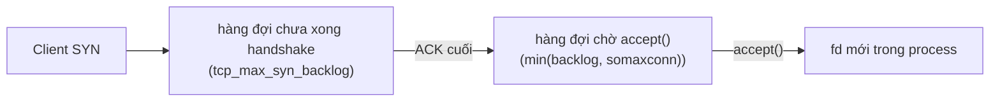

# Lab P6 — Networking

> Phần thực hành của [P6 · Networking](../06-networking/00-tong-quan.md). Cơ chế và lý do đứng sau từng thí nghiệm nằm ở các chương của P6; mỗi bài lab ghi rõ chương và mục cần đọc — **hãy đọc xong lý thuyết trước**, rồi quay lại làm lab. Quy ước như [00-roadmap.md](../00-roadmap.md): mọi fact có chú thích cuối trang kèm câu trích nguyên văn; câu có ghi "(nhận xét của người soạn)" là lời khuyên, không phải fact. Output trong phần Lab là output **thật** do người soạn chạy trong container Debian bookworm (kernel 6.8, Rust 1.95) qua `./labs/linux.sh`; PID, port, địa chỉ, thời gian sẽ khác trên máy bạn.

## 1. Thực hành

Crate: `labs/crates/lab-networking`. Mã Linux-only nằm sau `#[cfg(target_os = "linux")]`; trên macOS các bin `backlog`, `buffers`, `tcp_states` in hướng dẫn chạy `./labs/linux.sh`. Các bin `echo_server`, `echo_client`, `http_server`, `http_client`, `udp_pingpong` chạy được cả trên macOS (đã chạy thử: UDP trả `ConnectionRefused (os error 61)` thay vì `111` trên Linux).

Chuẩn bị (từ thư mục gốc dự án):

```bash
(cd labs && cargo build -p lab-networking)    # macOS: phải qua
(cd labs && cargo test -p lab-networking)     # 5 test của HTTP reader: pass
./labs/linux.sh cargo build -p lab-networking --bins
```

Trong các lệnh dưới, `B=./target-linux/debug` trong container.

### 1.0 Bảng định tuyến và dải ephemeral port của container lab

Lý thuyết: [chương 03 mục 4](../06-networking/03-ip.md) (bảng định tuyến, `ip route`), [chương 07 mục 5](../06-networking/07-socket-va-kernel.md) (ephemeral port).

Output thật của lab, dùng để đối chiếu với lý thuyết về routing/longest-match và ephemeral port. Trong container của lab (rút gọn: bỏ các dòng `cache`):

```text
$ ip -br addr show lo
lo               UNKNOWN        127.0.0.1/8 ::1/128
$ ip route
default via 172.17.0.1 dev eth0
172.17.0.0/16 dev eth0 proto kernel scope link src 172.17.0.5
$ ip route get 127.0.0.1
local 127.0.0.1 dev lo src 127.0.0.1 uid 0
$ ip route get 8.8.8.8
8.8.8.8 via 172.17.0.1 dev eth0 src 172.17.0.5 uid 0
```

Đọc: địa chỉ `127.0.0.1` đi qua interface `lo` (loopback, không rời máy — vì thế lab tự chứa, không cần Internet); `8.8.8.8` không khớp `172.17.0.0/16` nên rơi vào `default` (gateway `172.17.0.1`). (Phần đọc output là diễn giải của người soạn từ chính output ở trên.)

Dải ephemeral: `/proc/sys/net/ipv4/ip_local_port_range` = `32768	60999` (output thật) — dải này là "the default local port range allocated to sockets that are not explicitly bound to a port number"[^ip7-ephemeral]. Đó là lý do client trong lab có cổng kiểu `42032`.

### 1.1 Lab (a) — echo server blocking, strace

Lý thuyết: [chương 07 mục 1](../06-networking/07-socket-va-kernel.md) (`socket → bind → listen → accept`), [mục 7](../06-networking/07-socket-va-kernel.md) (`std::net` gọi những syscall nào), [chương 04 mục 1](../06-networking/04-udp-va-tcp-co-ban.md) (port, định danh kết nối TCP).

`echo_server ADDR [MAX_CONNS]` bind, `listen`, `accept` trong vòng lặp, mỗi kết nối một thread; `echo_client` ghi message, `shutdown(Write)`, rồi đọc echo đến EOF.

```bash
./labs/linux.sh bash -c '
B=./target-linux/debug
strace -f -e trace=socket,setsockopt,bind,listen,accept4,recvfrom,sendto,close,exit_group \
  -o /tmp/st.txt $B/echo_server 127.0.0.1:7878 1 2>/dev/null &
sleep 1; $B/echo_client 127.0.0.1:7878 "hello, tcp
"; wait
sed -n "/socket(AF_INET/,\$p" /tmp/st.txt | grep -v "write(2"'
```

Output thật (rút gọn bỏ dòng `write(2, …)` là log stderr của server; PID `10` là thread chính, `12` là thread phục vụ kết nối):

```text
10    socket(AF_INET, SOCK_STREAM|SOCK_CLOEXEC, IPPROTO_IP) = 3
10    setsockopt(3, SOL_SOCKET, SO_REUSEADDR, [1], 4) = 0
10    bind(3, {sa_family=AF_INET, sin_port=htons(7878), sin_addr=inet_addr("127.0.0.1")}, 16) = 0
10    listen(3, 128)                    = 0
10    accept4(3, {sa_family=AF_INET, sin_port=htons(42906), sin_addr=inet_addr("127.0.0.1")}, [128 => 16], SOCK_CLOEXEC) = 4
12    recvfrom(4, "hello, tcp\n", 4096, 0, NULL, NULL) = 11
12    sendto(4, "hello, tcp\n", 11, MSG_NOSIGNAL, NULL, 0) = 11
12    recvfrom(4, "", 4096, 0, NULL, NULL) = 0
12    close(4)                          = 0
12    +++ exited with 0 +++
10    close(3)                          = 0
10    exit_group(0)                     = ?
```

(`strace` ở đây là công cụ "intercepts and records the system calls which are called by a process"[^strace1].) Đọc output:

- `socket` → `setsockopt(SO_REUSEADDR)` → `bind` → `listen(3, 128)` đều đến từ **một** lời gọi `TcpListener::bind` (khớp bảng ở [chương 07 mục 7](../06-networking/07-socket-va-kernel.md)).
- `accept4` trả fd `4` — một fd mới cho kết nối; fd `3` vẫn là listener. Đây là điểm mấu chốt: **listener fd và connection fd là hai thứ khác nhau**.
- Thread `12` làm `recvfrom` → `sendto` → `recvfrom` trả `""`/`0` (EOF vì client `shutdown(Write)`) → `close(4)`.
- Một lần chạy riêng `strace -f -e trace=clone` (output thật): `clone(child_stack=0x…, flags=CLONE_VM|CLONE_FS|CLONE_FILES|CLONE_SIGHAND|CLONE_THREAD|CLONE_SYSVSEM|CLONE_SETTLS|CLONE_PARENT_SETTID|CLONE_CHILD_CLEARTID, …)` — một thread mới cho kết nối.

Phía client (strace trực tiếp `echo_client`, cùng thời điểm có server chạy; output thật):

```text
socket(AF_INET, SOCK_STREAM|SOCK_CLOEXEC, IPPROTO_IP) = 3
connect(3, {sa_family=AF_INET, sin_port=htons(7878), sin_addr=inet_addr("127.0.0.1")}, 16) = 0
sendto(3, "hello, tcp\n", 11, MSG_NOSIGNAL, NULL, 0) = 11
shutdown(3, SHUT_WR)                    = 0
recvfrom(3, "hello, tcp\n", 32, 0, NULL, NULL) = 11
recvfrom(3, "", 32, 0, NULL, NULL)      = 0
close(3)                                = 0
```

### 1.2 Lab (b) — `tcpdump -i lo`: handshake và FIN

Lý thuyết: [chương 04 mục 5](../06-networking/04-udp-va-tcp-co-ban.md) (three-way handshake), [mục 7](../06-networking/04-udp-va-tcp-co-ban.md) (đóng kết nối, TIME-WAIT), [chương 05 mục 2](../06-networking/05-tcp-reliability-va-flow-control.md) (sequence number và cumulative ACK).

`tcpdump` "prints out a description of the contents of packets on a network interface that match the Boolean expression"[^tcpdump]. Ta bắt cổng 7878 trên `lo` với `-n` (không resolve), `-tt` (timestamp epoch) và `-S` (sequence tuyệt đối):

```bash
./labs/linux.sh bash -c '
B=./target-linux/debug
tcpdump -i lo -n -tt -S "tcp port 7878" > /tmp/td.txt 2>&1 &
TD=$!; sleep 1
$B/echo_server 127.0.0.1:7878 1 2>/dev/null & SRV=$!
sleep 0.5
$B/echo_client 127.0.0.1:7878 "hello, tcp
"; wait $SRV; sleep 1; kill $TD; sleep 0.5; cat /tmp/td.txt'
```

Output thật (rút gọn: bỏ các `options […]`; timestamp rút còn phần lẻ giây; seq/port sẽ khác trên máy bạn). Quy ước cờ: `S` = SYN, `.` = ACK, `P` = PSH, `F` = FIN:

```text
.346600 127.0.0.1.46730 > 127.0.0.1.7878: [S],  seq 3088399142,            length 0
.346615 127.0.0.1.7878 > 127.0.0.1.46730: [S.], seq 1736484914, ack 3088399143, length 0
.346627 127.0.0.1.46730 > 127.0.0.1.7878: [.],  ack 1736484915,             length 0
.346687 127.0.0.1.46730 > 127.0.0.1.7878: [P.], seq 3088399143:3088399154, ack 1736484915, length 11
.346691 127.0.0.1.7878 > 127.0.0.1.46730: [.],  ack 3088399154,             length 0
.346698 127.0.0.1.46730 > 127.0.0.1.7878: [F.], seq 3088399154, ack 1736484915, length 0
.347047 127.0.0.1.7878 > 127.0.0.1.46730: [P.], seq 1736484915:1736484926, ack 3088399155, length 11
.347065 127.0.0.1.46730 > 127.0.0.1.7878: [.],  ack 1736484926,             length 0
.347090 127.0.0.1.7878 > 127.0.0.1.46730: [F.], seq 1736484926, ack 3088399155, length 0
.347114 127.0.0.1.46730 > 127.0.0.1.7878: [.],  ack 1736484927,             length 0
```

Giải thích từng bước, đối chiếu RFC 9293 (§3.4–3.6):

1. Dòng 1–3 là **three-way handshake**: SYN (`seq …142`) → SYN+ACK (`ack …143`, tức SYN chiếm 1 sequence[^rfc9293-synseq]) → ACK (`ack 1736484915` = seq SYN của server + 1). Xong bước 3, `connect()` ở client trả về.
2. Dòng 4: client gửi 11 byte (`seq …143:…154`); dòng 5 server ack `…154` = `…143 + 11` — ack cumulative[^rfc9293-cumack].
3. Dòng 6: client gửi **FIN** ngay (do `shutdown(Write)`), `seq …154`; dòng 7 server ack `…155` — FIN chiếm 1 sequence, đúng như SYN, và ACK thuần không chiếm.
4. Dòng 7 còn chứa 11 byte echo **sau** FIN của client: đó là half-close thật sự — chiều server→client vẫn mở[^rfc9293-halfclose].
5. Dòng 9–10: server gửi FIN, client ack `…927`. Cả hai chiều đã đóng. Bên gửi FIN đầu tiên (client) là bên chủ động → sẽ vào TIME-WAIT (mục 1.3).

Ghi chú: `tcpdump` báo `20 packets received by filter` nhưng chỉ `10 packets captured`; chênh lệch này người soạn chưa điều tra nguồn gốc (không đưa vào kết luận).

### 1.3 Lab (c) — `tcp_states`: `ss -tan` qua từng trạng thái

Lý thuyết: [chương 04 mục 6](../06-networking/04-udp-va-tcp-co-ban.md) (máy trạng thái TCP) và [mục 7](../06-networking/04-udp-va-tcp-co-ban.md) (half-close, RST, TIME-WAIT/2MSL, CLOSE-WAIT); [chương 07 mục 3](../06-networking/07-socket-va-kernel.md) (ý nghĩa `Recv-Q`/`Send-Q` của `ss`).

`tcp_states` tự dựng kết nối trên loopback, gọi `ss -tan` ở từng bước và đóng theo hai thứ tự khác nhau. Chạy:

```bash
./labs/linux.sh cargo run -q -p lab-networking --bin tcp_states
```

Output thật (cột `Process` rỗng nên bỏ; port sẽ khác trên máy bạn):

```text
listener on 127.0.0.1:40893
--- 1. after bind+listen
LISTEN 0      128        127.0.0.1:40893      0.0.0.0:*
--- 2. after connect + accept
LISTEN 0      128        127.0.0.1:40893      0.0.0.0:*
ESTAB  0      0          127.0.0.1:42664    127.0.0.1:40893
ESTAB  0      0          127.0.0.1:40893    127.0.0.1:42664
--- 3. client closed, server has not
LISTEN     0      128        127.0.0.1:40893      0.0.0.0:*
FIN-WAIT-2 0      0          127.0.0.1:42664    127.0.0.1:40893
CLOSE-WAIT 1      0          127.0.0.1:40893    127.0.0.1:42664
    server read_to_end -> 0 bytes (EOF = peer's FIN)
--- 4. server closed too
LISTEN    0      128        127.0.0.1:40893      0.0.0.0:*
TIME-WAIT 0      0          127.0.0.1:42664    127.0.0.1:40893
    client read -> 0 bytes (EOF)
--- 5. second connection, server closed first
LISTEN    0      128        127.0.0.1:40893      0.0.0.0:*
TIME-WAIT 0      0          127.0.0.1:40893    127.0.0.1:42672
TIME-WAIT 0      0          127.0.0.1:42664    127.0.0.1:40893
--- 6. re-bind 127.0.0.1:40893 while in TIME-WAIT -> ok (127.0.0.1:40893)
```

Đọc:

- **Bước 1**: chỉ có `LISTEN`, `Send-Q` = 128 khớp với backlog 128 mà `strace` thấy ở `listen(3, 128)`. Với socket LISTEN, kernel điền `Recv-Q` bằng `sk_ack_backlog` (số kết nối đang chờ accept) và `Send-Q` bằng `sk_max_ack_backlog` (backlog)[^tcpdiag-listen]; `ss` lấy `Recv-Q`/`Send-Q` từ hai trường `idiag_rqueue`/`idiag_wqueue` đó[^ss-rqwq], được `sock_diag(7)` mô tả là "the number of pending connections" và "the backlog length" cho listening socket[^sockdiag-rq].
- **Bước 2**: một kết nối hiện **hai dòng ESTAB** — hai đầu của cùng kết nối (client `42664 → 40893` và server `40893 → 42664`), vì cả hai nằm trong một máy. Listener vẫn `LISTEN`: nó không "biến thành" kết nối.
- **Bước 3**: client `drop` (gửi FIN) nhưng server chưa đóng: client ở `FIN-WAIT-2` (chờ FIN của peer), server ở `CLOSE-WAIT` (chờ *ứng dụng* của mình đóng)[^rfc9293-finwait2][^rfc9293-closewait]. `CLOSE-WAIT` tồn tại lâu = ứng dụng quên `close` (nhận xét của người soạn, suy ra từ định nghĩa trạng thái). `Recv-Q` = 1 ở dòng CLOSE-WAIT: với socket không LISTEN, kernel tính `Recv-Q` = `rcv_nxt − copied_seq` (số byte nhận được nhưng ứng dụng chưa đọc ra)[^tcpdiag-est]. Đọc mã nguồn kernel 6.8, FIN được tính vào `end_seq` của segment (`seq + syn + fin + len`)[^tcpipv4-endseq], `rcv_nxt` được cập nhật theo `end_seq`[^tcpinput-rcvnxt], còn `copied_seq` chỉ nhích thêm 1 khi `recvmsg` "xử lý" FIN[^tcp-finok]. Vì vậy FIN chưa được ứng dụng đọc làm `Recv-Q` = 1 dù không có byte dữ liệu nào; sau `read_to_end` (trả 0 byte) ở bước 3 FIN đã được tiêu thụ. Đây là **suy luận của người soạn từ việc đọc mã nguồn**, khớp với output nhưng chưa được kiểm bằng debugger; man page `ss(8)` không định nghĩa cột này.
- **Bước 4**: server đóng → client (bên đóng đầu tiên) ở `TIME-WAIT` còn server đã biến mất khỏi bảng (đã `CLOSED`)[^rfc9293-timewait].
- **Bước 5**: đảo thứ tự: server đóng trước nên **dòng TIME-WAIT nằm ở phía server** (`40893 → 42672`) — ai đóng chủ động thì giữ TIME-WAIT. Dòng thứ hai là TIME-WAIT cũ của bước 4, vẫn chưa hết 2×MSL[^rfc9293-2msl].
- **Bước 6**: sau `drop(listener)`, bind lại đúng port đó vẫn thành công dù có socket TIME-WAIT dùng `127.0.0.1:40893`; đây là nhờ `SO_REUSEADDR` mà std đặt (strace ở mục 1.1; xem [chương 07 mục 5](../06-networking/07-socket-va-kernel.md); `socket(7)`: tùy chọn cho phép dùng lại địa chỉ local khi `bind`[^socket7-reuseaddr]).

Trên host Linux của bạn, thử thêm `ss -tan state time-wait` — `ss` có bộ lọc theo state, trong đó `time-wait` là tên hợp lệ[^ss8-states].

### 1.4 Lab — `backlog` và `buffers`

Lý thuyết: [chương 07 mục 2](../06-networking/07-socket-va-kernel.md) (hai hàng đợi của socket nghe, `backlog`, `somaxconn`), [mục 3](../06-networking/07-socket-va-kernel.md) (`Recv-Q`/`Send-Q` của `ss`), [mục 4](../06-networking/07-socket-va-kernel.md) (socket buffer), [chương 05 mục 5](../06-networking/05-tcp-reliability-va-flow-control.md) (receive window) và [mục 7](../06-networking/05-tcp-reliability-va-flow-control.md) (Nagle, `TCP_NODELAY`).

**Backlog.** `listen(2)`: tham số backlog "defines the maximum length to which the queue of pending connections for sockfd may grow"[^listen2-backlog]. Nếu hàng đợi đầy, client có thể nhận `ECONNREFUSED` hoặc request bị bỏ qua để thử lại sau[^listen2-full]. Giá trị vượt `somaxconn` bị cắt âm thầm[^listen2-somaxconn]; từ Linux 5.4 mặc định của file này là 4096[^listen2-5.4]. Hàng đợi cho kết nối chưa hoàn tất (incomplete) là hàng đợi khác, cấu hình bằng `tcp_max_syn_backlog`[^listen2-syn].



```bash
./labs/linux.sh cargo run -q -p lab-networking --bin backlog
```

Output thật:

```text
somaxconn = 4096
--- listening, nobody connected
LISTEN 0      128        127.0.0.1:39877      0.0.0.0:*
5 connect() calls returned Ok without any accept()
--- 5 clients connected, 0 accepted
LISTEN 5      128        127.0.0.1:39877      0.0.0.0:*
accept() -> 127.0.0.1:37954
--- after one accept()
LISTEN 4      128        127.0.0.1:39877      0.0.0.0:*
```

Đọc: cả 5 `connect()` trả `Ok` dù **chưa có ai `accept`** — handshake do kernel làm. `Recv-Q` của dòng `LISTEN` đi 0 → 5 → 4 sau một `accept`; `Send-Q` = 128 = backlog đã truyền vào `listen`. Việc `Recv-Q` của socket LISTEN là số kết nối đang chờ accept và `Send-Q` là backlog được nguồn xác nhận: kernel đặt `idiag_rqueue = sk_ack_backlog`, `idiag_wqueue = sk_max_ack_backlog` cho socket LISTEN[^tcpdiag-listen], `ss` hiển thị hai trường đó thành `Recv-Q`/`Send-Q`[^ss-rqwq], và `sock_diag(7)` ghi "the number of pending connections" / "the backlog length"[^sockdiag-rq]. (`ss(8)` trên Debian bookworm không định nghĩa hai cột này; lưu ý man page `netstat(8)` ghi cho LISTEN là "syn backlog", lệch với mã nguồn kernel 6.8 ở trên — tài liệu này theo mã nguồn và output lab.) `somaxconn = 4096` khớp mô tả mặc định của kernel ≥ 5.4[^listen2-5.4] (kernel container là 6.8).

**Buffers và flow control.** `buffers` in giá trị mặc định, minh họa `SO_RCVBUF` bị nhân đôi, `TCP_NODELAY`, và cho một writer ghi tới khi kernel từ chối.

```bash
./labs/linux.sh cargo run -q -p lab-networking --bin buffers
```

Output thật (các con số phụ thuộc kernel/máy):

```text
== 1. defaults ==
  /proc/sys/net/ipv4/tcp_rmem = 4096 131072 6291456
  /proc/sys/net/ipv4/tcp_wmem = 4096 16384 4194304
  live socket: SO_SNDBUF=2626560 SO_RCVBUF=131072
== 2. SO_RCVBUF is doubled ==
  setsockopt(SO_RCVBUF, 4096) -> getsockopt = 8192
== 3. TCP_NODELAY ==
  default: nodelay()=false getsockopt(TCP_NODELAY)=0
  after set_nodelay(true): nodelay()=true getsockopt(TCP_NODELAY)=1
== 4. flow control: writer vs. a reader that does not read ==
  wrote 2612608 bytes before WouldBlock (a blocking write would sleep here)
State Recv-Q Send-Q  Local Address:Port  Peer Address:Port
ESTAB 112704 0           127.0.0.1:38585    127.0.0.1:33720
ESTAB 0      2579867     127.0.0.1:33720    127.0.0.1:38585
  reader consumed 2209856 bytes
  writer could then push 3667101 more bytes
```

Đọc:

- (2) Đặt 4096, đọc ra 8192: đúng mô tả "kernel doubles this value"[^socket7-rcvbuf].
- (1) `SO_SNDBUF` của socket đang sống (2.626.560) lớn hơn nhiều so với mặc định 16384 trong `tcp_wmem`: nhất quán với việc TCP "dynamically adjusts the size of the send buffer … in the range of these values"[^tcp7-wmem] (khoảng min–max là 4096–4194304, giá trị 2,6 MB nằm trong khoảng đó).
- (3) `nodelay()` mặc định `false` — tức Nagle đang bật; `set_nodelay(true)` đổi `TCP_NODELAY` từ 0 sang 1, cùng giá trị khi đọc thẳng bằng `getsockopt`.
- (4) Writer ghi được ~2,6 MB rồi `WouldBlock` (socket nonblocking chỉ để demo dừng đúng chỗ; socket blocking sẽ ngủ ở `write`). `ss` cho thấy dữ liệu nằm ở hai bộ đệm: 112.704 byte trong `Recv-Q` phía reader và ~2,58 MB trong `Send-Q` phía writer. Với socket không LISTEN, `Recv-Q` là byte đã nhận nhưng ứng dụng chưa đọc (`rcv_nxt − copied_seq`) và `Send-Q` là byte đã ghi nhưng chưa được peer ack (`write_seq − snd_una`)[^tcpdiag-est][^netstat-rq]. Khi reader đọc, cửa sổ mở lại và writer ghi thêm được. Đây là flow control nhìn từ ứng dụng. (Số byte cụ thể phụ thuộc auto-tuning; không có ý nghĩa tuyệt đối.)

### 1.5 Lab (d) — HTTP/1.1 thô

Lý thuyết: [chương 08 mục 5](../06-networking/08-dns-http-tls.md) (HTTP/1.1: framing, kết nối tái dùng), [mục 4](../06-networking/08-dns-http-tls.md) (`getaddrinfo`, `nsswitch`, `/etc/hosts`), [chương 04 mục 3](../06-networking/04-udp-va-tcp-co-ban.md) (byte stream: `read` không đúng 100 byte).

`http_server ADDR [MAX_CONNS]` đọc request head bằng `read_head`, kiểm tra `Host`, trả 200/404/405/400/505 với `Content-Length` và `Connection: close`. `http_client HOST:PORT [PATH]` giải tên bằng `ToSocketAddrs`, in nguyên byte request rồi parse response.

```bash
./labs/linux.sh bash -c '
B=./target-linux/debug
$B/http_server 127.0.0.1:8080 5 2>/tmp/h.err &
sleep 0.5
$B/http_client 127.0.0.1:8080 /
$B/http_client localhost:8080 /nope
curl -sv http://127.0.0.1:8080/ 2>&1 | grep -E "^[<>*] "
printf "GET / HTTP/1.1\r\n\r\n" | nc -q1 127.0.0.1 8080
printf "POST / HTTP/1.1\r\nHost: x\r\n\r\n" | nc -q1 127.0.0.1 8080
wait; cat /tmp/h.err'
```

Output thật (rút gọn `curl`):

```text
[client] 127.0.0.1:8080 resolved to [127.0.0.1:8080]
[client] >>> "GET / HTTP/1.1\r\nHost: 127.0.0.1:8080\r\nUser-Agent: p04-http-client\r\nConnection: close\r\n\r\n"
[client] <<< status 200 "OK"
[client] <<< Content-Type: text/plain; charset=utf-8
[client] <<< Content-Length: 48
[client] <<< Connection: close
[client] <<< body (48 bytes): "hello from p04 http_server, Host=127.0.0.1:8080\n"
---
[client] localhost:8080 resolved to [[::1]:8080, 127.0.0.1:8080]
[client] >>> "GET /nope HTTP/1.1\r\nHost: localhost:8080\r\n..."
[client] <<< status 404 "Not Found"
[client] <<< body (13 bytes): "no such path\n"
--- curl -sv (rút gọn)
> GET / HTTP/1.1
> Host: 127.0.0.1:8080
< HTTP/1.1 200 OK
< Content-Length: 48
< Connection: close
--- nc: HTTP/1.1 không có Host
HTTP/1.1 400 Bad Request
...
missing Host header
--- nc: POST
HTTP/1.1 405 Method Not Allowed
...
only GET
--- log server (stderr)
[http] listening on 127.0.0.1:8080
[http] 127.0.0.1:40332 GET / HTTP/1.1
[http] 127.0.0.1:40336 GET /nope HTTP/1.1
[http] 127.0.0.1:40350 GET / HTTP/1.1
[http] 127.0.0.1:40362 GET / HTTP/1.1
[http] 127.0.0.1:49078 POST / HTTP/1.1
```

Đọc:

- Request thô chỉ là bytes ASCII: `GET / HTTP/1.1` + CRLF + header + dòng trống[^rfc9112-msg]. `curl` gửi gần như cùng một thứ — đối chiếu để thấy HTTP không có phép màu.
- Request thiếu `Host` → 400, đúng quy định "MUST respond with a 400"[^rfc9112-host]; `curl` luôn gửi `Host`.
- `Content-Length: 48` khớp 48 byte body in ra; client đọc đúng chừng đó rồi dừng[^rfc9112-cl].
- **Điểm thú vị về DNS**: `localhost:8080` giải ra `[::1]:8080` *trước* rồi `127.0.0.1:8080`. Server chỉ nghe IPv4. Người soạn đã strace `http_client localhost:8080 /` (`strace -f -e trace=connect`, output thật): có `connect(…AF_INET6, "::1", htons(8080)…) = -1 ECONNREFUSED` ngay trước `connect(…AF_INET, "127.0.0.1", htons(8080)…) = 0` — đúng hành vi "thử lần lượt" của `TcpStream::connect`[^std-connect-multi]. (Các `connect` với `htons(0)` đứng trước là do glibc dò địa chỉ nguồn để sắp xếp kết quả; đó là diễn giải của người soạn, không được trích nguồn.) `getaddrinfo(3)` ghi hàm sắp xếp kết quả theo RFC 3484 và có thể chỉnh bằng `/etc/gai.conf`[^getaddrinfo3-sort]; RFC 3484 đã bị RFC 6724 thay thế[^rfc6724-obs] (luật chọn thứ tự và lý do `::1` đứng trước: [chương 08 mục 4](../06-networking/08-dns-http-tls.md)). Thứ tự địa chỉ do libc quyết định, có thể khác trên máy bạn.
- Cách `getaddrinfo` đọc cấu hình, quan sát bằng `strace -f -e trace=openat` trên `http_client localhost:1 /` (output thật, rút gọn): `/etc/nsswitch.conf`, `/etc/resolv.conf`, `/etc/hosts` — kèm `/etc/host.conf` và `/etc/gai.conf`. Đó chỉ là danh sách file mở quan sát được trên glibc của container; `getaddrinfo(3)` không mô tả thứ tự tra cứu này, và nội dung `/etc/hosts` của container có cả `127.0.0.1 localhost` lẫn `::1 localhost ip6-localhost`. (Lưu ý: `getent ahosts localhost` trong cùng container chỉ in `127.0.0.1`, khác với danh sách `[::1], 127.0.0.1` của `getaddrinfo` do Rust gọi — hai đường gọi cho kết quả khác nhau; người soạn chưa điều tra vì sao.)

### 1.6 Lab (e) — UDP ping-pong

Lý thuyết: [chương 04 mục 2](../06-networking/04-udp-va-tcp-co-ban.md) (UDP) và [mục 3](../06-networking/04-udp-va-tcp-co-ban.md) (TCP byte stream, để so sánh), [chương 07 mục 7](../06-networking/07-socket-va-kernel.md) (`UdpSocket`).

```bash
./labs/linux.sh cargo run -q -p lab-networking --bin udp_pingpong
```

Output thật (RTT, port sẽ khác):

```text
[udp] client 127.0.0.1:50821 -> server 127.0.0.1:36366
== 1. ping-pong ==
  "pong:ping 0" rtt=93.261µs
  "pong:ping 1" rtt=86.514µs
  ... (rút gọn: 5 vòng)
== 2. message boundaries: 3 sends -> 3 recvs ==
  recv -> 1 bytes "a"
  recv -> 2 bytes "bb"
  recv -> 3 bytes "ccc"
== 3. truncation: 100-byte datagram into a 10-byte buffer ==
  first recv -> 10 bytes (the other 90 are gone)
  second recv -> "next"
== 4. send to a port nobody listens on ==
  send() -> Ok(7)
  recv() -> Err(kind=ConnectionRefused, Connection refused (os error 111))
```

Đọc:

- (1) Không có `listen`/`accept`: UDP không có kết nối; client `connect` chỉ đặt peer mặc định[^connect2-dgram][^std-udp-connect].
- (2) Ba `send` → ba `recv` đúng ranh giới. So sánh với TCP: byte stream không giữ ranh giới[^socket2-stream].
- (3) Datagram 100 byte vào buffer 10 byte: nhận 10, **90 byte còn lại mất** và `recv` tiếp theo đã thấy datagram kế (`"next"`); đúng với "excess bytes may be discarded"[^recv2-trunc].
- (4) `send()` tới cổng không ai nghe vẫn `Ok(7)` — UDP không biết. Lỗi `ConnectionRefused` xuất hiện ở lời gọi `recv()` *sau đó*: khớp mô tả "no receiver was associated with the destination address. This might be caused by a previous packet sent over the socket"[^udp7-refused].

### 1.7 Bài tập mở rộng

Các bài này **chưa** được người soạn chạy; hãy tự kiểm chứng và đừng coi kết quả mong đợi là fact.

1. Chạy `echo_server` rồi mở 3 kết nối bằng `nc` giữ nguyên; dùng `ss -tanp` và `ls /proc/<pid>/task` đếm số thread. Liên hệ với [P7 · chương 04 mục 2](../07-io-async/04-kien-truc-event-loop.md) (thread-per-connection).
2. Trong `tcp_states`, cho client ghi dữ liệu mà server không đọc rồi `drop(server_side)` — quan sát có RST thay vì FIN không (đọc RFC 9293 §3.5.2 về Reset Generation và [chương 04 mục 7](../06-networking/04-udp-va-tcp-co-ban.md)).
3. Sửa `backlog.rs` để dùng `libc::listen(fd, 1)` trực tiếp và tăng số client; xem `ss -ltn` và khi nào `connect` bắt đầu treo hoặc bị từ chối (đối chiếu[^listen2-full]).
4. `tcpdump -i lo -n udp port <port>` khi chạy `udp_pingpong` và tìm gói ICMP port unreachable ở phần (4).
5. Viết client gửi 2 `write` nhỏ liên tiếp, đo thời gian với và không `set_nodelay(true)`; giải thích bằng Nagle[^rfc9293-nagle-desc]. Cẩn thận: kết quả phụ thuộc delayed ACK và loopback.
6. Thêm `Transfer-Encoding: chunked` cho `read_response` theo RFC 9112 §7.1 — nền cho capstone.

## 2. Câu hỏi tự kiểm tra về output lab

(Các câu hỏi lý thuyết thuần nằm ở phần "Câu hỏi tự kiểm tra" của từng chương trong [P6](../06-networking/00-tong-quan.md).)

1. Trong trace tcpdump (mục 1.2), vì sao ack của SYN+ACK là `seq_client + 1` dù SYN không mang dữ liệu? Và vì sao ack của một ACK thuần không làm số sequence tăng?
<details><summary>Đáp án</summary>

SYN (và FIN) chiếm một số sequence, ACK thì không[^rfc9293-synseq][^rfc9293-ackseq]. Lab 1.2 dòng 1–3, 6–7.

</details>

2. `connect()` trả `Ok` ở client nhưng server chưa gọi `accept()`. Kết nối ở trạng thái nào và nằm ở đâu?
<details><summary>Đáp án</summary>

Handshake do kernel hoàn tất; kết nối nằm trong hàng đợi pending của socket listening, tối đa theo backlog (bị cắt bởi `somaxconn`)[^listen2-backlog][^listen2-somaxconn]. Lab 1.4: `Recv-Q` của LISTEN = 5.

</details>

3. `nodelay()` mặc định trả gì, `set_nodelay(true)` tương ứng cờ nào, và nó đánh đổi điều gì?
<details><summary>Đáp án</summary>

Mặc định `false` (lab 1.4 (3)). `TCP_NODELAY` tắt Nagle: gửi segment ngay cả khi ít dữ liệu[^tcp7-nodelay][^std-nodelay]. Nagle gom dữ liệu khi còn data chưa ack[^rfc9293-nagle-desc], nên bật NODELAY đổi trễ thấp lấy nhiều gói nhỏ hơn (diễn giải của người soạn).

</details>

4. `TcpStream::connect("localhost:8080")` có thể thử bao nhiêu địa chỉ, và nếu địa chỉ đầu thất bại thì sao?
<details><summary>Đáp án</summary>

Nó nhận iterator địa chỉ do `getaddrinfo` trả về và thử lần lượt cho tới khi một cái thành công[^std-connect-multi][^std-getaddrinfo][^getaddrinfo3]. Lab 1.5: `[::1]` rồi `127.0.0.1`.

</details>

5. UDP `send()` tới port đóng trả `Ok`; lỗi xuất hiện ở đâu và vì sao?
<details><summary>Đáp án</summary>

Ở lời gọi sau (`recv`); lỗi `ECONNREFUSED` có thể do gói gửi trước đó[^udp7-refused]. Lab 1.6 (4).

</details>

6. Trong lab 1.6, vì sao `recv` với buffer nhỏ cắt datagram còn đọc TCP thì không?
<details><summary>Đáp án</summary>

TCP là byte stream không giữ record boundary[^socket2-stream]; UDP là datagram và message dài hơn buffer thì phần dư có thể bị bỏ[^recv2-trunc]. Lab 1.6 (2)(3).

</details>

7. Trong lab 1.3, vì sao ở bước 4 dòng `TIME-WAIT` nằm ở phía client còn ở bước 5 nó nằm ở phía server?
<details><summary>Đáp án</summary>

Bên đóng kết nối **trước** (gửi FIN đầu tiên) là bên vào `TIME-WAIT`[^rfc9293-timewait]: bước 4 client đóng trước, bước 5 server đóng trước. Trạng thái này kéo dài 2×MSL[^rfc9293-2msl]. Việc bind lại cổng ở bước 6 vẫn thành công nhờ `SO_REUSEADDR` mà std đặt trước `bind` (strace ở lab 1.1).

</details>

8. Trong strace của lab 1.1, fd `3` và fd `4` khác nhau ở chỗ nào?
<details><summary>Đáp án</summary>

fd `3` là socket nghe (kết quả của `socket` → `bind` → `listen`); `accept4` trả fd `4` cho từng kết nối đã bắt tay xong, và thread phục vụ chỉ `recvfrom`/`sendto`/`close` trên fd `4` (đọc từ output ở lab 1.1). Đóng fd `4` không đóng listener.

</details>

[^rfc6724-obs]: RFC 6724, header — <https://www.rfc-editor.org/rfc/rfc6724.html> — "Obsoletes: 3484 R. Draves Category: Standards Track"
[^ip7-ephemeral]: ip(7), Linux man-pages (Debian bookworm) — <https://manpages.debian.org/bookworm/manpages/ip.7.en.html> — "This file contains two integers that define the default local port range allocated to sockets that are not explicitly bound to a port number—that is, the range used for ephemeral ports."
[^strace1]: strace(1), Debian bookworm — <https://manpages.debian.org/bookworm/strace/strace.1.en.html> — "It intercepts and records the system calls which are called by a process and the signals which are received by a process."
[^tcpdump]: tcpdump(8), Debian bookworm — <https://manpages.debian.org/bookworm/tcpdump/tcpdump.8.en.html> — "Tcpdump prints out a description of the contents of packets on a network interface that match the Boolean expression"
[^rfc9293-synseq]: RFC 9293, §3.5 Establishing a Connection — <https://www.rfc-editor.org/rfc/rfc9293.html> — "Note that the acknowledgment field indicates TCP Peer B is now expecting to hear sequence 101, acknowledging the SYN that occupied sequence 100."
[^rfc9293-cumack]: RFC 9293, §3.4 Sequence Numbers — <https://www.rfc-editor.org/rfc/rfc9293.html> — "The acknowledgment mechanism employed is cumulative so that an acknowledgment of sequence number X indicates that all octets up to but not including X have been received."
[^rfc9293-halfclose]: RFC 9293, §3.6.1 Half-Closed Connections — <https://www.rfc-editor.org/rfc/rfc9293.html> — "Since the two directions of a TCP connection are closed independently, it is possible for a connection to be \"half closed\", i.e., closed in only one direction, and a host is permitted to continue sending data in the open direction on a half-closed connection."
[^tcpdiag-listen]: Linux v6.8, net/ipv4/tcp_diag.c (tcp_diag_get_info) — <https://raw.githubusercontent.com/torvalds/linux/v6.8/net/ipv4/tcp_diag.c> — "r->idiag_rqueue = READ_ONCE(sk->sk_ack_backlog); r->idiag_wqueue = READ_ONCE(sk->sk_max_ack_backlog);"
[^ss-rqwq]: iproute2 v6.1.0, misc/ss.c — <https://raw.githubusercontent.com/iproute2/iproute2/v6.1.0/misc/ss.c> — "s->wq = r->idiag_wqueue; s->rq = r->idiag_rqueue;"
[^sockdiag-rq]: sock_diag(7), Linux man-pages (Debian bookworm) — <https://manpages.debian.org/bookworm/manpages/sock_diag.7.en.html> — "For listening sockets: the number of pending connections."
[^rfc9293-finwait2]: RFC 9293, §3.3.2 State Machine Overview — <https://www.rfc-editor.org/rfc/rfc9293.html> — "FIN-WAIT-2 - represents waiting for a connection termination request from the remote TCP peer."
[^rfc9293-closewait]: RFC 9293, §3.3.2 State Machine Overview — <https://www.rfc-editor.org/rfc/rfc9293.html> — "CLOSE-WAIT - represents waiting for a connection termination request from the local user."
[^tcpdiag-est]: Linux v6.8, net/ipv4/tcp_diag.c (tcp_diag_get_info) — <https://raw.githubusercontent.com/torvalds/linux/v6.8/net/ipv4/tcp_diag.c> — "r->idiag_rqueue = max_t(int, READ_ONCE(tp->rcv_nxt) - READ_ONCE(tp->copied_seq), 0); r->idiag_wqueue = READ_ONCE(tp->write_seq) - tp->snd_una;"
[^tcpipv4-endseq]: Linux v6.8, net/ipv4/tcp_ipv4.c (tcp_v4_fill_cb) — <https://raw.githubusercontent.com/torvalds/linux/v6.8/net/ipv4/tcp_ipv4.c> — "TCP_SKB_CB(skb)->end_seq = (TCP_SKB_CB(skb)->seq + th->syn + th->fin + skb->len - th->doff * 4);"
[^tcpinput-rcvnxt]: Linux v6.8, net/ipv4/tcp_input.c (tcp_queue_rcv) — <https://raw.githubusercontent.com/torvalds/linux/v6.8/net/ipv4/tcp_input.c> — "tcp_rcv_nxt_update(tcp_sk(sk), TCP_SKB_CB(skb)->end_seq);"
[^tcp-finok]: Linux v6.8, net/ipv4/tcp.c (tcp_recvmsg_locked, found_fin_ok) — <https://raw.githubusercontent.com/torvalds/linux/v6.8/net/ipv4/tcp.c> — "/* Process the FIN. */ WRITE_ONCE(*seq, *seq + 1);"
[^rfc9293-timewait]: RFC 9293, §3.3.2 State Machine Overview — <https://www.rfc-editor.org/rfc/rfc9293.html> — "TIME-WAIT - represents waiting for enough time to pass to be sure the remote TCP peer received the acknowledgment of its connection termination request and to avoid new connections being impacted by delayed segments from previous connections."
[^rfc9293-2msl]: RFC 9293, §3.6.1 Half-Closed Connections — <https://www.rfc-editor.org/rfc/rfc9293.html> — "When a connection is closed actively, it MUST linger in the TIME-WAIT state for a time 2xMSL (Maximum Segment Lifetime)"
[^socket7-reuseaddr]: socket(7), Linux man-pages (Debian bookworm) — <https://manpages.debian.org/bookworm/manpages/socket.7.en.html> — "Indicates that the rules used in validating addresses supplied in a bind(2) call should allow reuse of local addresses."
[^ss8-states]: ss(8), iproute2 (Debian bookworm) — <https://manpages.debian.org/bookworm/iproute2/ss.8.en.html> — "All standard TCP states: established, syn-sent, syn-recv, fin-wait-1, fin-wait-2, time-wait, closed, close-wait, last-ack, listening and closing."
[^listen2-backlog]: listen(2), Linux man-pages (Debian bookworm) — <https://manpages.debian.org/bookworm/manpages-dev/listen.2.en.html> — "The backlog argument defines the maximum length to which the queue of pending connections for sockfd may grow."
[^listen2-full]: listen(2), Linux man-pages (Debian bookworm) — <https://manpages.debian.org/bookworm/manpages-dev/listen.2.en.html> — "If a connection request arrives when the queue is full, the client may receive an error with an indication of ECONNREFUSED or, if the underlying protocol supports retransmission, the request may be ignored so that a later reattempt at connection succeeds."
[^listen2-somaxconn]: listen(2), Linux man-pages (Debian bookworm) — <https://manpages.debian.org/bookworm/manpages-dev/listen.2.en.html> — "If the backlog argument is greater than the value in /proc/sys/net/core/somaxconn, then it is silently capped to that value."
[^listen2-5.4]: listen(2), Linux man-pages (Debian bookworm) — <https://manpages.debian.org/bookworm/manpages-dev/listen.2.en.html> — "Since Linux 5.4, the default in this file is 4096; in earlier kernels, the default value is 128."
[^listen2-syn]: listen(2), Linux man-pages (Debian bookworm) — <https://manpages.debian.org/bookworm/manpages-dev/listen.2.en.html> — "The maximum length of the queue for incomplete sockets can be set using /proc/sys/net/ipv4/tcp_max_syn_backlog."
[^socket7-rcvbuf]: socket(7), Linux man-pages (Debian bookworm) — <https://manpages.debian.org/bookworm/manpages/socket.7.en.html> — "The kernel doubles this value (to allow space for bookkeeping overhead) when it is set using setsockopt(2), and this doubled value is returned by getsockopt(2)."
[^tcp7-wmem]: tcp(7), Linux man-pages (Debian bookworm) — <https://manpages.debian.org/bookworm/manpages/tcp.7.en.html> — "TCP dynamically adjusts the size of the send buffer from the default values listed below, in the range of these values, depending on memory available."
[^netstat-rq]: netstat(8), net-tools (Debian bookworm) — <https://manpages.debian.org/bookworm/net-tools/netstat.8.en.html> — "Established: The count of bytes not copied by the user program connected to this socket."
[^rfc9112-msg]: RFC 9112, §2.1 Message Format — <https://www.rfc-editor.org/rfc/rfc9112.html> — "An HTTP/1.1 message consists of a start-line followed by a CRLF and a sequence of octets in a format similar to the Internet Message Format"
[^rfc9112-host]: RFC 9112, §3.2 Request Target — <https://www.rfc-editor.org/rfc/rfc9112.html> — "A server MUST respond with a 400 (Bad Request) status code to any HTTP/1.1 request message that lacks a Host header field"
[^rfc9112-cl]: RFC 9112, §6.3 Message Body Length — <https://www.rfc-editor.org/rfc/rfc9112.html> — "If a valid Content-Length header field is present without Transfer-Encoding, its decimal value defines the expected message body length in octets."
[^std-connect-multi]: Rust std 1.95.0 source, library/std/src/net/tcp.rs (TcpStream::connect) — <https://raw.githubusercontent.com/rust-lang/rust/1.95.0/library/std/src/net/tcp.rs> — "If `addr` yields multiple addresses, `connect` will be attempted with each of the addresses until a connection is successful."
[^getaddrinfo3-sort]: getaddrinfo(3), Linux man-pages (Debian bookworm) — <https://manpages.debian.org/bookworm/manpages-dev/getaddrinfo.3.en.html> — "The sorting function used within getaddrinfo() is defined in RFC 3484; the order can be tweaked for a particular system by editing /etc/gai.conf"
[^connect2-dgram]: connect(2), Linux man-pages (Debian bookworm) — <https://manpages.debian.org/bookworm/manpages-dev/connect.2.en.html> — "If the socket sockfd is of type SOCK_DGRAM, then addr is the address to which datagrams are sent by default, and the only address from which datagrams are received."
[^std-udp-connect]: Rust std 1.95.0 source, library/std/src/net/udp.rs (UdpSocket::connect) — <https://raw.githubusercontent.com/rust-lang/rust/1.95.0/library/std/src/net/udp.rs> — "Connects this UDP socket to a remote address, allowing the `send` and `recv` syscalls to be used to send data and also applies filters to only receive data from the specified address."
[^socket2-stream]: socket(2), Linux man-pages (Debian bookworm) — <https://manpages.debian.org/bookworm/manpages-dev/socket.2.en.html> — "Sockets of type SOCK_STREAM are full-duplex byte streams. They do not preserve record boundaries."
[^recv2-trunc]: recv(2), Linux man-pages (Debian bookworm) — <https://manpages.debian.org/bookworm/manpages-dev/recv.2.en.html> — "If a message is too long to fit in the supplied buffer, excess bytes may be discarded depending on the type of socket the message is received from."
[^udp7-refused]: udp(7), Linux man-pages (Debian bookworm) — <https://manpages.debian.org/bookworm/manpages/udp.7.en.html> — "ECONNREFUSED No receiver was associated with the destination address. This might be caused by a previous packet sent over the socket."
[^rfc9293-nagle-desc]: RFC 9293, §3.7.4 Nagle Algorithm — <https://www.rfc-editor.org/rfc/rfc9293.html> — "If there is unacknowledged data (i.e., SND.NXT > SND.UNA), then the sending TCP endpoint buffers all user data (regardless of the PSH bit) until the outstanding data has been acknowledged or until the TCP endpoint can send a full-sized segment (Eff.snd.MSS bytes)."
[^rfc9293-ackseq]: RFC 9293, §3.5 Establishing a Connection — <https://www.rfc-editor.org/rfc/rfc9293.html> — "Note that the sequence number of the segment in line 5 is the same as in line 4 because the ACK does not occupy sequence number space"
[^tcp7-nodelay]: tcp(7), Linux man-pages (Debian bookworm) — <https://manpages.debian.org/bookworm/manpages/tcp.7.en.html> — "If set, disable the Nagle algorithm. This means that segments are always sent as soon as possible, even if there is only a small amount of data."
[^std-nodelay]: Rust std 1.95.0 source, library/std/src/net/tcp.rs (TcpStream::set_nodelay) — <https://raw.githubusercontent.com/rust-lang/rust/1.95.0/library/std/src/net/tcp.rs> — "If set, this option disables the Nagle algorithm. This means that segments are always sent as soon as possible, even if there is only a small amount of data."
[^std-getaddrinfo]: rust-lang/rust tag 1.95.0, library/std/src/sys/net/connection/socket/mod.rs (lookup_host) — <https://raw.githubusercontent.com/rust-lang/rust/1.95.0/library/std/src/sys/net/connection/socket/mod.rs> — "cvt_gai(c::getaddrinfo(c_host.as_ptr(), ptr::null(), &hints, &mut res))"
[^getaddrinfo3]: getaddrinfo(3), Linux man-pages (Debian bookworm) — <https://manpages.debian.org/bookworm/manpages-dev/getaddrinfo.3.en.html> — "Given node and service, which identify an Internet host and a service, getaddrinfo() returns one or more addrinfo structures, each of which contains an Internet address that can be specified in a call to bind(2) or connect(2)."
