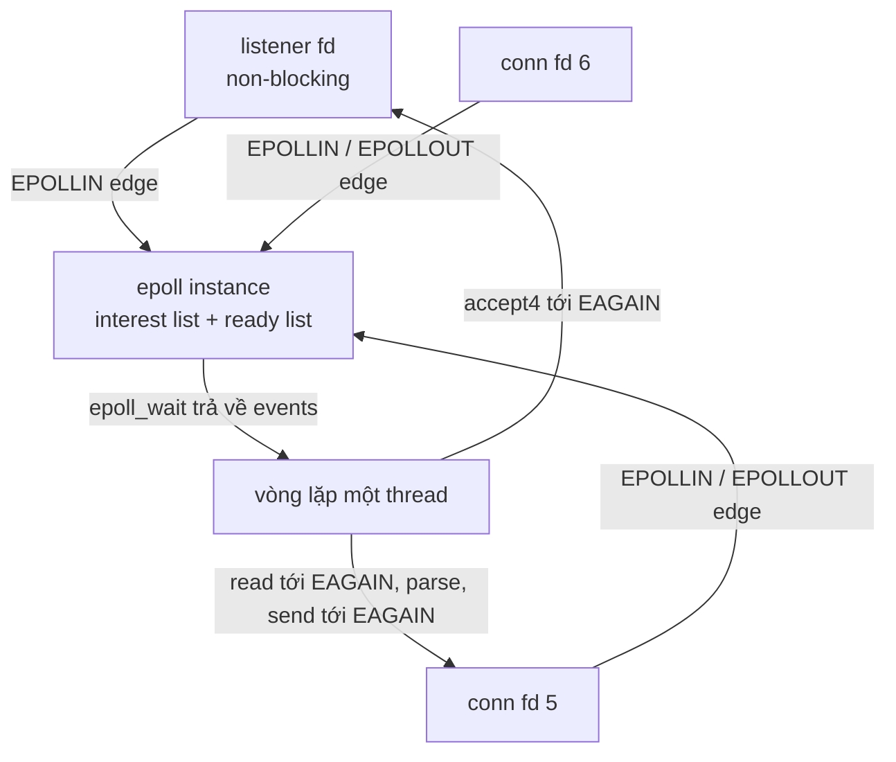
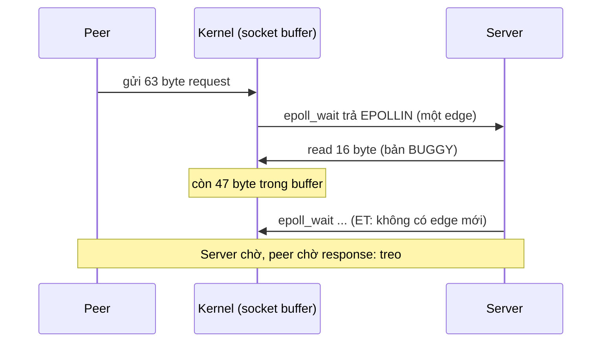
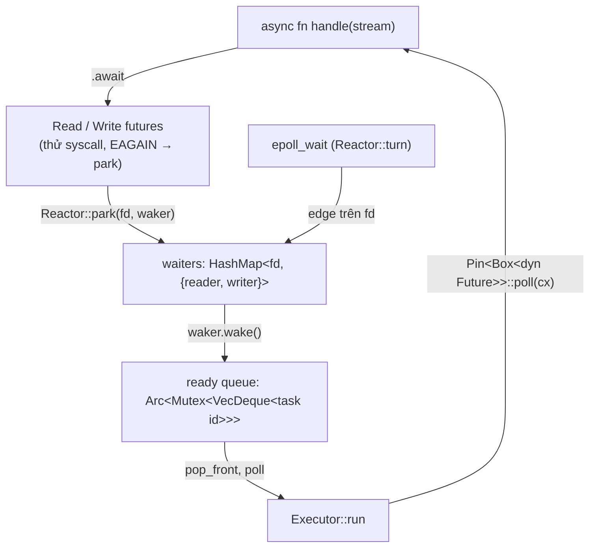

# Capstone: HTTP server trên epoll, rồi tự viết mini async runtime

> Capstone không dạy khái niệm mới. Nó bắt bạn **ghép** [P1 (syscall, fd)](../01-linux/00-tong-quan.md), [P6 (TCP, sockets)](../06-networking/00-tong-quan.md) và [P7 (epoll, `Future`, `Waker`)](../07-io-async/00-tong-quan.md) thành hai chương trình chạy được; mỗi mục dưới đây trỏ tới chương và mục lý thuyết cần đọc. Mọi fact có chú thích cuối trang; câu nào ghi "(nhận xét của người soạn)" là lời khuyên, không phải fact. Output trong tài liệu là output **thật** đã chạy trong container `./labs/linux.sh` (Debian bookworm, Rust 1.95, VM colima với kernel `Linux 6.8.0-117-generic aarch64` trên máy người soạn). PID, cổng, thời gian, số đếm sẽ khác trên máy bạn.

**Lời khuyên (nhận xét của người soạn): tự làm trước, đừng mở lời giải.** Đọc mục 1 và mục 4.1 (yêu cầu + milestone), tự viết đến hết milestone M3 rồi mới so với `labs/crates/lab-capstone`. Bẫy ET ở mục 2.3 chỉ "thấm" khi chính bạn bị treo kết nối một lần. Lời giải tham chiếu dùng để đối chiếu, không phải đáp án duy nhất.

## 1. Mục tiêu

Sau capstone này bạn làm được:

1. Viết **HTTP/1.1 server tối giản** chỉ bằng `libc` + `std`: listener non-blocking, một vòng `epoll_wait` trên một thread, parse request line và header, trả `200` có `Content-Length` hoặc `404`, xử lý `EAGAIN` khi đọc/ghi, ghi dở (partial write), đóng kết nối.
2. Giải thích bằng nguồn (epoll(7)) vì sao edge-triggered đòi hỏi đọc tới `EAGAIN`, và **tái hiện** lỗi treo kết nối khi không làm vậy.
3. Viết **mini async runtime**: `Future` cho socket non-blocking, reactor epoll giữ `Waker` theo fd, executor single-thread với hàng đợi task (`std::task::Wake` + `Arc`), rồi chạy lại đúng HTTP server bằng `async fn`.
4. Kiểm chứng bằng `curl` và bằng một load client nhiều kết nối đồng thời, không bằng niềm tin.

### Yêu cầu và milestone

| # | Milestone | Lệnh kiểm tra (chạy sau khi server nghe ở cổng 8080) | Đạt khi |
|---|---|---|---|
| M1 | `GET /` trả 200, path khác trả 404 | `curl -si http://127.0.0.1:8080/` và `curl -si http://127.0.0.1:8080/nope` | Status line `200 OK` + `Content-Length: 15`; `404 Not Found` |
| M2 | Ghi dở / `EAGAIN` khi ghi | `curl -s -o /dev/null -w '%{http_code} %{size_download}\n' http://127.0.0.1:8080/big` | `200 1048576` (body 1 MiB không bị cụt) |
| M3 | Nhiều kết nối đồng thời, request đến từng mảnh | `load_client 127.0.0.1:8080 --conns 100 --reqs 50` và thêm `--split` | `failed=0`, mọi response khớp `Content-Length` |
| M4 | Cùng M1–M3 nhưng bằng `mini_runtime` (cổng 8081) | như trên, đổi cổng | giống M1–M3 |
| M5 | Tái hiện bẫy ET | `epoll_http 8082 --buggy-read-once`, gửi request, quan sát treo | `curl` timeout (exit 28), `ss` thấy `Recv-Q` > 0 |

Ranh giới của bài (nhận xét của người soạn): chỉ `GET`/`HEAD`, không có request body, không chunked, không keep-alive; mỗi response kèm `Connection: close`. Keep-alive, timer, multi-thread nằm ở mục "mở rộng".

## 2. Khái niệm cốt lõi

### 2.1 Kiến trúc: một thread, một epoll, nhiều kết nối

Lý thuyết: [P7 · chương 04 mục 3](../07-io-async/04-kien-truc-event-loop.md) (cấu trúc event loop), [mục 5](../07-io-async/04-kien-truc-event-loop.md) (reactor pattern), [P7 · chương 02 mục 4](../07-io-async/02-select-poll-epoll.md) (interest list, ready list), [P6 · chương 07 mục 1](../06-networking/07-socket-va-kernel.md) (`socket → bind → listen → accept`).



epoll theo dõi nhiều file descriptor để xem fd nào có thể làm I/O[^epoll-api]. Về mặt khái niệm, một epoll instance chứa hai danh sách: **interest list** (các fd mình đăng ký theo dõi) và **ready list** (tập con của interest list đang "sẵn sàng" cho I/O)[^epoll-lists]. Ba syscall: `epoll_create1` tạo instance, `epoll_ctl` thêm/sửa/xóa mục trong interest list, `epoll_wait` lấy mục từ ready list và chặn thread nếu chưa có gì[^epoll-lists2].

`epoll_ctl(EPOLL_CTL_DEL)` gỡ fd khỏi interest list; tham số `event` bị bỏ qua và có thể là `NULL`[^epollctl-del]. Lab dùng `NULL` (xem `Epoll::delete` trong `sys.rs`).

### 2.2 Non-blocking: `fcntl`, `accept4`, `EAGAIN`

Lý thuyết: [P7 · chương 01 mục 2](../07-io-async/01-mo-hinh-io.md) (`O_NONBLOCK`, `EAGAIN`), [P1 · chương 04 mục 4](../01-linux/04-file-descriptor-va-vfs.md) (`O_CLOEXEC`, vì sao `accept4`/`open` nhận cờ ngay lúc tạo fd), [P6 · chương 07 mục 2](../06-networking/07-socket-va-kernel.md) (hàng đợi accept, `backlog`), [mục 4](../06-networking/07-socket-va-kernel.md) (socket buffer, vì sao send buffer bị nhân đôi).

- Cờ `O_NONBLOCK` là một **file status flag**. `fcntl(F_GETFL)` trả về access mode và các status flag[^fcntl-getfl]; `F_SETFL` đặt lại, và trên Linux chỉ đổi được `O_APPEND`, `O_ASYNC`, `O_DIRECT`, `O_NOATIME`, `O_NONBLOCK`[^fcntl-setfl]. Vì thế `set_nonblocking` trong `sys.rs` đọc cờ hiện tại bằng `F_GETFL`, OR thêm `O_NONBLOCK`, rồi `F_SETFL` (read-modify-write để không làm mất cờ khác).
- **Socket mới từ `accept` không thừa kế `O_NONBLOCK`** của listener trên Linux[^accept4-inherit]. `accept4(..., SOCK_NONBLOCK)` đặt `O_NONBLOCK` ngay cho fd mới và tiết kiệm một lần gọi `fcntl`[^accept4-nb]. Strace ở mục 4.3 xác nhận `accept4(3, NULL, NULL, SOCK_CLOEXEC|SOCK_NONBLOCK) = 5`.
- Khi socket non-blocking mà hàng đợi kết nối rỗng, `accept` thất bại với `EAGAIN` hoặc `EWOULDBLOCK`[^accept4-eagain]. `read` cũng vậy: fd là socket, đã `O_NONBLOCK`, và lần đọc sẽ phải chặn[^read-eagain]. `send` khi dữ liệu không vừa send buffer: blocking mode thì chặn, non-blocking thì lỗi `EAGAIN`/`EWOULDBLOCK`[^send-eagain].
- `read` trả về ít byte hơn yêu cầu **không phải lỗi**[^read-short]; trả `0` nghĩa là EOF[^read-eof]. Với `send`, giá trị trả về là số byte đã gửi[^send-ret], nên vòng ghi phải cộng dồn `written` và gọi lại cho tới khi hết buffer hoặc gặp `EAGAIN`. Lab đếm được các lần ghi dở (`partial_writes`) ở mục 4.
- `MSG_NOSIGNAL`: không sinh `SIGPIPE` khi peer đã đóng; lỗi `EPIPE` vẫn được trả về[^send-nosig]. Lab dùng `send(..., MSG_NOSIGNAL)` thay cho `write` để một client bỏ đi không giết cả process (đó là lựa chọn của người soạn; có thể thay bằng ignore `SIGPIPE`).
- Kích thước send buffer: `SO_SNDBUF` là mức tối đa của buffer gửi, kernel nhân đôi giá trị khi đặt bằng `setsockopt`[^sndbuf]. Lab đặt `LAB_SNDBUF = 16 KiB` (nhận xét của người soạn: cố ý nhỏ để response `/big` 1 MiB chắc chắn phải qua đường ghi dở thay vì phụ thuộc buffer tự chỉnh của kernel).

### 2.3 Edge-triggered vs level-triggered, và bẫy "đọc một lần"

Lý thuyết: [P7 · chương 02 mục 5](../07-io-async/02-select-poll-epoll.md) (level-triggered vs edge-triggered; ví dụ 2 KB làm `epoll_wait` treo; quy tắc đọc tới `EAGAIN`).

epoll chạy được cả hai kiểu và scale tốt với số lượng fd lớn[^epoll-api2]. Khác biệt cốt lõi nằm ở **thời điểm báo**:

- Level-triggered (mặc định, khi không có `EPOLLET`): epoll "chỉ là poll(2) nhanh hơn", cùng ngữ nghĩa[^epoll-lt]. Còn dữ liệu trong buffer thì `epoll_wait` còn báo.
- Edge-triggered (`EPOLLET`): chỉ báo khi có **thay đổi** trên fd[^epoll-et-def]. Tài liệu epoll(7) mô tả kịch bản: ghi 2 kB vào pipe, `epoll_wait` báo, chỉ đọc 1 kB, rồi gọi `epoll_wait` lần nữa — lần gọi này "probably hang" dù dữ liệu vẫn nằm trong buffer[^epoll-et-hang].
- Cách dùng ET do tài liệu đề nghị: dùng fd non-blocking, và **chỉ chờ sự kiện sau khi `read`/`write` trả `EAGAIN`**[^epoll-et-rule]. Lý do cần non-blocking: tránh một `read`/`write` chặn làm đói task đang xử lý nhiều fd[^epoll-nb].
- Khi gặp `EAGAIN`, một state machine phải **lưu trạng thái** để lần sau tiếp tục từ chỗ dừng[^epoll-state]. Trong `epoll_http.rs` đó là struct `Conn` (`inbuf`, `out`, `written`, `responding`).
- Với ET có thể đăng ký `EPOLLIN|EPOLLOUT` một lần ngay lúc `EPOLL_CTL_ADD` để khỏi phải `EPOLL_CTL_MOD` liên tục giữa hai cờ[^epoll-inout]. Lab làm đúng như vậy.



Ghi chú về thiết kế lab (nhận xét của người soạn): server dùng ET cho cả listener và connection, vì ET "bắt buộc" bạn hiểu hợp đồng đọc tới `EAGAIN`. LT là lựa chọn đơn giản hơn và là bài tập mở rộng (mục 4.6).

Listener cũng là fd ET: một edge `EPOLLIN` có thể đại diện cho nhiều kết nối đang đợi, nên `accept_all` gọi `accept4` tới khi `EAGAIN` (theo cùng quy tắc epoll(7) ở trên). Nếu `accept4` lỗi vì hết fd (`EMFILE`: đã chạm giới hạn số fd mỗi process[^accept4-emfile]), các kết nối còn trong backlog có thể không còn edge mới nào báo (suy luận của người soạn từ quy tắc ET ở trên) — lab chỉ in lỗi và quay lại vòng lặp, đây là điểm yếu có chủ đích, ghi ở mục bẫy.

### 2.4 Đóng fd và epoll

Lý thuyết: [P7 · chương 02 mục 6](../07-io-async/02-select-poll-epoll.md) (đóng fd, event cache).

Đóng một fd **không đảm bảo** nó rời khỏi interest list ngay: fd chỉ bị gỡ sau khi mọi fd cùng tham chiếu tới *open file description* đó đã bị đóng[^epoll-close]. Lab gọi `EPOLL_CTL_DEL` rõ ràng trước khi đóng (`epoll.delete(..)` rồi mới drop `OwnedFd`), kể cả khi trong lab không có `dup`. Trong `mini_runtime`, việc này nằm trong `Drop` của `TcpStream`/`TcpListener`: `Drop::drop` chạy trước khi các field (gồm `OwnedFd`) bị drop (quy tắc thứ tự drop của Rust, nhận xét của người soạn — phần này bạn hãy tự kiểm chứng bằng cách đảo thứ tự và quan sát).

### 2.5 HTTP/1.1 tối thiểu (RFC 9112)

Lý thuyết: [P6 · chương 08 mục 5](../06-networking/08-dns-http-tls.md) (HTTP/1.1: framing, `Content-Length`, kết nối tái dùng), [P6 · chương 04 mục 3](../06-networking/04-udp-va-tcp-co-ban.md) (TCP là byte stream, nên request đến từng mảnh).

- Một message gồm `start-line CRLF *( field-line CRLF ) CRLF [ message-body ]`[^rfc-msg]. Đầu request kết thúc ở dòng trống (`\r\n\r\n`) — vì request đến theo từng mảnh TCP, parser trả `Ok(None)` ("chưa đủ") và server đọc tiếp.
- Request line: `method SP request-target SP HTTP-version`. Spec cho phép receiver nới lỏng, parse theo ranh giới whitespace[^rfc-reqline]; parser của lab **chặt hơn** (chỉ chấp nhận đúng một SP), lựa chọn đơn giản hóa của người soạn.
- HTTP/1.1: server **phải** trả 400 nếu request thiếu `Host` (hoặc có nhiều `Host`)[^rfc-host]. Parser trả `MissingHost`, `error_response` biến thành 400 — lab xác nhận ở mục 4.2.
- Không được có khoảng trắng giữa tên header và dấu `:`; server phải từ chối bằng 400[^rfc-ws]. `obs-fold` (header xuống dòng) bị cấm sinh ra[^rfc-obsfold]; parser của lab từ chối dòng bắt đầu bằng whitespace vì tên header phải là *token*, tức chỉ gồm các ký tự `tchar`; các delimiter không được phép trong token[^rfc-tchar].
- Response: `Content-Length` là độ dài dữ liệu dưới dạng số nguyên thập phân không âm tính bằng octet[^rfc-cl]. Với `HEAD`, server không được gửi body[^rfc-head], và response cho HEAD luôn kết thúc ở dòng trống đầu tiên sau header[^rfc-headlen]; lab giữ nguyên `Content-Length` của GET tương ứng nhưng bỏ body (`head_only`).
- `404`: server không tìm thấy representation hiện tại cho target, hoặc không muốn tiết lộ là có[^rfc-404].
- `Connection: close`: người gửi báo sẽ đóng kết nối sau response[^rfc-close]. Lab luôn gửi header này; đó là lý do một request = một kết nối và `load_client` đọc tới EOF.
- Giới hạn kích thước: RFC khuyến nghị hỗ trợ tối thiểu request-line 8000 octet[^rfc-8000]; lab chặn toàn bộ phần đầu ở `MAX_HEAD = 8 KiB` và trả 400 (người soạn không cài mã 414/431).

## 3. Liên hệ với Rust

| Khái niệm OS / mạng | API Rust trong lab | Chú thích |
|---|---|---|
| fd sở hữu, đóng khi hết đời | `std::os::fd::OwnedFd` | `OwnedFd` đóng fd khi drop, đảm bảo không ai khác đóng fd đó[^ownedfd] |
| `errno` → lỗi | `io::Error::last_os_error()` | đọc `errno` của nền tảng và trả `Error` tương ứng[^lastos] |
| `EAGAIN` | `ErrorKind::WouldBlock` | "thao tác cần chặn, nhưng đã yêu cầu không chặn"[^wouldblock] |
| `EINTR` | `ErrorKind::Interrupted` | thao tác bị ngắt, thường có thể thử lại[^interrupted] |
| `epoll_wait` + token | `sys::Epoll`, `u64` token | `Epoll::wait` thử lại khi `EINTR`, vì `epoll_wait` có thể bị signal handler ngắt[^epollwait-eintr] |
| Tín hiệu "xong, chạy tiếp" | `Future::poll` → `Poll` | xem 3.1 |

### 3.1 `Future`, `Poll`, `Context`, `Waker`

Lý thuyết: [P7 · chương 05 mục 2](../07-io-async/05-future-poll-waker.md) (`Future`, `poll`), [mục 3](../07-io-async/05-future-poll-waker.md) (hợp đồng của `poll`), [mục 4](../07-io-async/05-future-poll-waker.md) (`Context`, `Waker`), [mục 6](../07-io-async/05-future-poll-waker.md) (`Wake`).

- Future là một tính toán bất đồng bộ, thường có được từ `async`[^fut-def]. `poll` **không chặn** khi giá trị chưa sẵn sàng[^fut-noblock]. Future tự nó "inert": phải được poll thì mới tiến triển[^fut-inert].
- `Poll<T>` cho biết giá trị đã sẵn sàng, hoặc task hiện tại đã được lên lịch để được đánh thức[^poll-enum].
- Hợp đồng quan trọng nhất: khi trả `Poll::Pending`, future phải lưu một bản clone của `Waker` lấy từ `Context` hiện tại, và waker đó được gọi khi future có thể tiến tiếp[^fut-poll]. `Context` hiện chỉ để truy cập `&Waker`[^ctx].
- `Waker` là handle để đánh thức task bằng cách báo executor rằng nó sẵn sàng chạy[^waker-def]. Mỗi lần `wake()` được đảm bảo kéo theo ít nhất một lần `poll()` của task đó[^waker-guarantee]; nhiều lần wake có thể gộp thành một lần poll[^waker-coalesce]. Đó là lý do hợp lệ để `Read::poll` luôn "thử syscall trước, rồi mới park".
- `Waker` là `Send + Sync`: có thể được gọi từ thread bất kỳ[^waker-sendsync]. Để dựng `Waker` từ trait `Wake`, bọc kiểu implement `Wake` vào `Arc<W>` rồi `Waker::from`[^wake-arc]; impl chuyển đổi trong thư viện chuẩn đòi `W: Wake + Send + Sync + 'static`[^wake-from]; executor định nghĩa `impl Wake` và dùng nó dựng `Waker` cho các task[^wake-trait]. Trong lab, `TaskWaker { id, ready: Arc<Mutex<VecDeque<u64>>> }` làm đúng việc đó: `wake` chỉ đẩy id task vào hàng đợi ready. Việc dùng `Arc<Mutex<..>>` (thay vì `Rc<RefCell<..>>`) là suy luận của người soạn từ ràng buộc `Send + Sync` ở trên: executor chạy một thread nhưng *kiểu* `Waker` không biết điều đó.
- `Waker::will_wake`: nếu trả `true` thì chắc chắn hai waker đánh thức cùng một task (có thể trả `false` oan)[^waker-willwake]. `Reactor::park` dùng nó để khỏi clone lại waker mỗi lần poll.

### 3.2 `Pin`

Lý thuyết: [P7 · chương 06 mục 4](../07-io-async/06-async-await-pin.md) (vì sao move future nguy hiểm) và [mục 5](../07-io-async/06-async-await-pin.md) (`Pin`, `Unpin`).

`Future::poll` nhận `self: Pin<&mut Self>`. `Pin` tồn tại cho các giá trị cần giữ nguyên địa chỉ: một giá trị đã "pinned" bị gắn vĩnh viễn (tới hết đời) vào vị trí bộ nhớ của nó[^pin-def]. `Pin<Box<T>>` là con trỏ sở hữu, pin, tới một `T` đã được pin[^pin-box].

Trong lab: task lưu dạng `Pin<Box<dyn Future<Output = ()>>>` (`LocalTask`), nên future của `async fn` nằm trên heap và không di chuyển khi `HashMap` rehash. Các leaf future (`Accept`, `Read`, `Write`) chỉ chứa tham chiếu nên là `Unpin` — vì thế code gọi được `self.get_mut()` (trong `Read::poll`). Với future do `async fn` sinh ra, bạn không làm vậy được; bạn chỉ poll qua `fut.as_mut().poll(cx)` trên `Pin<Box<..>>` (nhận xét của người soạn).

### 3.3 So với runtime thật

Lý thuyết: [P7 · chương 07](../07-io-async/07-executor-va-mio.md) (executor, reactor, `mio`; mục 7 là một executor single-thread tối giản) và [P7 · chương 08](../07-io-async/08-tokio.md) (Tokio).

Tokio có I/O driver dựa trên event queue của hệ điều hành (epoll, kqueue, IOCP…)[^tokio-driver] và chạy nhiều task trên ít thread bằng cách hoán đổi task đang chạy[^tokio-swap]; `mio` là thư viện I/O mức thấp, tập trung vào non-blocking API và event notification[^mio]. `mini_runtime` là phiên bản cực giản của ba thứ đó: `Reactor` ≈ driver, `Executor` ≈ scheduler `current_thread`, `Waiters` theo fd ≈ bảng đăng ký của driver (nhận xét của người soạn — phép so sánh về vai trò, không khẳng định về cách cài đặt nội bộ của Tokio).

## 4. Lab

Crate: `labs/crates/lab-capstone` (phụ thuộc duy nhất: `libc`, chỉ trên Linux; parser HTTP và `load_client` là `std` thuần).

| File | Vai trò |
|---|---|
| `src/http.rs` | parse request (RFC 9112), `route`, dựng response; có 7 unit test |
| `src/sys.rs` | wrapper Linux: `listen_tcp`, `set_nonblocking`, `accept`, `read`, `send`, `Epoll` |
| `src/bin/epoll_http.rs` | Dự án 1: server ET một thread; cờ `--buggy-read-once` |
| `src/bin/mini_runtime.rs` | Dự án 2: reactor + executor + `async fn` handler |
| `src/bin/load_client.rs` | client nhiều thread, kiểm tra từng response |

Build/clippy đã chạy: trên macOS `cargo build -p lab-capstone` và `cargo clippy -p lab-capstone -- -D warnings` (exit 0; trên macOS binary Linux-only in hướng dẫn rồi thoát), trong container `cargo clippy -p lab-capstone --all-targets -- -D warnings` (exit 0) và `cargo test -p lab-capstone` (7 test pass).

### 4.1 Cách tự làm (đề xuất)

1. M1: `socket → bind → listen → O_NONBLOCK`, chưa epoll: vòng `accept` busy-loop, trả response cứng. `curl` thấy 200.
2. Thêm epoll LT trước, ET sau. Với ET, viết vòng "đọc tới `EAGAIN`" ngay từ đầu.
3. Thêm `/big` và đặt `SO_SNDBUF` nhỏ để buộc đi qua nhánh partial write.
4. Chỉ sau khi M1–M3 xong mới viết Dự án 2: reactor trước (giữ `HashMap<fd, Waiters>`), rồi executor, rồi `async fn handle`.

(nhận xét của người soạn)

### 4.2 Dự án 1, M1–M3: một lệnh bash chạy server nền + curl + load_client + kill

```bash
./labs/linux.sh bash -c '
cargo build -q -p lab-capstone
B=$CARGO_TARGET_DIR/debug
$B/epoll_http 8080 & S=$!
sleep 0.5
curl -si http://127.0.0.1:8080/
curl -si http://127.0.0.1:8080/nope | head -1
curl -s -o /dev/null -w "big: status=%{http_code} size=%{size_download}\n" http://127.0.0.1:8080/big
$B/load_client 127.0.0.1:8080 --conns 100 --reqs 50
$B/load_client 127.0.0.1:8080 --conns 100 --reqs 5 --split
curl -s http://127.0.0.1:8080/stats
kill $S; wait $S 2>/dev/null; echo "server killed"
'
```

Output thật (exit code của lệnh: 0):

```text
epoll_http: listening on 127.0.0.1:8080, edge-triggered (EPOLLET)
HTTP/1.1 200 OK
Content-Length: 15
Content-Type: text/plain
Connection: close

hello from p07
HTTP/1.1 404 Not Found
big: status=200 size=1048576
target=127.0.0.1:8080 path=/ conns=100 reqs/conn=50 split=false
ok=5000 failed=0 elapsed=0.109s rate=45768 req/s body_bytes=75000
status: 200x5000
latency: p50=1.798094ms p99=4.758386ms max=8.468335ms
target=127.0.0.1:8080 path=/ conns=100 reqs/conn=5 split=true
ok=500 failed=0 elapsed=0.120s rate=4172 req/s body_bytes=7500
status: 200x500
latency: p50=20.551401ms p99=31.095525ms max=31.156613ms
accepted=5504 requests=5504 epoll_waits=386 read_eagain=6011 write_eagain=5 partial_writes=17 peer_closed_early=0 open=1
server killed
```

Giải thích:

- M1: response `200` với `Content-Length: 15` đúng bằng độ dài `hello from p07\n`; path lạ trả `404`.
- M2: `/big` trả đủ 1 048 576 byte dù send buffer chỉ 16 KiB (kernel nhân đôi, xem mục 2.2) — nghĩa là vòng ghi dở và chờ `EPOLLOUT` hoạt động.
- M3, `--split`: client gửi nửa đầu request, ngủ 20 ms, gửi nửa sau. Hai điều rút ra: (a) `failed=0` nghĩa là 100 kết nối với head dở dang cùng lúc không làm server chặn lẫn nhau; (b) `p50 ≈ 20 ms` chính là thời gian ngủ của client, không phải độ trễ của server (đọc số liệu cho đúng).
- `/stats` (cộng dồn từ khi server khởi động, gồm cả các request trước đó): `read_eagain=6011` nhiều hơn số request vì mỗi lần drain đều kết thúc bằng một `EAGAIN` (và đôi khi head dở nên drain nhiều lần); `epoll_waits=386 ≪ requests=5504` gợi ý (suy luận của người soạn) rằng mỗi lần `epoll_wait` trả nhiều event cùng lúc. Chỉ số `write_eagain`/`partial_writes` rất nhỏ ở lần chạy này (5 và 17); trong một lần chạy trước (có thêm 50×4 request `/big`, 200 MiB) chúng lên tới 582 và 3417 (rút gọn từ lần chạy riêng, không phải output ở trên). Số của bạn sẽ khác.
- `kill $S` → vòng lặp không có đường thoát sạch (server chạy tới khi bị kill), đó là chủ ý của lab.

Các lỗi giao thức (đã chạy ở một lần chạy riêng, rút gọn):

```text
HEAD /          -> HTTP/1.1 200 OK  Content-Length: 15  (không có body)
POST /          -> HTTP/1.1 501 Not Implemented
GET / HTTP/1.1 (không Host, qua nc) -> HTTP/1.1 400 Bad Request
```

(`POST` trả 501 vì server không cài method đó. RFC 9110 nói method không nhận ra hoặc chưa cài đặt thì nên trả `501`[^rfc-501]; HEAD không có body đúng theo RFC 9110[^rfc-head].)

### 4.3 Strace: nhìn đúng hợp đồng ET ở mức syscall

Lệnh (đã chạy): `strace -f -e trace=network,read,write,epoll_ctl,epoll_wait,epoll_create1,fcntl,accept4,sendto,close ./epoll_http 8083` rồi `curl http://127.0.0.1:8083/`. Đoạn liên quan (rút gọn, bỏ các dòng của loader; FD sẽ có thể khác):

```text
socket(AF_INET, SOCK_STREAM|SOCK_CLOEXEC, IPPROTO_IP) = 3
setsockopt(3, SOL_SOCKET, SO_REUSEADDR, [1], 4) = 0
bind(3, {sa_family=AF_INET, sin_port=htons(8083), sin_addr=inet_addr("127.0.0.1")}, 16) = 0
listen(3, 1024)                   = 0
fcntl(3, F_GETFL)                 = 0x2 (flags O_RDWR)
fcntl(3, F_SETFL, O_RDWR|O_NONBLOCK) = 0
epoll_create1(EPOLL_CLOEXEC)      = 4
epoll_ctl(4, EPOLL_CTL_ADD, 3, {events=EPOLLIN|EPOLLET, data={u32=0, u64=0}}) = 0
accept4(3, NULL, NULL, SOCK_CLOEXEC|SOCK_NONBLOCK) = 5
setsockopt(5, SOL_SOCKET, SO_SNDBUF, [16384], 4) = 0
epoll_ctl(4, EPOLL_CTL_ADD, 5, {events=EPOLLIN|EPOLLOUT|EPOLLET, data={u32=1, u64=1}}) = 0
accept4(3, NULL, NULL, SOCK_CLOEXEC|SOCK_NONBLOCK) = -1 EAGAIN (Resource temporarily unavailable)
read(5, "GET / HTTP/1.1\r\nHost: 127.0.0.1:"..., 4096) = 78
read(5, 0xffffc36bbd80, 4096)     = -1 EAGAIN (Resource temporarily unavailable)
sendto(5, "HTTP/1.1 200 OK\r\nContent-Length:"..., 99, MSG_NOSIGNAL, NULL, 0) = 99
epoll_ctl(4, EPOLL_CTL_DEL, 5, NULL) = 0
close(5)                          = 0
```

Đọc từng dòng:

- `fcntl(F_GETFL)` rồi `F_SETFL` với `O_RDWR|O_NONBLOCK`: đúng read-modify-write ở 2.2.
- `accept4(...) = 5` rồi **lập tức** `accept4(...) = -1 EAGAIN`: vòng accept chạy tới khi hết kết nối chờ.
- `read = 78` rồi `read = -1 EAGAIN`: vòng đọc không dừng ở lần đọc đầu dù đã đủ request — đây chính là hợp đồng ET. Thiếu dòng EAGAIN này là cái bẫy ở 4.4.
- `sendto(..., MSG_NOSIGNAL) = 99`: response 99 byte gửi hết trong một lần, không cần `EPOLLOUT`.
- `epoll_ctl(DEL)` rồi `close`: gỡ khỏi interest list trước khi đóng.
- Trong đoạn đầy đủ (không dán hết) có thêm dòng `--- SIGTERM ... ---` và `+++ killed by SIGTERM +++` do `kill` của script.

### 4.4 M5: tái hiện bẫy "ET chỉ đọc một lần"

Chạy server với `--buggy-read-once`: mỗi event chỉ `read` đúng 16 byte rồi thoát vòng đọc, không drain tới `EAGAIN`. Lệnh và output thật (exit 0):

```bash
./labs/linux.sh bash -c '
B=$CARGO_TARGET_DIR/debug
$B/epoll_http 8082 --buggy-read-once & S=$!
sleep 0.5
(printf "GET / HTTP/1.1\r\nHost: x\r\n\r\n"; sleep 3) | nc 127.0.0.1 8082 &
curl -s -m 2 -o /dev/null http://127.0.0.1:8082/; echo "curl exit=$?"
ss -tn "( sport = :8082 )"
kill $S; wait 2>/dev/null
'
```

```text
epoll_http: listening on 127.0.0.1:8082, edge-triggered (EPOLLET)
epoll_http: BUGGY mode: one 16-byte read per event, no drain to EAGAIN
curl exit=28
State      Recv-Q Send-Q Local Address:Port Peer Address:Port Process
CLOSE-WAIT 47     0          127.0.0.1:8082    127.0.0.1:34578
ESTAB      11     0          127.0.0.1:8082    127.0.0.1:34570
```

Giải thích:

- `curl exit=28` là mã "operation timeout" của curl (khớp với `-m 2`; đây là quan sát từ exit code thực tế, không phải trích dẫn).
- Dòng `ESTAB Recv-Q 11` là kết nối của `nc`: request dài 27 byte, server đọc 16 byte, còn **11 byte** nằm trong receive queue và không bao giờ được đọc — đúng kịch bản "chưa tiêu thụ hết buffer, không có edge mới" của epoll(7)[^epoll-et-hang].
- Dòng `CLOSE-WAIT Recv-Q 47` là của `curl` (request của curl dài 63 byte, đọc 16, còn 47): curl đã timeout và đóng phía nó (FIN tới), server vẫn chưa `close` — trạng thái `CLOSE-WAIT` tích tụ là dấu hiệu server không bao giờ phục vụ xong kết nối (diễn giải của người soạn từ [P6 · chương 04 mục 7](../06-networking/04-udp-va-tcp-co-ban.md); `ss` chỉ cho biết trạng thái, xem cách đọc `ss` ở [P6 · chương 07 mục 3](../06-networking/07-socket-va-kernel.md)).
- Cách sửa: thay `break` sau lần đọc đầu bằng vòng đọc tới `EAGAIN` (hoặc chuyển sang LT, nơi `epoll_wait` còn báo khi buffer còn dữ liệu[^epoll-lt]).

### 4.5 Dự án 2: mini async runtime

Cấu trúc (`mini_runtime.rs`, từ dưới lên):



Luồng một lần đọc bị `EAGAIN`:

1. `Read::poll` gọi `read(2)`; được `EAGAIN` thì `Reactor::park(fd, cx.waker(), false)` lưu clone waker, trả `Poll::Pending` — đúng hợp đồng ở 3.1.
2. Executor không còn task ready → `Reactor::turn` chặn trong `epoll_wait`.
3. Có edge trên fd → `turn` lấy waker ra khỏi `Waiters` và gọi `wake()` → id task vào ready queue.
4. Executor poll lại task; `Read::poll` **gọi `read` lại** (không giả định event nghĩa là còn dữ liệu), nhận dữ liệu hoặc park lại.

Vì sao đúng với ET (suy luận của người soạn từ hợp đồng epoll(7) ở 2.3): task luôn "syscall trước, park sau"; waker chỉ được đặt *sau* khi syscall trả `EAGAIN`, nên một edge đến trước khi park không bị mất — lần poll kế tiếp vẫn thử syscall. Và `async fn handle` lặp `read().await` tới khi parse xong head, tức drain tới `EAGAIN` (hoặc tới khi đủ head) theo từng bước.

Spawn: `serve` accept trong vòng lặp `listener.accept().await` rồi `spawner.spawn(async move { handle(..) })` cho từng kết nối. Các future không cần `Send` (tất cả ở một thread; `Rc`/`RefCell` tự do) — `Rc` không `Send`[^rc-nosend] và không `Sync`[^rc-send], và đó là lý do kiểu `Waker` (cần `Send + Sync`) không thể chứa `Rc`, như đã nói ở 3.1.

Chạy (cùng bộ milestone, cổng 8081; đã chạy, exit 0):

```bash
./labs/linux.sh bash -c '
B=$CARGO_TARGET_DIR/debug
$B/mini_runtime 8081 & S=$!
sleep 0.5
curl -si http://127.0.0.1:8081/ | head -1
curl -si http://127.0.0.1:8081/nope | head -1
curl -s -o /dev/null -w "big: status=%{http_code} size=%{size_download}\n" http://127.0.0.1:8081/big
$B/load_client 127.0.0.1:8081 --conns 100 --reqs 50
$B/load_client 127.0.0.1:8081 --conns 100 --reqs 5 --split
$B/load_client 127.0.0.1:8081 --conns 50 --reqs 4 --path /big
curl -s http://127.0.0.1:8081/stats
kill $S; wait $S 2>/dev/null; echo "server killed"
'
```

```text
mini_runtime: listening on 127.0.0.1:8081 (single-thread executor + epoll reactor, EPOLLET)
HTTP/1.1 200 OK
HTTP/1.1 404 Not Found
big: status=200 size=1048576
target=127.0.0.1:8081 path=/ conns=100 reqs/conn=50 split=false
ok=5000 failed=0 elapsed=0.135s rate=37074 req/s body_bytes=75000
status: 200x5000
latency: p50=2.12034ms p99=6.120506ms max=9.638064ms
target=127.0.0.1:8081 path=/ conns=100 reqs/conn=5 split=true
ok=500 failed=0 elapsed=0.119s rate=4188 req/s body_bytes=7500
status: 200x500
latency: p50=20.565293ms p99=31.721289ms max=32.059191ms
target=127.0.0.1:8081 path=/big conns=50 reqs/conn=4 split=false
ok=200 failed=0 elapsed=0.238s rate=840 req/s body_bytes=209715200
status: 200x200
latency: p50=10.643031ms p99=209.470591ms max=212.164193ms
accepted=5704 requests=5704 polls=7287 epoll_waits=518 io_wakes=1582 read_pending=504 write_pending=860 io_errors=0 live_tasks=2
server killed
```

Giải thích `/stats`:

- `polls=7287` so với `requests=5704`: trung bình ~1,28 lần poll mỗi request; phần lớn kết nối hoàn thành trong lần poll đầu vì dữ liệu đã có sẵn khi task chạy.
- `read_pending=504`: số lần `Read::poll` thực sự phải park (chủ yếu là các request `--split`: 500 request, mỗi request đúng một lần đợi nửa sau). Con số khớp 500 + 4 là quan sát; phần giải thích "chủ yếu từ `--split`" là suy luận của người soạn.
- `write_pending=860`, `io_wakes=1582`: các lần ghi `/big` phải park chờ `EPOLLOUT` rồi được wake lại.
- `live_tasks=2`: task `serve` (accept loop) và chính task đang phục vụ request `/stats`.
- `io_errors=0`, mọi `failed=0`: không kết nối nào hỏng.
- Con số req/s giữa `epoll_http` và `mini_runtime` ở cùng máy chỉ cùng bậc độ lớn (45 768 vs 37 074 req/s trong lần chạy này); chạy một lần trên container chia sẻ CPU không đủ để kết luận cái nào "nhanh hơn" (nhận xét của người soạn — đừng dùng làm benchmark).

### 4.6 Bài tập mở rộng

1. **LT**: đổi `EPOLLET` thành LT ở `epoll_http` (bỏ vòng drain). Bản `--buggy-read-once` có còn treo không? Giải thích bằng epoll(7)[^epoll-lt]. Cái giá (suy luận của người soạn từ định nghĩa LT): `EPOLLOUT` ở LT sẽ báo mãi khi buffer gửi còn chỗ — bạn phải bật/tắt bằng `EPOLL_CTL_MOD`.
2. **Keep-alive**: HTTP/1.1 mặc định dùng persistent connection[^rfc-persist]. Bỏ `Connection: close`, dùng `Content-Length` để biết ranh giới response, và sau khi gửi xong thì quay lại trạng thái đọc request kế (pipelining: dữ liệu thừa sau `parse_request` — số byte trả về từ `parse_request` đã có sẵn cho việc này).
3. **Timer**: thêm timeout cho kết nối chậm (slowloris). Gợi ý: truyền `timeout` cho `Epoll::wait`, giữ `BTreeMap<Instant, fd>`; ở `mini_runtime`, viết future `Sleep` đăng ký deadline vào reactor. Đọc trước [P7 · chương 04 mục 7](../07-io-async/04-kien-truc-event-loop.md) (timer và việc nặng trong event loop) và [P7 · chương 07 mục 8](../07-io-async/07-executor-va-mio.md) (timer trong runtime).
4. **Multi-thread**: nhiều thread chờ cùng một epoll fd — với fd ET, chỉ một thread được đánh thức[^epoll-herd]; hoặc mỗi thread một epoll + `SO_REUSEPORT` (xem [P6 · chương 07 mục 5](../06-networking/07-socket-va-kernel.md); mô hình nhiều event loop ở [P7 · chương 04 mục 6](../07-io-async/04-kien-truc-event-loop.md)). Với `mini_runtime`, `Rc`/`RefCell` phải đổi sang `Arc`/`Mutex` và future phải `Send`.
5. **Sửa điểm yếu `EMFILE`**: khi `accept4` lỗi `EMFILE`, các kết nối trong backlog không còn edge nào. Thiết kế cách khôi phục (ví dụ giữ một fd dự phòng, hoặc đăng ký lại listener).
6. **Tự xây `block_on`**: đọc ví dụ `block_on` trong tài liệu `std::task::Wake` (và [P7 · chương 05 mục 7](../07-io-async/05-future-poll-waker.md), `block_on` bằng `park`/`unpark`), viết một `block_on` dùng `thread::park` rồi so với executor của lab.
7. **Profile `epoll_http` dưới tải** (chưa chạy): theo [P11 · chương 01](../11-do-dac-va-go-loi/01-perf-va-sampling-profiler.md), chạy `perf record` với call graph trên tiến trình `epoll_http` trong khi `load_client` bắn `--conns 100 --reqs 50` nhiều lần, rồi dựng flame graph. Dự đoán trước (và ghi lại) hàm nào chiếm nhiều mẫu nhất, so với kết quả sau khi đo.
8. **Đếm syscall bằng tracing** (chưa chạy): theo [P11 · chương 02](../11-do-dac-va-go-loi/02-ebpf-va-tracing.md), viết one-liner `bpftrace` đếm syscall của `epoll_http` theo tên, so với bộ đếm `epoll_waits`, `read_eagain` ở `/stats`.
9. **Đo percentile, không đo trung bình** (chưa chạy): theo [P11 · chương 03 mục 2](../11-do-dac-va-go-loi/03-hieu-nang-service-rust.md), chạy `load_client` nhiều lần với `--split` và `--path /big`, so p50/p99/max của `epoll_http` và `mini_runtime`; đọc [mục 8](../11-do-dac-va-go-loi/03-hieu-nang-service-rust.md) để nghĩ vì sao một task chặn làm đuôi latency xấu đi.

### 4.7 Đo và gỡ lỗi server này với P11

Capstone dừng ở "server chạy đúng". Phase [P11 — đo đạc và gỡ lỗi](../11-do-dac-va-go-loi/00-tong-quan.md) trả lời "chạy nhanh/chậm vì đâu" và "treo/crash thì xem gì". Các lệnh dưới đây là gợi ý cho bạn tự làm, **chưa chạy** trong tài liệu này (không có output):

- **Profiling CPU**: `perf record`/`perf report` và flame graph — [chương 01 mục 4](../11-do-dac-va-go-loi/01-perf-va-sampling-profiler.md) (`perf stat` vs `perf record`), [mục 7](../11-do-dac-va-go-loi/01-perf-va-sampling-profiler.md) (on-CPU vs off-CPU, flame graph). Để thấy tên hàm Rust, cần symbol/debuginfo ([mục 6](../11-do-dac-va-go-loi/01-perf-va-sampling-profiler.md)) và cờ build ở [chương 03 mục 5](../11-do-dac-va-go-loi/03-hieu-nang-service-rust.md). Trong container `./labs/linux.sh` có thể cần quyền riêng cho `perf` ([chương 01 mục 8](../11-do-dac-va-go-loi/01-perf-va-sampling-profiler.md)).
- **Tracing syscall và độ trễ**: tracepoint `syscalls:*` và one-liner `bpftrace` — [chương 02 mục 3](../11-do-dac-va-go-loi/02-ebpf-va-tracing.md), [mục 5](../11-do-dac-va-go-loi/02-ebpf-va-tracing.md); chi phí của tracing ở [mục 7](../11-do-dac-va-go-loi/02-ebpf-va-tracing.md) và quyền ở [mục 8](../11-do-dac-va-go-loi/02-ebpf-va-tracing.md).
- **Phương pháp đo ở mức service**: [chương 03 mục 1–2](../11-do-dac-va-go-loi/03-hieu-nang-service-rust.md) (benchmark đúng cách, percentile) và [mục 8](../11-do-dac-va-go-loi/03-hieu-nang-service-rust.md) (latency đuôi trong runtime async).
- **Gắn debugger vào server đang chạy**: `gdb -p <pid>` rồi xem `bt` của thread đang ở `epoll_wait` — [chương 04 mục 8](../11-do-dac-va-go-loi/04-debugger-va-dwarf.md) (attach, `ptrace_scope`, container); breakpoint ở [mục 2](../11-do-dac-va-go-loi/04-debugger-va-dwarf.md).
- **Core dump và backtrace**: thử cho server `--buggy-read-once` treo rồi `kill -SEGV`/`gcore`, hoặc đọc stack mọi thread của process đang treo — [chương 05 mục 8](../11-do-dac-va-go-loi/05-core-dump-va-backtrace.md); điều kiện để có file core ở [mục 2](../11-do-dac-va-go-loi/05-core-dump-va-backtrace.md)–[3](../11-do-dac-va-go-loi/05-core-dump-va-backtrace.md).

## 5. Bẫy thường gặp

| Bẫy | Hậu quả | Cách tránh |
|---|---|---|
| ET mà đọc/ghi không tới `EAGAIN` | kết nối treo, dữ liệu kẹt trong buffer[^epoll-et-hang] | luôn dùng vòng drain; chờ chỉ sau `EAGAIN`[^epoll-et-rule] |
| ET mà fd **blocking** | một `read` chặn cả vòng lặp[^epoll-nb] | `O_NONBLOCK` mọi fd, `accept4(SOCK_NONBLOCK)` |
| Quên socket mới không thừa kế `O_NONBLOCK` | server bị chặn ở `read` đầu tiên | dùng `SOCK_NONBLOCK` hoặc `fcntl` trên fd mới[^accept4-inherit] |
| Chỉ `accept` một kết nối mỗi edge | kết nối "mồ côi" trong backlog | `accept4` tới `EAGAIN` |
| Không xử lý `EINTR` | `epoll_wait` lỗi vặt khi có signal[^epollwait-eintr] | thử lại (`Epoll::wait`) |
| Coi `read` ngắn là lỗi, hoặc `send` một lần là đủ | response cụt hoặc request dở | `read` ngắn không phải lỗi[^read-short]; lặp `send` và nhớ `written` |
| `SIGPIPE` khi peer đã đi | process chết | `MSG_NOSIGNAL`[^send-nosig] |
| Đóng fd mà không `EPOLL_CTL_DEL` (khi fd đã nhân bản) | vẫn nhận event cho fd "đã đóng"[^epoll-close] | `DEL` trước khi đóng |
| Event cũ trong cùng batch (token đã bị đóng, hoặc số fd bị tái sử dụng) | thao tác nhầm kết nối (suy luận của người soạn từ việc `accept4` dùng lại số fd nhỏ nhất còn trống) | tra token trong map, bỏ qua nếu không còn (`let Some(conn) = ... else { continue }`); `mini_runtime` gỡ waiter trước khi đóng fd |
| Async: `Pending` mà không lưu waker | task ngủ mãi — hợp đồng `poll` yêu cầu lưu waker[^fut-poll] | park waker *trước khi* trả `Pending`, sau khi syscall xác nhận `EAGAIN` |
| Async: giả định mỗi `wake` = đúng một lần poll | bỏ sót việc | wake có thể gộp[^waker-coalesce]; luôn thử lại syscall |
| Giữ `MutexGuard` khi poll task | self-wake gây deadlock | lab lấy id ra khỏi queue (`let next = ...pop_front();`) rồi mới poll |

## 6. Câu hỏi tự kiểm tra

1. Vì sao ở ET, sau một event `EPOLLIN` mà chỉ `read` một lần có thể làm kết nối treo? Hãy dựng lại kịch bản bằng số byte của 4.4.

<details><summary>Đáp án</summary>

ET chỉ báo khi có thay đổi trên fd[^epoll-et-def]; nếu lần `read` không tiêu thụ hết buffer, lần `epoll_wait` sau "probably hang" dù dữ liệu vẫn còn[^epoll-et-hang]. Trong lab: request 27 byte, đọc 16, còn 11 byte kẹt (`Recv-Q 11`).

</details>

2. Hai điều kiện tài liệu epoll(7) đề nghị khi dùng ET là gì?

<details><summary>Đáp án</summary>

fd non-blocking, và chỉ chờ sự kiện sau khi `read`/`write` trả `EAGAIN`[^epoll-et-rule].

</details>

3. `accept4(..., SOCK_NONBLOCK)` giải quyết điều gì mà `accept` thường không làm?

<details><summary>Đáp án</summary>

Trên Linux socket trả về từ `accept` không thừa kế `O_NONBLOCK` từ listener[^accept4-inherit]; `SOCK_NONBLOCK` đặt cờ luôn và tiết kiệm một lần `fcntl`[^accept4-nb].

</details>

4. Vì sao có thể đăng ký `EPOLLIN|EPOLLOUT|EPOLLET` một lần cho mỗi kết nối và không cần `EPOLL_CTL_MOD`?

<details><summary>Đáp án</summary>

Với ET, mỗi hướng chỉ báo khi có thay đổi trạng thái; epoll(7) nói rõ cách này tránh việc chuyển qua lại giữa `EPOLLIN` và `EPOLLOUT` bằng `EPOLL_CTL_MOD`[^epoll-inout]. Ở LT thì `EPOLLOUT` sẽ báo liên tục khi buffer còn chỗ nên không nên làm vậy (suy luận của người soạn từ định nghĩa LT[^epoll-lt]).

</details>

5. `Read::poll` trả `Pending` khi nào, và nó phải làm gì trước khi trả?

<details><summary>Đáp án</summary>

Khi `read` trả `EAGAIN`[^read-eagain]. Trước khi trả `Pending` phải lưu clone của waker từ `Context` để được đánh thức khi có thể tiến tiếp[^fut-poll]; trong lab đó là `Reactor::park`.

</details>

6. Vì sao hàng đợi ready của executor là `Arc<Mutex<VecDeque<u64>>>` dù chỉ có một thread?

<details><summary>Đáp án</summary>

`Waker` là `Send + Sync`[^waker-sendsync] và được dựng từ `Arc<W>` với `W: Wake`[^wake-arc], nên dữ liệu nó mang phải chia sẻ được giữa thread về mặt kiểu. `Rc` không `Send`[^rc-nosend] và không `Sync`[^rc-send]. (Phần "nên dữ liệu phải thread-safe" là suy luận của người soạn.)

</details>

7. Nếu một `wake()` đến khi task đang được poll, task có bị bỏ sót không?

<details><summary>Đáp án</summary>

Không: mỗi lần `wake()` được đảm bảo kéo theo ít nhất một lần `poll()` sau đó[^waker-guarantee]; nhiều wake có thể gộp thành một poll[^waker-coalesce], nên `poll` phải thử lại thao tác I/O thay vì tin số lần wake.

</details>

8. `write` trả về ít hơn độ dài buffer trên socket non-blocking: server phải làm gì?

<details><summary>Đáp án</summary>

Giá trị trả về là số byte đã gửi[^send-ret]; giữ `written`, gọi `send` tiếp phần còn lại, nếu gặp `EAGAIN`[^send-eagain] thì lưu trạng thái và chờ edge `EPOLLOUT` kế (lưu trạng thái theo[^epoll-state]).

</details>

9. Vì sao `Pin<Box<dyn Future>>` được dùng để lưu task?

<details><summary>Đáp án</summary>

`poll` nhận `Pin<&mut Self>`; `Pin<Box<T>>` là con trỏ sở hữu và pin tới `T`[^pin-box], giữ future ở vị trí cố định trên heap suốt đời task[^pin-def]. (Chi tiết vì sao future sinh bởi `async fn` cần địa chỉ cố định: đọc `std::pin` ở mục Đọc thêm.)

</details>

10. Vì sao đóng fd có thể chưa làm nó biến mất khỏi epoll?

<details><summary>Đáp án</summary>

Fd chỉ bị gỡ sau khi mọi fd cùng tham chiếu một open file description đã bị đóng[^epoll-close]; vì thế nên `EPOLL_CTL_DEL` trước (tham số event có thể `NULL`[^epollctl-del]).

</details>

## 7. Đọc thêm

- epoll(7) — phần "Level-triggered and edge-triggered", "Example for suggested usage", "Questions and answers": <https://manpages.debian.org/bookworm/manpages/epoll.7.en.html>
- epoll_ctl(2), epoll_wait(2), accept4(2), fcntl(2), read(2), send(2): <https://manpages.debian.org/bookworm/manpages-dev/epoll_ctl.2.en.html>, <https://manpages.debian.org/bookworm/manpages-dev/accept4.2.en.html>, <https://manpages.debian.org/bookworm/manpages-dev/send.2.en.html>
- RFC 9112 (HTTP/1.1) mục 2 (message format), 3 (request line), 5 (field syntax), 6 (message body), 9 (connection management): <https://www.rfc-editor.org/rfc/rfc9112.html>
- RFC 9110 mục 8.6 (Content-Length), 9.3 (methods), 15.5.5 (404): <https://www.rfc-editor.org/rfc/rfc9110.html>
- `std::future::Future`, `std::task` (`Wake`, `Waker`, `Context`, `Poll`), `std::pin`: <https://doc.rust-lang.org/1.95.0/std/future/trait.Future.html>, <https://doc.rust-lang.org/1.95.0/std/task/trait.Wake.html>, <https://doc.rust-lang.org/1.95.0/std/pin/index.html>
- Giáo trình trong repo: [P1](../01-linux/00-tong-quan.md), [P6](../06-networking/00-tong-quan.md), [P7](../07-io-async/00-tong-quan.md) — các chương và mục được trỏ ở từng phần của capstone này.
- Đo và gỡ lỗi server này: [P11](../11-do-dac-va-go-loi/00-tong-quan.md), xem mục 4.7.
- `mio` 1.2.4 và `tokio` 1.53.2 để so với runtime thật: <https://docs.rs/mio/1.2.4/mio/>, <https://docs.rs/tokio/1.53.2/tokio/>

[^epoll-api]: epoll(7), DESCRIPTION — <https://manpages.debian.org/bookworm/manpages/epoll.7.en.html> — "The epoll API performs a similar task to poll(2): monitoring multiple file descriptors to see if I/O is possible on any of them."
[^epoll-api2]: epoll(7), DESCRIPTION — <https://manpages.debian.org/bookworm/manpages/epoll.7.en.html> — "The epoll API can be used either as an edge-triggered or a level-triggered interface and scales well to large numbers of watched file descriptors."
[^epoll-lists]: epoll(7), DESCRIPTION — <https://manpages.debian.org/bookworm/manpages/epoll.7.en.html> — "The interest list (sometimes also called the epoll set): the set of file descriptors that the process has registered an interest in monitoring."
[^epoll-lists2]: epoll(7), DESCRIPTION — <https://manpages.debian.org/bookworm/manpages/epoll.7.en.html> — "epoll_wait(2) waits for I/O events, blocking the calling thread if no events are currently available."
[^epoll-et-def]: epoll(7), Level-triggered and edge-triggered — <https://manpages.debian.org/bookworm/manpages/epoll.7.en.html> — "edge-triggered mode delivers events only when changes occur on the monitored file descriptor."
[^epoll-et-hang]: epoll(7), Level-triggered and edge-triggered — <https://manpages.debian.org/bookworm/manpages/epoll.7.en.html> — "the call to epoll_wait(2) done in step 5 will probably hang despite the available data still present in the file input buffer"
[^epoll-et-rule]: epoll(7), Level-triggered and edge-triggered — <https://manpages.debian.org/bookworm/manpages/epoll.7.en.html> — "by waiting for an event only after read(2) or write(2) return EAGAIN."
[^epoll-nb]: epoll(7), Level-triggered and edge-triggered — <https://manpages.debian.org/bookworm/manpages/epoll.7.en.html> — "An application that employs the EPOLLET flag should use nonblocking file descriptors to avoid having a blocking read or write starve a task that is handling multiple file descriptors."
[^epoll-lt]: epoll(7), Level-triggered and edge-triggered — <https://manpages.debian.org/bookworm/manpages/epoll.7.en.html> — "when used as a level-triggered interface (the default, when EPOLLET is not specified), epoll is simply a faster poll(2), and can be used wherever the latter is used since it shares the same semantics."
[^epoll-state]: epoll(7), Example for suggested usage — <https://manpages.debian.org/bookworm/manpages/epoll.7.en.html> — "An event-driven state machine application should, after having received EAGAIN, record its current state so that at the next call to do_use_fd() it will continue to read(2) or write(2) from where it stopped before."
[^epoll-inout]: epoll(7), Example for suggested usage — <https://manpages.debian.org/bookworm/manpages/epoll.7.en.html> — "it is possible to add the file descriptor inside the epoll interface (EPOLL_CTL_ADD) once by specifying (EPOLLIN|EPOLLOUT). This allows you to avoid continuously switching between EPOLLIN and EPOLLOUT calling epoll_ctl(2) with EPOLL_CTL_MOD."
[^epoll-close]: epoll(7), Questions and answers — <https://manpages.debian.org/bookworm/manpages/epoll.7.en.html> — "A file descriptor is removed from an interest list only after all the file descriptors referring to the underlying open file description have been closed."
[^epoll-herd]: epoll(7), Level-triggered and edge-triggered — <https://manpages.debian.org/bookworm/manpages/epoll.7.en.html> — "just one of the threads (or processes) is awoken from epoll_wait(2)."
[^epollctl-del]: epoll_ctl(2), DESCRIPTION — <https://manpages.debian.org/bookworm/manpages-dev/epoll_ctl.2.en.html> — "Remove (deregister) the target file descriptor fd from the interest list. The event argument is ignored and can be NULL"
[^epollwait-eintr]: epoll_wait(2), ERRORS — <https://manpages.debian.org/bookworm/manpages-dev/epoll_wait.2.en.html> — "The call was interrupted by a signal handler before either (1) any of the requested events occurred or (2) the timeout expired"
[^accept4-nb]: accept4(2), DESCRIPTION — <https://manpages.debian.org/bookworm/manpages-dev/accept4.2.en.html> — "Set the O_NONBLOCK file status flag on the open file description (see open(2)) referred to by the new file descriptor. Using this flag saves extra calls to fcntl(2) to achieve the same result."
[^accept4-inherit]: accept4(2), STANDARDS — <https://manpages.debian.org/bookworm/manpages-dev/accept4.2.en.html> — "On Linux, the new socket returned by accept() does not inherit file status flags such as O_NONBLOCK and O_ASYNC from the listening socket."
[^accept4-eagain]: accept4(2), DESCRIPTION — <https://manpages.debian.org/bookworm/manpages-dev/accept4.2.en.html> — "If the socket is marked nonblocking and no pending connections are present on the queue, accept() fails with the error EAGAIN or EWOULDBLOCK."
[^accept4-emfile]: accept4(2), ERRORS — <https://manpages.debian.org/bookworm/manpages-dev/accept4.2.en.html> — "The per-process limit on the number of open file descriptors has been reached."
[^fcntl-getfl]: fcntl(2), File status flags — <https://manpages.debian.org/bookworm/manpages-dev/fcntl.2.en.html> — "Return (as the function result) the file access mode and the file status flags; arg is ignored."
[^fcntl-setfl]: fcntl(2), File status flags — <https://manpages.debian.org/bookworm/manpages-dev/fcntl.2.en.html> — "On Linux, this command can change only the O_APPEND, O_ASYNC, O_DIRECT, O_NOATIME, and O_NONBLOCK flags."
[^read-eagain]: read(2), ERRORS — <https://manpages.debian.org/bookworm/manpages-dev/read.2.en.html> — "The file descriptor fd refers to a socket and has been marked nonblocking (O_NONBLOCK), and the read would block."
[^read-short]: read(2), RETURN VALUE — <https://manpages.debian.org/bookworm/manpages-dev/read.2.en.html> — "It is not an error if this number is smaller than the number of bytes requested; this may happen for example because fewer bytes are actually available right now"
[^read-eof]: read(2), RETURN VALUE — <https://manpages.debian.org/bookworm/manpages-dev/read.2.en.html> — "On success, the number of bytes read is returned (zero indicates end of file)"
[^send-eagain]: send(2), DESCRIPTION — <https://manpages.debian.org/bookworm/manpages-dev/send.2.en.html> — "does not fit into the send buffer of the socket, send() normally blocks, unless the socket has been placed in nonblocking I/O mode. In nonblocking mode it would fail with the error EAGAIN or EWOULDBLOCK in this case."
[^send-ret]: send(2), RETURN VALUE — <https://manpages.debian.org/bookworm/manpages-dev/send.2.en.html> — "On success, these calls return the number of bytes sent."
[^send-nosig]: send(2), MSG_NOSIGNAL — <https://manpages.debian.org/bookworm/manpages-dev/send.2.en.html> — "Don't generate a SIGPIPE signal if the peer on a stream-oriented socket has closed the connection. The EPIPE error is still returned."
[^sndbuf]: socket(7), SO_SNDBUF — <https://manpages.debian.org/bookworm/manpages/socket.7.en.html> — "Sets or gets the maximum socket send buffer in bytes. The kernel doubles this value (to allow space for bookkeeping overhead) when it is set using setsockopt(2)"
[^rfc-msg]: RFC 9112, section 2.1 Message Format — <https://www.rfc-editor.org/rfc/rfc9112.html> — "HTTP-message = start-line CRLF *( field-line CRLF ) CRLF [ message-body ]"
[^rfc-reqline]: RFC 9112, section 3 Request Line — <https://www.rfc-editor.org/rfc/rfc9112.html> — "Although the request-line grammar rule requires that each of the component elements be separated by a single SP octet, recipients MAY instead parse on whitespace-delimited word boundaries"
[^rfc-host]: RFC 9112, section 3.2 Request Target — <https://www.rfc-editor.org/rfc/rfc9112.html> — "A server MUST respond with a 400 (Bad Request) status code to any HTTP/1.1 request message that lacks a Host header field and to any request message that contains more than one Host header field line or a Host header field with an invalid field value."
[^rfc-ws]: RFC 9112, section 5.1 Field Line Parsing — <https://www.rfc-editor.org/rfc/rfc9112.html> — "A server MUST reject, with a response status code of 400 (Bad Request), any received request message that contains whitespace between a header field name and colon."
[^rfc-obsfold]: RFC 9112, section 5.2 Obsolete Line Folding — <https://www.rfc-editor.org/rfc/rfc9112.html> — "A sender MUST NOT generate a message that includes line folding"
[^rfc-tchar]: RFC 9110, section 5.6.2 Tokens — <https://www.rfc-editor.org/rfc/rfc9110.html> — "Delimiters are chosen from the set of US-ASCII visual characters not allowed in a token"
[^rfc-cl]: RFC 9110, section 8.6 Content-Length — <https://www.rfc-editor.org/rfc/rfc9110.html> — "The Content-Length header field indicates the associated representation's data length as a decimal non-negative integer number of octets."
[^rfc-head]: RFC 9110, section 9.3.2 HEAD — <https://www.rfc-editor.org/rfc/rfc9110.html> — "The HEAD method is identical to GET except that the server MUST NOT send content in the response."
[^rfc-headlen]: RFC 9112, section 6.3 Message Body Length — <https://www.rfc-editor.org/rfc/rfc9112.html> — "Any response to a HEAD request and any response with a 1xx (Informational), 204 (No Content), or 304 (Not Modified) status code is always terminated by the first empty line after the header fields"
[^rfc-404]: RFC 9110, section 15.5.5 404 Not Found — <https://www.rfc-editor.org/rfc/rfc9110.html> — "The 404 (Not Found) status code indicates that the origin server did not find a current representation for the target resource or is not willing to disclose that one exists."
[^rfc-501]: RFC 9110, section 9.1 Overview (methods) — <https://www.rfc-editor.org/rfc/rfc9110.html> — "An origin server that receives a request method that is unrecognized or not implemented SHOULD respond with the 501 (Not Implemented) status code."
[^rfc-close]: RFC 9112, section 9.6 Tear-down — <https://www.rfc-editor.org/rfc/rfc9112.html> — "The \"close\" connection option is defined as a signal that the sender will close this connection after completion of the response."
[^rfc-persist]: RFC 9112, section 9.3 Persistence — <https://www.rfc-editor.org/rfc/rfc9112.html> — "HTTP/1.1 defaults to the use of \"persistent connections\", allowing multiple requests and responses to be carried over a single connection."
[^rfc-8000]: RFC 9112, section 3 Request Line — <https://www.rfc-editor.org/rfc/rfc9112.html> — "It is RECOMMENDED that all HTTP senders and recipients support, at a minimum, request-line lengths of 8000 octets."
[^ownedfd]: std::os::fd::OwnedFd, Rust 1.95.0 — <https://doc.rust-lang.org/1.95.0/std/os/fd/struct.OwnedFd.html> — "closes the file descriptor on drop. It is guaranteed that nobody else will close the file descriptor."
[^lastos]: std::io::Error::last_os_error, Rust 1.95.0 — <https://doc.rust-lang.org/1.95.0/std/io/struct.Error.html> — "This function reads the value of errno for the target platform (e.g. GetLastError on Windows) and will return a corresponding instance of Error for the error code."
[^wouldblock]: std::io::ErrorKind::WouldBlock, Rust 1.95.0 — <https://doc.rust-lang.org/1.95.0/std/io/enum.ErrorKind.html> — "The operation needs to block to complete, but the blocking operation was requested to not occur."
[^interrupted]: std::io::ErrorKind::Interrupted, Rust 1.95.0 — <https://doc.rust-lang.org/1.95.0/std/io/enum.ErrorKind.html> — "This operation was interrupted. Interrupted operations can typically be retried."
[^fut-def]: std::future::Future, Rust 1.95.0 — <https://doc.rust-lang.org/1.95.0/std/future/trait.Future.html> — "A future represents an asynchronous computation, commonly obtained by use of async."
[^fut-noblock]: std::future::Future, The poll method — <https://doc.rust-lang.org/1.95.0/std/future/trait.Future.html> — "The core method of future, poll, attempts to resolve the future into a final value. This method does not block if the value is not ready."
[^fut-inert]: std::future::Future, Rust 1.95.0 — <https://doc.rust-lang.org/1.95.0/std/future/trait.Future.html> — "Futures alone are inert; they must be actively polled for the underlying computation to make progress"
[^fut-poll]: std::future::Future, Return value — <https://doc.rust-lang.org/1.95.0/std/future/trait.Future.html> — "When a future is not ready yet, poll returns Poll::Pending and stores a clone of the Waker copied from the current Context."
[^poll-enum]: std::task::Poll, Rust 1.95.0 — <https://doc.rust-lang.org/1.95.0/std/task/enum.Poll.html> — "Indicates whether a value is available or if the current task has been scheduled to receive a wakeup instead."
[^ctx]: std::task::Context, Rust 1.95.0 — <https://doc.rust-lang.org/1.95.0/std/task/struct.Context.html> — "Currently, Context only serves to provide access to a &Waker which can be used to wake the current task."
[^waker-def]: std::task::Waker, Rust 1.95.0 — <https://doc.rust-lang.org/1.95.0/std/task/struct.Waker.html> — "A Waker is a handle for waking up a task by notifying its executor that it is ready to be run."
[^waker-guarantee]: std::task::Waker::wake, Rust 1.95.0 — <https://doc.rust-lang.org/1.95.0/std/task/struct.Waker.html> — "it is guaranteed that each invocation of wake() (or wake_by_ref()) will be followed by at least one poll() of the task to which this Waker belongs."
[^waker-coalesce]: std::task::Waker::wake, Rust 1.95.0 — <https://doc.rust-lang.org/1.95.0/std/task/struct.Waker.html> — "multiple wake-ups may be coalesced into a single poll() invocation by the runtime"
[^waker-sendsync]: std::task::Waker, Rust 1.95.0 — <https://doc.rust-lang.org/1.95.0/std/task/struct.Waker.html> — "Implements Clone, Send, and Sync; therefore, a waker may be invoked from any thread, including ones not in any way managed by the executor."
[^waker-willwake]: std::task::Waker::will_wake, Rust 1.95.0 — <https://doc.rust-lang.org/1.95.0/std/task/struct.Waker.html> — "if this function returns true, it is guaranteed that the Wakers will awaken the same task."
[^wake-trait]: std::task::Wake, Rust 1.95.0 — <https://doc.rust-lang.org/1.95.0/std/task/trait.Wake.html> — "An executor can define an implementation of this trait, and use that to construct a Waker to pass to the tasks that are executed on that executor."
[^wake-from]: alloc::task, impl From\<Arc\<W>> for Waker, Rust 1.95.0 — <https://raw.githubusercontent.com/rust-lang/rust/1.95.0/library/alloc/src/task.rs> — "impl\<W: Wake + Send + Sync + 'static> From\<Arc\<W>> for Waker {"
[^wake-arc]: std::task::Wake, Rust 1.95.0 — <https://doc.rust-lang.org/1.95.0/std/task/trait.Wake.html> — "To construct a Waker from some type W implementing this trait, wrap it in an Arc\<W> and call Waker::from() on that."
[^pin-def]: std::pin, Rust 1.95.0 — <https://doc.rust-lang.org/1.95.0/std/pin/index.html> — "it has been permanently (until the end of its lifespan) attached to its location in memory, as though pinned to a pinboard."
[^pin-box]: std::pin, Rust 1.95.0 — <https://doc.rust-lang.org/1.95.0/std/pin/index.html> — "a Pin\<Box\<T>> is an owned, pinning pointer to a pinned T"
[^rc-nosend]: std::rc::Rc, trait implementations, Rust 1.95.0 — <https://doc.rust-lang.org/1.95.0/std/rc/struct.Rc.html> — "impl\<T, A> !Send for Rc\<T, A>"
[^rc-send]: std::rc::Rc, trait implementations, Rust 1.95.0 — <https://doc.rust-lang.org/1.95.0/std/rc/struct.Rc.html> — "impl\<T, A> !Sync for Rc\<T, A> where A: Allocator, T: ?Sized"
[^tokio-driver]: tokio 1.53.2 crate docs — <https://docs.rs/tokio/1.53.2/tokio/> — "I/O driver backed by the operating system’s event queue (epoll, kqueue, IOCP, etc…), and a high performance timer."
[^tokio-swap]: tokio 1.53.2, CPU-bound tasks and blocking code — <https://docs.rs/tokio/1.53.2/tokio/> — "Tokio is able to concurrently run many tasks on a few threads by repeatedly swapping the currently running task on each thread."
[^mio]: mio 1.2.4 crate docs — <https://docs.rs/mio/1.2.4/mio/> — "Mio is a fast, low-level I/O library for Rust focusing on non-blocking APIs and event notification for building high performance I/O apps with as little overhead as possible over the OS abstractions."
